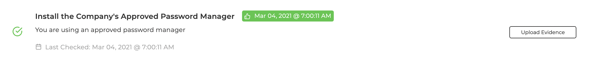

# Computer Configuration via Windows OS

Source: https://help.drata.com/en/articles/5002070-computer-configuration-via-windows-os
Collection: Personnel Management › Drata Agent
Updated: 2026-08-05
Fetched: 2026-11-22

## Article text

**HERE'S WHY**

The Drata agent is a lightweight application that lives in your computer's toolbar. This application is granted **READ ONLY** access to your system preferences to help ensure proper security configurations are set - such as screensaver locking, password manager, antivirus software and automatic updates are enabled. These security configurations are required for SOC 2 compliance. The agent runs every day.

**HERE'S HOW**

Once you [install the Drata agent](https://help.drata.com/en/articles/5002305-installing-the-drata-agent-via-windows-os), you will see a list of items you need to show proof of under 'Configure your computer'. **The agent will pick up your password manager, automatic updates,antivirus software, hard disk encryption and screen saver lock**. If you do not see a green check mark next to one of these steps saying it is complete, you will see a blue link under the step which will guide you to make the update.

**NOTE: The Drata agent runs every day so you will not see the items automatically turn green after making the update.**

## Images

- [image 01] ../../images/ux/personnel/computer-configuration-via-windows-os--01.png

## Related articles

- [Configure your computer for installing  Anti-Virus Software](configure-your-computer-for-installing-anti-virus-software.md)
- [How does the Drata agent work?](how-does-the-drata-agent-work.md)
- [Computer Configuration via Ubuntu Linux](computer-configuration-via-ubuntu-linux.md)
- [Hexnode UEM (Windows) Integration Guide](hexnode-uem-windows-integration-guide.md)
- [1Password Device Trust (Kolide) Integration Guide](1password-device-trust-kolide-integration-guide.md)
