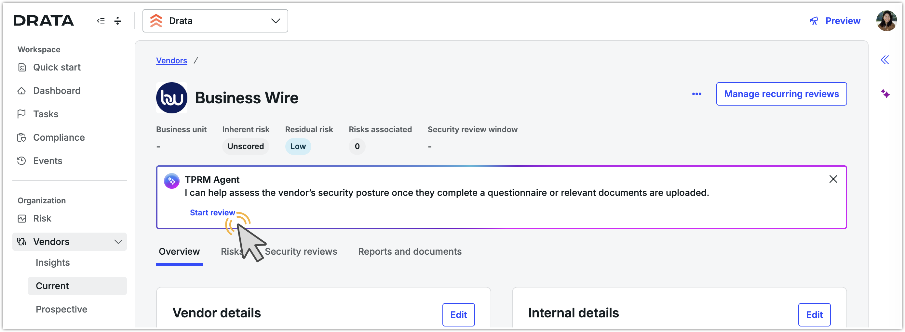
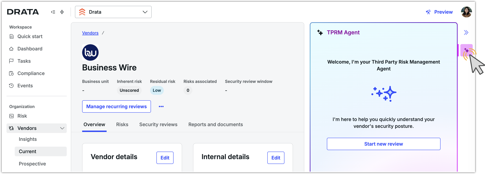
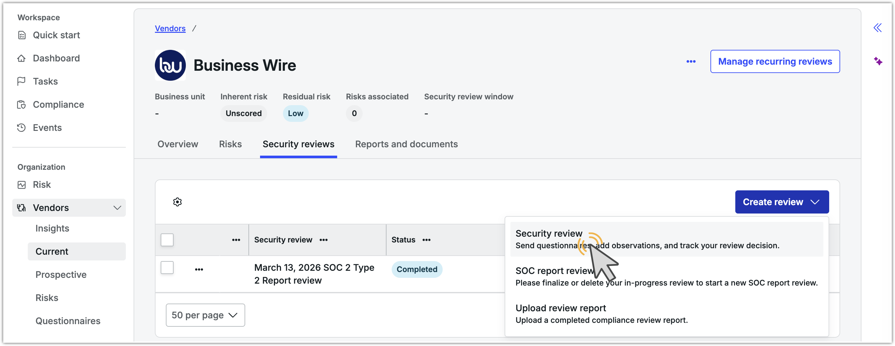
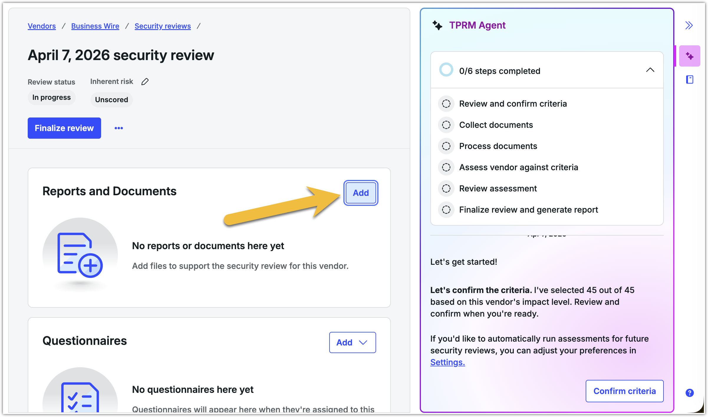
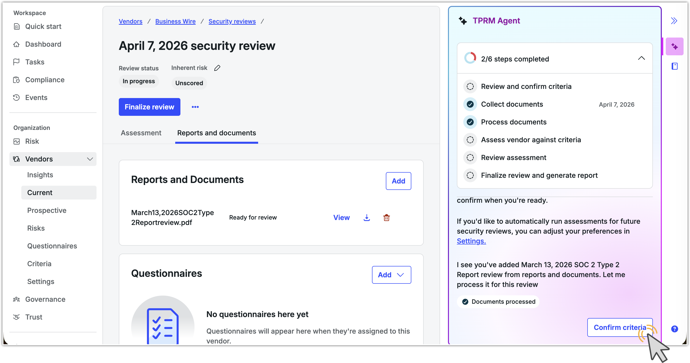
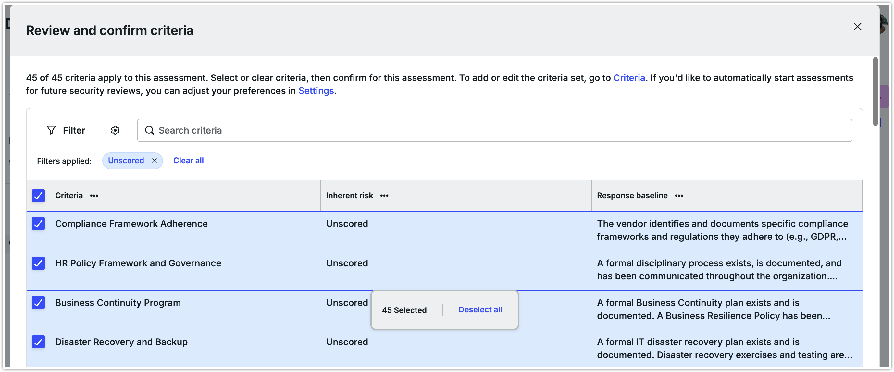

# Conducting a Security Review (Legacy)

Source: https://help.drata.com/en/articles/14447644-conducting-a-security-review-legacy
Collection: Understand the Drata Platform › Vendors › TPRM Agent Legacy
Updated: 2026-09-15
Fetched: 2026-11-22
Description: Learn how to use the TPRM Agent in Drata to collect vendor documentation, run AI-powered security reviews, and interpret assessment results based on your evaluation criteria.

## Article text

**TPRM Agent** automates the complex task of analyzing vendor documentation, allowing you to assess security postures with greater speed and accuracy. The Agent maps evidence to your criteria and helps you move from raw data to actionable risk insights quickly. Whether you are processing a single policy or multiple 200-page SOC 2 reports, the Agent handles the heavy lifting so you can focus on high-level decision-making.

Get to know the [TPRM Agent](legacy-tprm-agent-create-a-criteria.md) before you begin your security review.

## Start the Review

You can start a new security review in several ways:

1. Click **Start or Open Review** in the banner at the top of a vendor profile.
   
2. Open the **AI Agent** icon in the utilities bar on the right side of the vendor profile.
   
3. Navigate to the **Security Review** tab on the vendor and create a new review directly.
   

### Step 1: Collect Documents

After creating a review, the next step is providing the agent with vendor documentation to evaluate. You have several options:

You have three ways to provide data to the agent:

1. **Manual Upload:** Add PDFs, DOCX, CSV, or XLSX files (English only).
2. **Drata Questionnaire:** If a vendor completes a Drata questionnaire, the agent automatically processes the attached evidence.
3. **SafeBase Trust Center:** If a URL is provided, the agent can pull documents automatically.

**Note: **Please note that we currently support **English only**. Regarding length, feel free to upload your most detailed documents. There is **no strict page limit**, and our system can handle files as large as a 200-page SOC 2 report.

#### Option 1: Manual Upload

1. Select **Add** for **Reports and Documents** section.
   
2. Click **Upload Files** to add documents from your computer.

#### Option 2: Drata Questionnaire

If you prefer to continue using questionnaires, you can send one directly to the vendor.

When the vendor completes the questionnaire and uploads any supporting files, the agent will automatically process the documents and begin the assessment — no manual intervention required.

#### Option 3: SafeBase Trust Center

If the vendor has an active SafeBase Trust Center linked in their profile (the trust center url field is filled), the agent can collect documents automatically.

Learn more about [SafeBase Trust Center Integration](safebase-integration-for-tprm-reviews.md).

### Step 2: Document processing

Once documents are collected, the agent processes them into its AI infrastructure. You'll see a progress indicator in the actions trail on the right panel.

Processing time depends on the number and density of documents uploaded. You can navigate away from the page during this step — progress is not lost.

### Step 3: Select criteria for assessment

Before the assessment begins, you may be prompted to review and confirm the specific criteria the Agent will use for its evaluation. This allows you to **tailor each assessment** to a specific vendor’s profile without permanently changing your global configuration.

**How to Select Criteria**

1. When the prompt appears, select Confirm Criteria to confirm.
   
2. Then, choose the specific requirements for the current assessment.
   

If you need to update your standards more broadly, you have two options:

- **To update the master list:** Navigate to **Vendors > Criteria** to manage your available criteria.
- **To adjust Agent behavior:** Navigate to **Vendors > Settings** and select **Edit TPRM Agent** to configure default settings.

### Step 4: Assessment

After confirming criteria, the agent begins evaluating each criterion requirement against the uploaded documentation. Results appear incrementally as each criterion is assessed.

Assessment duration depends on the number of criteria and volume of documentation — typically a few minutes. The first results usually appear within 30–60 seconds. You can leave and return at any time.

**Note:** You can stop an assessment in progress, but this cancels it completely. You would need to start a new assessment to re-run.

---

## Adding Documents After an Assessment

If additional documents become available after an initial assessment, you can add them to the existing security review.

Upload the new documents to the **Reports and Documents** section, then re-run the assessment. The agent will re-evaluate all criteria using the full set of documents, including the new additions.

We recommend staying within the same security review rather than creating a new one.

---

## Tips for Best Results

- **Provide comprehensive documentation.** The more relevant documents you upload, the fewer inconclusive results you'll see. SOC 2 reports, security policies, and pen test summaries are a strong starting point for the default criteria.
- **Review criteria before assessments.** Use the criteria confirmation step to remove irrelevant criteria, which keeps results focused and reduces noise.
- **Review results before sending follow-ups.** Mark criteria as Not Applicable or override statuses where appropriate before generating the follow-up questionnaire. This keeps the vendor-facing questionnaire as short as possible.
- **Keep impact levels current.** Since impact levels drive which criteria the agent uses, make sure vendors are scored accurately.
- **Results vary by documentation.** Two vendors may receive different results for the same criterion depending on the content and depth of their submitted documents. This is expected and reflects the differences in what vendors disclose.

---

## Understanding Assessment Results

### Criterion statuses

Each criterion receives an overall status based on the results of its individual requirements:

| Status | Meaning |
|---|---|
| **Met** | All requirements within the criterion are met. |
| **Not Met** | At least one requirement is explicitly not met based on the documentation. |
| **Partially Met** | At least one requirement is met, but others are inconclusive. |
| **Inconclusive** | The documentation does not contain enough information to determine whether requirements are met. |

### What you'll see for each criterion

- **Overall status** — The rollup status for the criterion.
- **Analysis summary** — The agent's explanation of why the criterion received its status, covering all requirements.
- **Requirement-level results** — Individual met/not met/inconclusive status for each requirement.
- **Sources** — The specific text excerpted from the uploaded documents that the agent used to make its determination. This saves you from having to locate the relevant passages yourself in lengthy reports.

### Overriding results

You have full control over assessment results. For any criterion, you can manually change the status. This is useful when:

- You've reviewed the inconclusive result and determined it's acceptable.
- The criterion isn't relevant to how you plan to use this vendor.
- You have additional context the agent didn't have access to.
- A particular criterion is not applicable to the assessment and you’d like to leave some rationale explaining why

### Acting on results

From any criterion's detail view, you can:

- **Add to Risk Management** — Create a risk directly from a not-met or inconclusive criterion to track it in the vendor's risk register.
- **Create an Observation** — Log a note tied to the security review for follow-up or documentation purposes.

## Follow-Up Questionnaire

If criteria remain not met or inconclusive after the initial assessment, the agent can generate a **follow-up questionnaire** to help close gaps.

The agent creates one targeted question for each unresolved criterion requirement. Before generating the questionnaire, we recommend reviewing all assessment results and updating statuses where appropriate — this reduces the number of follow-up questions and keeps the questionnaire concise for the vendor.

After you send the follow-up questionnaire and the vendor responds, the agent will automatically re-run the assessment incorporating the new information and present updated results.

You can repeat this cycle — review results, send follow-ups, re-assess — until you're satisfied with the review.

## Finalizing a Review

When you're ready to close the review, click **Finalize Review**. You'll be prompted to add a rationale and assign a vendor status.

### Executive Summary

After finalizing, you can download an **Executive Summary** (PDF) that includes:

- **Administrative details** — Reviewer name, finalization date, vendor name, impact level, vendor status, and your rationale.
- **Executive summary narrative** — A high-level overview of the vendor's security posture, highlighting not-met and inconclusive criteria.
- **Observations and notes** — Any observations or notes logged during the review.
- **Full results table** — Every criterion with its status, the agent's analysis summary, and document references.
- **Document reference list** — All documents that were uploaded and used in the assessment.
- **Agent activity trail** — A timestamped log of what the agent did throughout the review.

## FAQ

**Can I use the agent with questionnaires instead of documents?** Yes. You can send a questionnaire via Drata, and when the vendor responds, the agent will process any uploaded documents and run the assessment automatically.

**What happens if I navigate away during processing or assessment?** Progress is preserved. You can leave and return at any time.

**Can I re-run an assessment?** Yes. Add new documents and re-run the assessment within the same security review to get updated results.

**How long does the criteria generation process take?** Typically 10–15 minutes, depending on the size of the uploaded questionnaire.

**How long does an assessment take?** Results begin appearing within 30–60 seconds. A full assessment typically completes in a few minutes, depending on the number of criteria and documents.

**Can I export or import criteria?** There isn’t a manual bulk import, however you can upload a questionnaire or a file for the agent to use to create custom criteria.

**Does saving custom criteria remove my default criteria?** Yes. Saving a custom set replaces all existing criteria. You can restore Drata's defaults at any time.

**Is the agent available in languages other than English?** Not at this time. The agent supports English-language documents only.

> 🎓 **Want to learn more?** Dive deeper into this topic and see it in action! Check out our dedicated Vendors course over at the **[Drata Academy](https://academy.drata.com/risks-vendor-management)**.

## Images

- [image 01] ../../images/ux/vendors/conducting-a-security-review-legacy--01.png
- [image 02] ../../images/ux/ai/conducting-a-security-review-legacy--02.png
- [image 03] ../../images/ux/vendors/conducting-a-security-review-legacy--03.png
- [image 04] ../../images/ux/vendors/conducting-a-security-review-legacy--04.png
- [image 05] ../../images/ux/vendors/conducting-a-security-review-legacy--05.png
- [image 06] ../../images/ux/vendors/conducting-a-security-review-legacy--06.png

## Related articles

- [SafeBase Integration for TPRM Reviews](safebase-integration-for-tprm-reviews.md)
- [Residual Risk in Security Reviews](residual-risk-in-security-reviews.md)
- [Training Video: Conducting an End-to-End Vendor Review with the Drata TPRM Agent (New Experience)](training-video-conducting-an-end-to-end-vendor-review-with-the-drata-tprm-agent-new-experience.md)
- [TPRM Agent: Create a Criteria](tprm-agent-create-a-criteria.md)
- [Conducting a Security Review](conducting-a-security-review.md)
