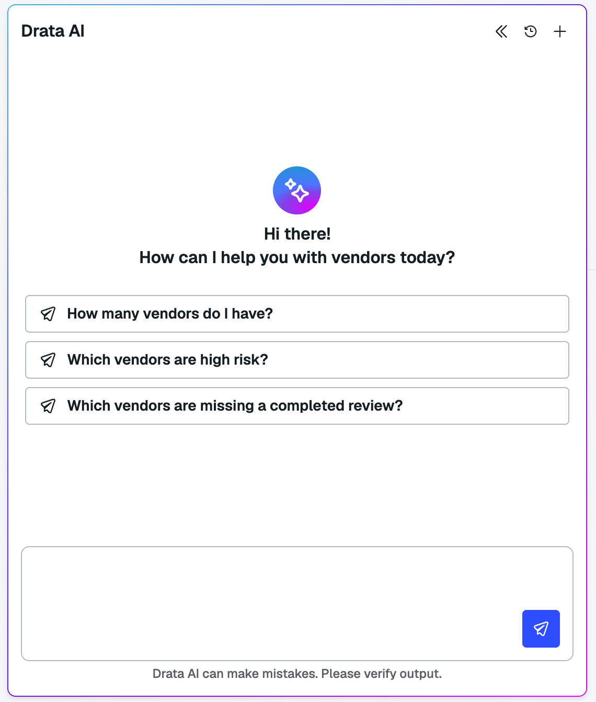
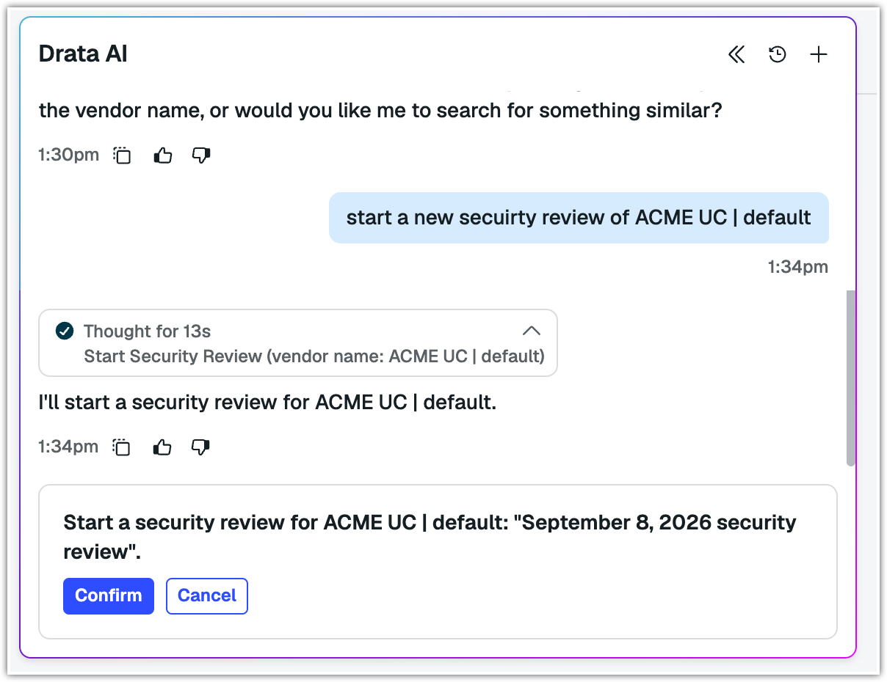
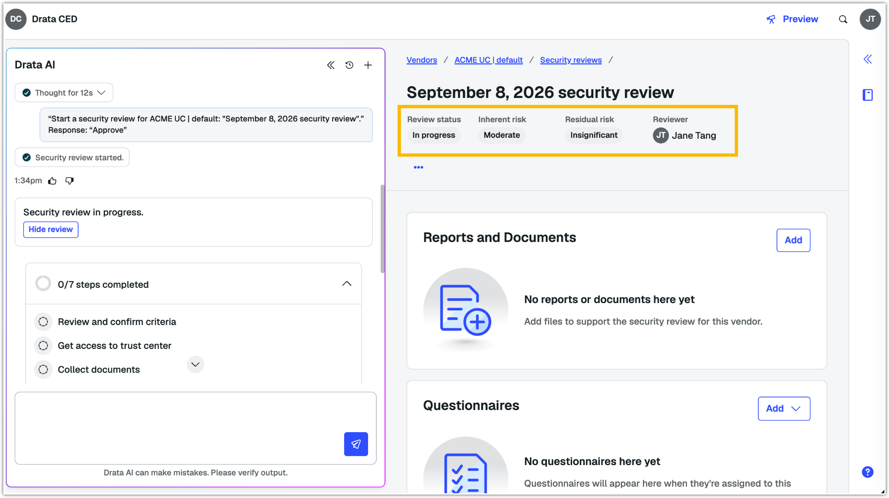
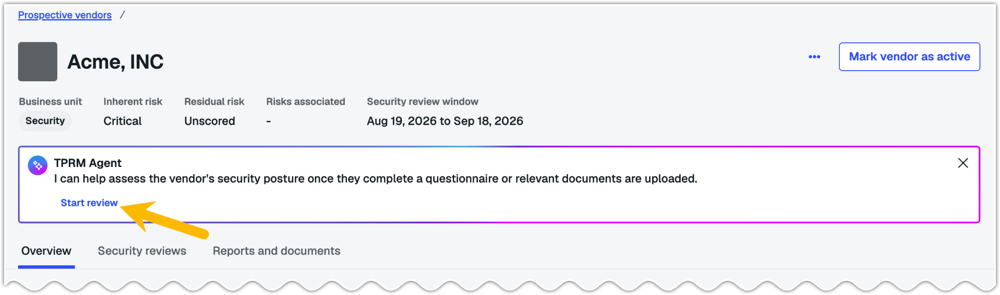
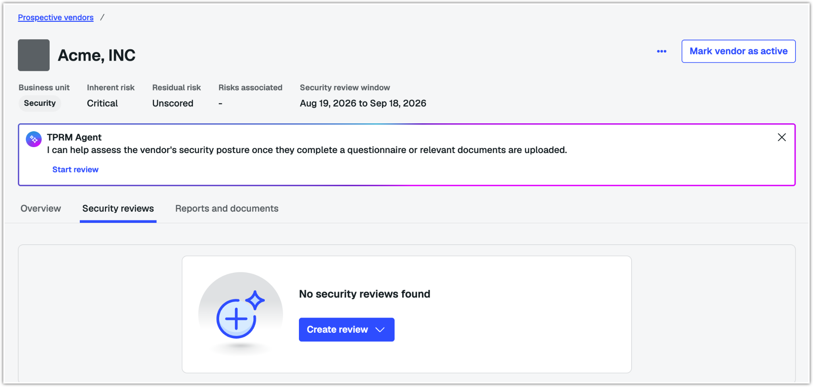

# Conducting a Security Review

Source: https://help.drata.com/en/articles/16880358-conducting-a-security-review
Collection: Understand the Drata Platform › Vendors › TPRM Agent
Updated: 2026-09-10
Fetched: 2026-11-22
Description: Learn how to run an end-to-end vendor security review with the TPRM Agent — from starting the review in chat, through document collection, assessment, and residual risk scoring, to finalizing the review and generating a report.

## Article text

This article walks you through conducting a vendor security review in Drata using the TPRM Agent.

The TPRM Agent runs the security review as a guided, workflow you drive from the **Drata AI** chat panel. You ask the agent to start a review, and it collects and processes vendor documentation, evaluates that documentation against your criteria, recommends a residual risk rating with its reasoning shown, and prepares the follow-up questionnaire, observations, and final report. You stay in control at every step: the agent asks for your approval before it takes an action, and you can override any status, rating, or decision it proposes.

If you've used the TPRM Agent before, the underlying assessment works the way it did previously. What's changed is that the whole review is now consolidated into a single, unified chat, with interactive prompts at each step and the ability to ask questions and take further actions — such as drafting observations or finalizing the review — directly from the conversation. Two capabilities are new: a **residual risk recommendation** with a transparent score, and **severity** and **vendor type** as dimensions for selecting criteria.

This matters because vendor reviews are usually slow and manual. Reading a 200-page SOC 2 report, mapping what it says to each of your criteria, deciding how much residual risk is left, and writing it all up can take hours per vendor. The agent does the reading and the first-pass judgment, and shows you the evidence behind every conclusion so you can verify it quickly instead of reconstructing it yourself.

**New to the TPRM Agent?** Get to know the [TPRM Agent](legacy-tprm-agent-create-a-criteria.md) and your criteria configuration before you begin.

---

#### The security review workflow

1. Review and confirm criteria
2. Get access to Trust Center *(optional; skip if the vendor has no Trust Center)*
3. Collect documents
4. Process documents
5. Assess vendor against criteria
6. Review residual risk
7. Finalize review and generate report

The agent works through these steps with you—not for you. Depending on your TPRM Agent settings under **Vendors > Settings**, it may pause for your approval before taking actions that affect the review.

**Expected outcome:** You can locate the checklist in the Drata AI panel and identify which step the review is currently on.

---

## Start the review

You can start a security review from the chat panel (Drata AI), or from the vendor profile.

#### Start from Drata AI

1. Open the **Drata AI** panel from the vendor profile or anywhere in Drata.
2. Type a request such as start a security review of [Enter the Vendor name such as data monster].
3. The agent proposes the action and asks you to confirm. You'll see an approval card showing what it's about to do — for example, *"Start a security review for Data Monster: 'August 25, 2026 security review'."*
4. Select **Confirm**.

The agent creates the review, names it by date, and displays **Security review in progress** along with the checklist. The review opens in the main pane with **Review status: In progress**, the vendor's **Inherent risk**, **Residual risk**, and the **Reviewer**. To update the inherent risk, residual risk, or reviewer, hover over and select the relevant field.

#### Start from the vendor profile

You can also start a review without chat:

1. Select the vendor.
2. Start the review using either option:
   - In the **TPRM Agent** banner, select **Start review**.
      
   - Open the Security reviews tab, then select Create review.
      

**Quick tip**: When starting a separate security review, select New chat (+ icon in the chat) to keep the conversation focused and give Drata AI clean context. Continue in the same chat when following up on the current review.

**Expected outcome:** A new security review exists for the vendor with status **In progress**, named after the current date (for example, *August 25, 2026 security review*). The Drata AI panel shows **Security review in progress** with the checklist visible, and the review appears in the vendor's **Security reviews** tab.

---

## Step 1: Review and confirm criteria

Before the assessment runs, review the criteria selected for the vendor.

1. Each row shows:
   - **Criteria** — the criterion name
   - **Inherent risk** — the risk level the criterion applies to
   - **Severity** — Low, Medium, or High
   - **Vendor type** — which vendor types the criterion applies to
   - **Response baseline** — what a satisfactory answer looks like
2. The list is filtered by the vendor's inherent risk level (for example, **Moderate**). Use **Clear all** to remove the filter, or **Search criteria** to find a specific one.
3. Select **Edit selection** to add or remove criteria for this assessment.
4. Select **Confirm criteria** to approve the criteria.

If the vendor has a configured Trust Center, the criteria-confirmation card may offer these actions:

- Request trust center access — Start the vendor’s Trust Center access request.
- Assess public docs only — Continue the assessment using publicly available documentation without waiting for access to private documentation.

Note: These actions appear alongside **Confirm criteria** and provide different ways to continue the review.

#### How criteria are selected

A criterion is shown if it matches **either** the vendor's inherent risk level **or** the vendor's type. **Severity** indicates how significant a gap is relative to other criteria at the same risk level. It also contributes to the residual risk calculation.

To change your standards more broadly:

- Go to **Vendors > Criteria** to update the master criteria list.
- Go to **Vendors > Settings > Edit TPRM Agent** to adjust the agent’s behavior.

**Expected outcome:** The criteria list shows only the criteria you want assessed for this vendor, and the header count reflects that total (for example, *Out of 45 total*).

---

### Get access to Trust Center

For vendors with a configured SafeBase Trust Center, the criteria-confirmation card may display these actions:

- **Request trust center access** — Start a request to access the vendor’s confidential Trust Center documents.
- **Assess public docs only** — Continue the assessment using publicly available documents without waiting for access to confidential documents.

**If you request access**

Select **Request trust center access** to begin the access request from Drata.

Learn more about vendors with the SafeBase Trust center here.

**If you assess public documents only**

Select **Assess public docs only** to continue with the documents available without private access.

Because the assessment uses only the available documents, some criteria may remain **Inconclusive** when the documentation does not provide enough evidence.

**If access is unavailable**

Trust Center access is not required to complete the review. You can continue by:

- Assessing the available public documents
- Uploading documents manually
- Sending a questionnaire through Drata

**Expected outcome:** You choose whether to request access, continue with publicly available documents, or use another documentation source.

---

## Step 2: Collect documents

Document collection is part of both the standard and SafeBase workflows. In the standard workflow, it is Step 2. In the SafeBase workflow, it is Step 3 because **Get access to Trust Center** is added before it.

#### Option 1: Manual upload

1. Open the **Reports and Documents** section of the review.
2. Select **Add**, then **Upload Files** to add documents from your computer.

#### Option 2: Drata questionnaire

Send a questionnaire to the vendor directly from Drata. When the vendor completes it and uploads supporting files, the agent processes those documents.

**Expected outcome**: The documents appear in the review and are available for processing.

---

### Step 3: Process documents

Once documents are collected, the agent processes them into its AI infrastructure. You'll see a progress indicator in the Drata AI panel while this runs.

Processing time depends on the number and density of the documents. You can navigate away from the page during this step — progress is not lost.

When processing finishes, the agent confirms what it ingested and offers to continue. For example: *"I've processed your documents (SOC 2 Type II Report_ System & Organization Controls (SOC)), you can add more anytime. I'm ready to run the assessment whenever you are."*

Select **Run assessment** to continue.

**Expected outcome:** The **Process documents** step is checked, the agent lists the documents it processed by name, and a **Run assessment** button is available in the chat panel.

---

### Step 4: Assess vendor against criteria

The agent evaluates every criterion requirement against the processed documentation. Results appear incrementally as each criterion is assessed.

The first results usually appear within 30–60 seconds. A full assessment typically completes in a few minutes, depending on the number of criteria and the volume of documentation. You can leave the page and return at any time.

**Note:** You can stop an assessment in progress, but this cancels it completely. You'd need to start a new assessment to re-run it.

When the assessment completes, four summary cards appear at the top of the review, each showing a count out of the total criteria in scope:

- **Criteria met**
- **Criteria partially met**
- **Criteria not met**
- **Criteria inconclusive**

Below the cards, the criteria table lists each criterion with its **Severity**, **Status**, **Analysis summary**, and **Source**.

**Expected outcome:** The **Assess vendor against criteria** step is checked, the four summary cards show counts that add up to the total criteria in scope, and every criterion in the table has a status and an analysis summary.

---

#### Understanding assessment results

Each criterion receives an overall status based on the results of its individual requirements:

| **Status** | **Meaning** |
|---|---|
| **Met** | All requirements within the criterion are met. |
| **Not Met** | At least one requirement is explicitly not met based on the documentation. |
| **Partially Met** | At least one requirement is met, but others are inconclusive. |
| **Inconclusive** | The documentation does not contain enough information to determine whether requirements are met. |

Select a criterion to open its detail view, which shows:

- **Status** — editable, so you can override the agent's determination
- **Analysis summary** — the agent's explanation of why the criterion received its status
- **Criterion requirements** — individual met / not met / inconclusive results for each requirement
- **Sources** — the specific text excerpted from your uploaded documents that the agent used to make its determination

From the detail view you can also select **Add internal note** or **Add observation** to capture context tied to that criterion.

#### Overriding results

You have full control over assessment results. For any criterion, you can change the status manually. This is useful when:

- You've reviewed an inconclusive result and determined it's acceptable
- The criterion isn't relevant to how you plan to use this vendor
- You have additional context the agent didn't have access to
- The criterion is not applicable and you want to leave a rationale explaining why

To change several criteria at once, select the checkbox on each row (or the header checkbox to select all). A bulk action bar appears showing the number selected, with options to **Mark as met**, **Mark as partially met**, **Mark as inconclusive**, **Mark as not met**, or **Deselect all**.

**Expected outcome:** Each criterion you changed displays its new status, and the four summary cards at the top of the review update to reflect the change. A confirmation message appears when the assessment is updated.

---

## Step 5: Review residual risk

After the assessment, the agent recommends a residual risk rating — the risk remaining for the vendor after evaluating its security posture.

In the Drata AI panel you'll see a **Recommended residual risk** card with a **Residual risk** dropdown pre-filled with the agent's recommendation, plus two buttons:

- **Save** — accept the rating as shown
- **Review residual risk** — open the full scoring breakdown before deciding

**Reviewing the scoring breakdown**

Select **Review residual risk** to open the **Residual risk** dialog. It contains:

- **A narrative summary** explaining the rating — which control areas are strengths, which partially met gaps offset them, and how many criteria were inconclusive and therefore excluded from the score.
- **Agent reasoning**, including the band scale your score falls into.
- **A per-criterion scoring table** showing **Criterion**, **Severity**, **Status**, and **Points**.
- **Result**, **Total possible points**, and **Share of possible points** at the bottom of the table.
- A **how scoring works** link for the full methodology.

You can change the rating in the dropdown and select **Save residual risk**, or **Cancel** to leave it unchanged.

### How the score is calculated

Each criterion contributes points based on two things: how heavily it's weighted, and how large the gap is.

**Severity sets the weight:**

| **Severity** | **Weight** |
|---|---|
| Low | 1 |
| Medium | 2 |
| High | 3 |

**Status sets the share of that weight counted as a gap:**

| **Status** | **Share of weight** | **Example (High severity, weight 3)** |
|---|---|---|
| Met | 0% | 0 points |
| Partially met | 50% | 1.5 points |
| Not met | 100% | 3 points |
| Inconclusive | Excluded from the score | — |

A higher score means a worse outcome: points represent gaps, not credit.

The agent totals the points across all conclusive criteria (**Result**), divides by the total points those criteria could have contributed if every one were not met (**Total possible points**), and expresses that as a percentage (**Share of possible points**). For example, a result of 19.5 out of 56 total possible points is a 35% share.

That percentage is then mapped onto your risk levels. Drata divides the 0–100% range evenly across the number of risk levels you have configured, using the same levels you use for inherent risk. With Drata's five default risk levels, the ranges are:

| **Band** | **Range** |
|---|---|
| Insignificant | 0%–20% |
| Minor | 20%–40% |
| Moderate | 40%–60% |
| Major | 60%–80% |
| Critical | 80%–100% |

A 35% share falls in the Minor band. Risk levels are customizable — if your organization uses a different number of levels, the ranges are divided evenly across that number instead.

#### When the agent withholds a recommendation

If too many criteria came back inconclusive, the agent won't recommend a residual risk at all. Because inconclusive criteria are excluded from the score, too many of them means there isn't enough determined evidence for the result to be meaningful.

When this happens, the agent asks you to either:

- Set the residual risk manually, or
- Change which criteria are in scope and run the assessment again

Adding more documentation and re-running is usually the better path, since it resolves the inconclusive criteria rather than working around them.

#### When residual risk exceeds inherent risk

At the other end, if the residual risk lands higher than the vendor's inherent risk, the agent flags it:

**Residual exceeds inherent risk** — Residual (Critical) is higher than inherent (Moderate) — raise the inherent risk and rerun the assessment, or revisit which criteria are in scope.

The level names in the warning are your own configured risk levels. This is a warning, not a block. It's telling you the two ratings are inconsistent: because inherent risk determines which criteria are assessed, a residual rating above it suggests the vendor was classified too low and the assessment may have used the wrong criteria set. Review the criteria in scope, add more documentation, or raise the inherent risk and re-run.

**Expected outcome:** The review header shows a **Residual risk** value in place of **Unscored**, and the **Review residual risk** step is checked in the Drata AI panel. If the agent withheld its recommendation, no rating is applied until you set one manually or re-run with adjusted criteria. If your saved residual risk is above the vendor's inherent risk, a warning is displayed until you resolve the mismatch.

---

## Follow-up questionnaire

Once you save the residual risk, the review advances to the follow-up questionnaire step. If criteria remain not met or inconclusive, the agent generates a questionnaire to close those gaps. Generation takes a few moments.

1. Wait for the agent to generate the questionnaire, or ask it to generate one.
2. The agent creates one targeted question per unresolved criterion requirement and opens the **Follow-up questionnaire** builder.
3. Review the draft. The builder shows:
   - **Questionnaire name** (for example, *Vendor Assessment Follow-Up - Review 134*) — editable
   - Each **Question**, its **Response type** (such as Long Answer), and the **Source** criterion and analysis that produced it
   - **Mark question as required** per question, or **Mark all questions as required**
   - Controls to reorder, duplicate, add, or delete questions
4. Select **Save draft** to come back later, or **Save** to finish the questionnaire.
5. Select **Send Questionnaire** and complete the send dialog:
   - **Send to** — up to 5 recipients, separated by commas
   - **CC (optional)** and **BCC (optional)** — up to 5 recipients each
   - **Subject line** — pre-filled, editable
   - **Message to the vendor** — pre-filled, editable
6. Select **Submit**.

Before generating the questionnaire, review your assessment results and update statuses where appropriate. Marking criteria as met or not applicable first reduces the number of follow-up questions and keeps the questionnaire short for the vendor.

After you send it, the questionnaire page shows **Status: Waiting for response**, the **Sent date**, the recipient **Email**, and **Questions answered** (for example, *0 of 80*). The agent confirms in chat that it added the questionnaire to the review's **Reports and documents** tab, and that it will re-run the assessment and notify you once the vendor responds. It also sends the vendor a reminder email every 3 days until they complete the questionnaire — you can change that frequency in **Settings**.

When the vendor responds, the agent automatically re-runs the assessment incorporating the new information and presents updated results. You can repeat this cycle — review results, send follow-ups, re-assess — until you're satisfied with the review.

**Expected outcome:** A follow-up questionnaire exists with one question per unresolved criterion requirement, its status reads **Waiting for response** with a sent date and recipient, and it is listed in the review's **Reports and documents** tab.

---

## Adding documents after an assessment

If more documents become available after an initial assessment, add them to the existing security review rather than creating a new one.

1. Upload the new documents to the **Reports and Documents** section.
2. Re-run the assessment.

The agent re-evaluates all criteria using the full set of documents, including the new additions.

**Expected outcome:** The new documents appear in **Reports and Documents**, and after the re-run every criterion has a status reflecting the complete document set — including criteria that were previously inconclusive.

---

## Observations and internal notes

Observations and internal notes let you capture context that belongs to the review rather than to a single criterion. Open them from the utilities panel on the right side of the review, which has two tabs:

- **Observation** — captures vendor-specific posture and can be turned into risks after the review. Observations appear in the final report.
- **Internal Note** — private detail for you and your team.

#### Adding one manually

1. Select the **Observation** or **Internal Note** tab.
2. Enter your text in the field. Both support Markdown formatting, up to 30,000 characters.
3. Confirm the **Context** shown beneath the field — either the review generally, or a specific criterion if you opened the panel from a criterion detail view.
4. Select **Save**.

#### Having the agent draft them

You can also ask the agent to draft observations or notes for you. For example:

- *"Suggest observations for the high-severity gaps"*
- *"Create an internal note describing the review approval conditions"*

The agent drafts the content, shows it to you, and asks for approval before logging it — for example, *"Log an observation on Data Monster's security review."* Select **Approve** to save it. Each logged observation records the **Context** (the source document or assessment), the **Author**, and the **Date**.

#### Promoting an observation to a risk

Each saved observation has an **Add to risk register** action, which creates a risk in the vendor's risk register from that observation.

**Expected outcome:** Your observations and internal notes appear in the utilities panel with an author and timestamp, observations are available for **Add to risk register**, and observations are included in the finalized review record. Internal notes stay private to your team.

---

## Asking the agent questions

At any point during the review you can ask the agent questions in the Drata AI panel and it will answer from the assessment and the source documents. Useful requests include:

- **Explain the findings** — *"Can you tell me more about their information security program and risk?"* The agent returns a structured breakdown covering strengths, key gaps and concerns, risk profile, and what's next.
- **Prioritize the gaps** — *"Which documents should we ask for to resolve the most critical missing evidence?"* The agent returns a recommended priority order grouped into tiers (for example, Tier 1: request immediately; Tier 2: request for completeness; Tier 3: nice to have).
- **Summarize for a stakeholder** — *"Give me a two-sentence summary of the review to share with the team."*
- **Draft follow-ups** — *"Prepare an upload request for the Tier 1 documents."*

The agent shows a **Thought for Xs** indicator while it reasons, and you can expand it to see what it considered. Responses that reference earlier context are labeled accordingly (for example, *Recalling from earlier in this chat*).

**Expected outcome:** The agent's answer cites the criteria and documents it drew from, and you can act on it directly — logging it as an observation or note, or asking the agent to take the next step.

---

## Step 6: Finalize the review and generate the report

When you're ready to close the review, you can finalize it from chat or from the review page.

**Finalize from chat**

1. Tell the agent you're ready — for example, *"Let's finalize this review."*
2. The agent proposes a decision and explains its reasoning. It asks which decision you want to record: **Approved**, **Approved with Conditions**, or **Rejected**. For example, it may recommend **Approved with Conditions** based on the number of inconclusive criteria and the high-severity gaps identified, with a note outlining the follow-up documentation needed.
3. Confirm the decision, and optionally ask the agent to include a note about specific conditions.
4. The agent runs the finalize action and confirms when the review is complete.

**Finalize from the review page**

Select **Finalize review** in the top-right corner of the review, then record your decision and rationale.

Once finalized, the review moves to a completed view with **Review status: Completed** and a **Security review completed** banner. The completed record contains:

- **Observations** — every observation logged during the review, each with its context, author, timestamp, and an **Add to risk register** action
- **Decision** — the decision you recorded (for example, *Approved with conditions*)
- **Internal Notes** — notes captured during the review
- **Review scope** — the documents used in the assessment, each downloadable, with any exceptions the agent found flagged
- **The full criteria table** — every criterion with its severity, status, analysis summary, and source

If you need to make changes after finalizing, select **Re-open review**.

**Expected outcome:** The review's status reads **Completed**, the recorded decision is displayed, and the completed view shows your observations, internal notes, review scope documents, and the full criteria results table. The **Finalize review and generate report** step is checked in the Drata AI panel.

---

## Tips for best results

- **Provide comprehensive documentation.** The more relevant documents you upload, the fewer inconclusive results you'll see. SOC 2 reports, security policies, and pen test summaries are a strong starting point for the default criteria.
- **Review criteria before the assessment.** Use the criteria confirmation step to remove irrelevant criteria. This keeps results focused and reduces noise.
- **Resolve inconclusive results before scoring residual risk.** Inconclusive criteria are excluded from the residual risk calculation. If too many are inconclusive, the agent withholds its recommendation entirely.
- **Keep severity current on your criteria.** Severity drives the weighting behind the residual risk score, so criteria with stale or default severity will skew the result.
- **Review results before sending follow-ups.** Mark criteria as not applicable or override statuses where appropriate before generating the follow-up questionnaire. This keeps the vendor-facing questionnaire as short as possible.
- **Keep impact levels current.** Inherent risk drives which criteria the agent uses, so make sure vendors are scored accurately.
- **Results vary by documentation.** Two vendors may receive different results for the same criterion depending on the content and depth of their submitted documents. This is expected and reflects differences in what vendors disclose.

---

### FAQ

**Can I start a review without using chat?** Yes. You can start a review from the banner on the vendor profile, the AI Agent icon in the utilities bar, or the **Security reviews** tab.

**Can I use the agent with questionnaires instead of documents?** Yes. Send a questionnaire via Drata, and when the vendor responds the agent processes any uploaded documents and runs the assessment automatically.

**What happens if I navigate away during processing or assessment?** Progress is preserved. You can leave and return at any time.

**Can I re-run an assessment?** Yes. Add new documents and re-run the assessment within the same security review to get updated results.

**Why are some criteria excluded from the residual risk score?** Inconclusive criteria are excluded, because the documentation didn't contain enough information to determine whether the requirements are met. Resolving them — through follow-up documentation or a manual status override — increases confidence in the score.

**Why didn't the agent recommend a residual risk?** Too many criteria came back inconclusive. Since inconclusive criteria are excluded from the score, the agent withholds a recommendation rather than producing one from insufficient evidence. Set the residual risk manually, or adjust which criteria are in scope — or add more documentation — and run the assessment again.

**What does "Residual exceeds inherent risk" mean?** Your residual risk rating is higher than the vendor's inherent risk classification. Since inherent risk determines which criteria are assessed, this suggests the inherent risk is set too low. Review the criteria in scope, add more documentation, or raise the inherent risk and re-run the assessment.

**How does severity affect the score?** Severity sets each criterion's weight — Low is 1, Medium is 2, High is 3. Status then determines how much of that weight counts as a gap: Met contributes 0%, Partially met 50%, and Not met the full weight. Higher totals mean more residual risk.

**What are the default risk levels?** Drata includes five out of the box: Insignificant, Minor, Moderate, Major, and Critical. These are used for both inherent and residual risk, and they're customizable.

**Are the residual risk bands always 20% wide?** Only if you're using the five default risk levels. Drata divides the 0–100% range evenly across however many levels your organization has configured, so a customized set produces different ranges.

**How long does the criteria generation process take?** Typically 10–15 minutes, depending on the size of the uploaded questionnaire.

**Can I export or import criteria?** There isn't a manual bulk import, but you can upload a questionnaire or file for the agent to use to create custom criteria.

**Does saving custom criteria remove my default criteria?** Yes. Saving a custom set replaces all existing criteria. You can restore Drata's defaults at any time.

**Can I change a review after finalizing it?** Yes. Select **Re-open review** on the completed review.

**Is the agent available in languages other than English?** Not at this time. The agent supports English-language documents only.

---

## Images

- [image 01] ../../images/ux/ai/conducting-a-security-review--01.png
- [image 02] ../../images/ux/ai/conducting-a-security-review--02.png
- [image 03] ../../images/ux/ai/conducting-a-security-review--03.png
- [image 04] ../../images/ux/vendors/conducting-a-security-review--04.png
- [image 05] ../../images/ux/vendors/conducting-a-security-review--05.png

## Related articles

- [Conducting a Security Review (Legacy)](conducting-a-security-review-legacy.md)
- [Residual Risk in Security Reviews](residual-risk-in-security-reviews.md)
- [Training Video: Conducting an End-to-End Vendor Review with the Drata TPRM Agent (New Experience)](training-video-conducting-an-end-to-end-vendor-review-with-the-drata-tprm-agent-new-experience.md)
- [TPRM Agent: Create a Criteria](tprm-agent-create-a-criteria.md)
