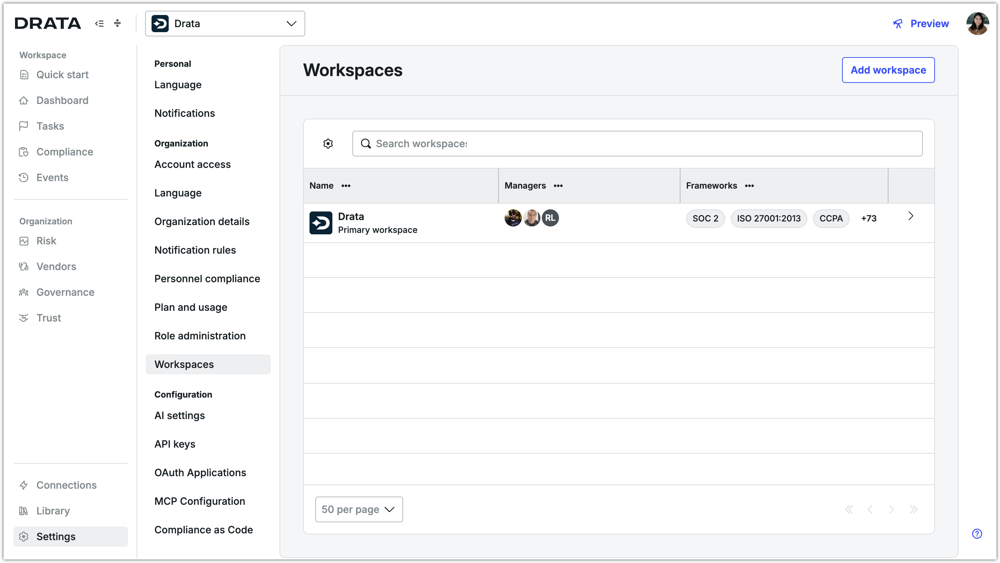
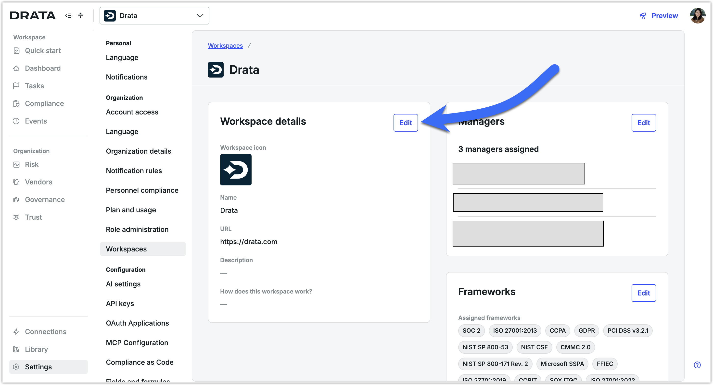
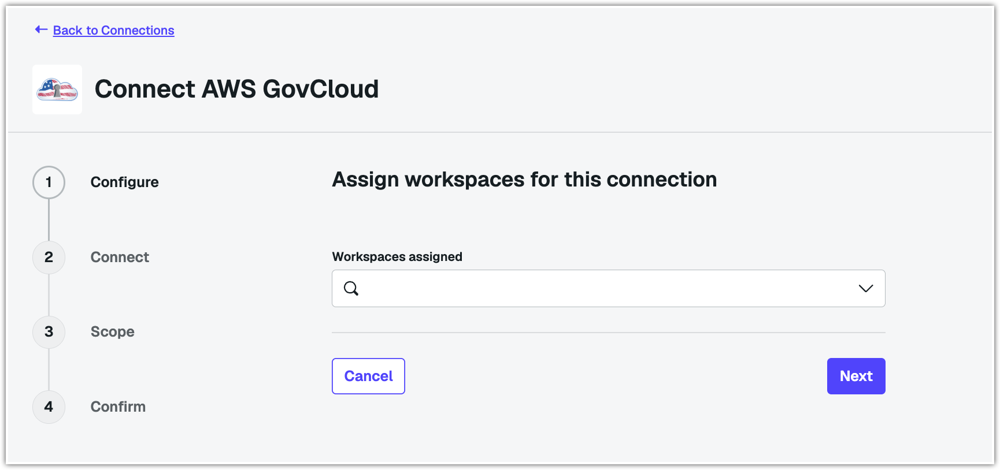

# Configure Workspace Details, Frameworks, and Connections

Source: https://help.drata.com/en/articles/13567122-configure-workspace-details-frameworks-and-connections
Collection: Getting Started › Workspaces
Updated: 2026-11-09
Fetched: 2026-11-22
Description: Update workspace URLs, frameworks, and managers.

## Article text

Workspaces allow you to organize compliance efforts by product, business unit, or environment. Each workspace can have its own frameworks, managers, and public-facing details, such as a product or company URL.

## Prerequisites

Before you can configure frameworks or connections for a Workspace:

- Workspaces must be enabled for your account.
- Required role: Admin, or Workspace Manager for that specific Workspace.
- Framework availability depends on your purchase agreement. A framework must be enabled at the tenant level (by Drata or your Account Manager) before it can be turned on inside any individual Workspace.

## Access Workspaces

1. Select **Settings**.
2. Under **Organization**, select **Workspaces**.
3. Select a workspace from the list to view its details.

You can also create new workspaces directly from this page by selecting **Add workspace**. Learn more at [Create and manage workspaces](create-and-manage-workspaces.md).

### Workspace details

When you select a workspace, you can view and edit the following information:

- **Workspace details**
   - Name
   - Workspace icon
   - URL (for example, your product or company website)
   - The workspace URL is commonly used for audit context and customer-facing experiences, such as the Trust Center.
   - Description (optional)
- **Managers**
   - Assign one or more workspace managers
   - Workspace managers can configure frameworks, manage compliance setup, and oversee workspace-specific settings
- **Frameworks**
   - View and manage frameworks assigned to the workspace
   - A workspace can support multiple frameworks (for example, SOC 2, ISO 27001, HIPAA, GDPR)
   - Changes to frameworks affect which controls, tests, and evidence are required in that workspace.

## Update a workspace URL or details

To update a workspace’s URL or other details:

1. Select the workspace you want to update.
2. Select **Edit** in the Workspace details section.
3. Make your changes and save.

Updates take effect immediately and apply only to the selected workspace.

## How frameworks and connections relate to Workspaces

- **Frameworks are enabled per Workspace, not from the main Frameworks page.**
   - This lets each Workspace run only the frameworks relevant to that product or business unit.
- **Connections behave differently depending on type:**
   - These connection types can be scoped to one or more specific Workspaces when you set them up: Infrastructure, Observability, Ticketing, Version Control, Codebase, CSPM, and Vulnerability Scanning.
   - All other connection types apply across every Workspace and can't be limited to a subset.

## Enable or remove a framework for a Workspace

1. Go to **Settings**.
2. Select **Organization > Workspaces**.
3. Select the Workspace you want to configure.
4. In the **Frameworks** section, select **Edit**.
5. Select the **X** next to a framework to remove it, or search and select a framework to add one.
6. Select **Save**.

**Result:** Enabled frameworks become clickable on the Frameworks page for that Workspace.

**Exception:** If a framework you've purchased still doesn't appear in the list, contact Drata Support to confirm it's been activated at the tenant level first — enabling a framework for a Workspace only works for frameworks already turned on for the account as a whole.

## Assign connections to a Workspace

When setting up Infrastructure, Observability, Ticketing, Version Control, Codebase, CSPM, Vulnerability, or Custom connections, you can select the specific Workspaces to associate with the connection. Other connection types apply across all Workspaces.

***Example: AWS GovCloud is an Infrastructure connection. When you set one up, the first step of the setup wizard is Select Workspace — if your account uses Workspaces, you choose which Workspace to associate with that AWS GovCloud connection before moving on to the rest of setup (creating the IAM role, entering the Role ARN, and configuring scope).*

## Images

- [image 01] ../../images/ux/workspaces/configure-workspace-details-frameworks-and-connections--01.png
- [image 02] ../../images/ux/workspaces/configure-workspace-details-frameworks-and-connections--02.png
- [image 03] ../../images/ux/connections/configure-workspace-details-frameworks-and-connections--03.png

## Related articles

- [Framework Requirements](framework-requirements.md)
- [Custom Framework](custom-framework.md)
- [Wiz (CSPM) Integration Guide](wiz-cspm-integration-guide.md)
- [Create and Manage Workspaces](create-and-manage-workspaces.md)
- [Ticket Automation (Jira-only) (New experience)](ticket-automation-jira-only-new-experience.md)
