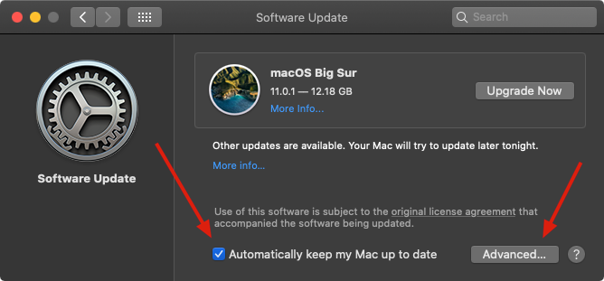
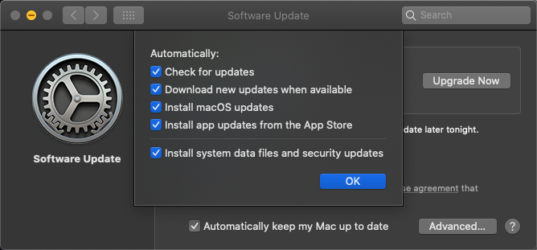
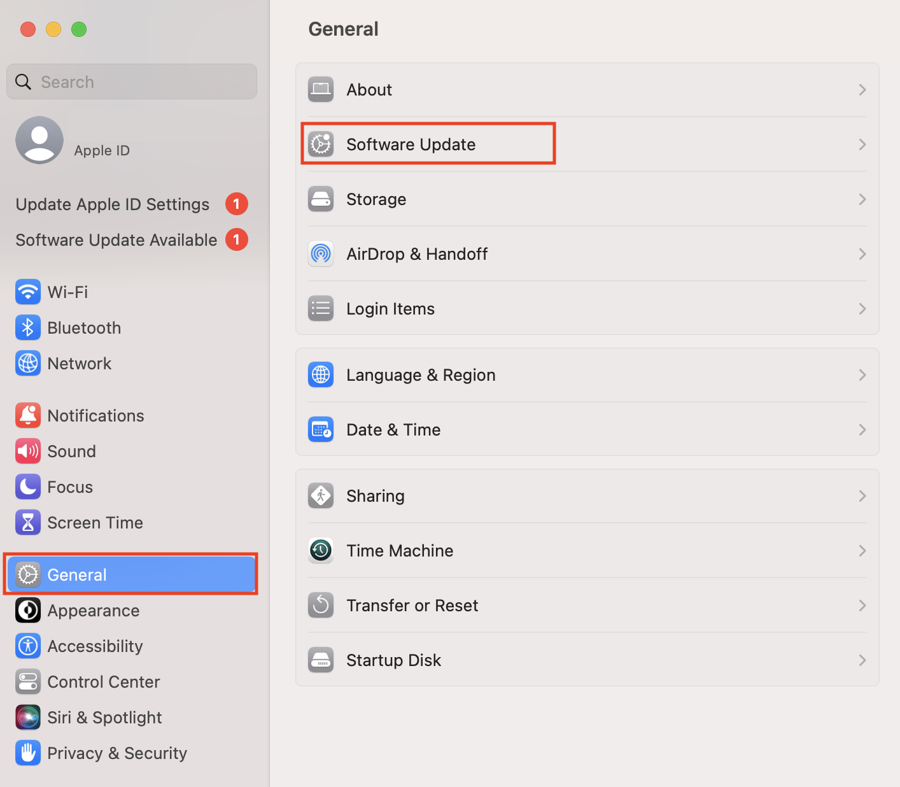
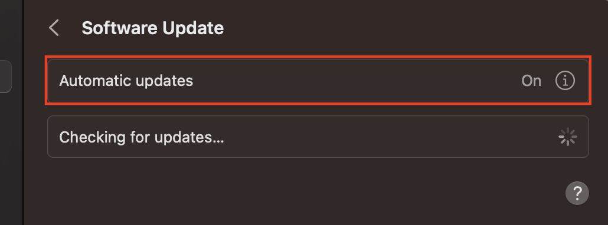
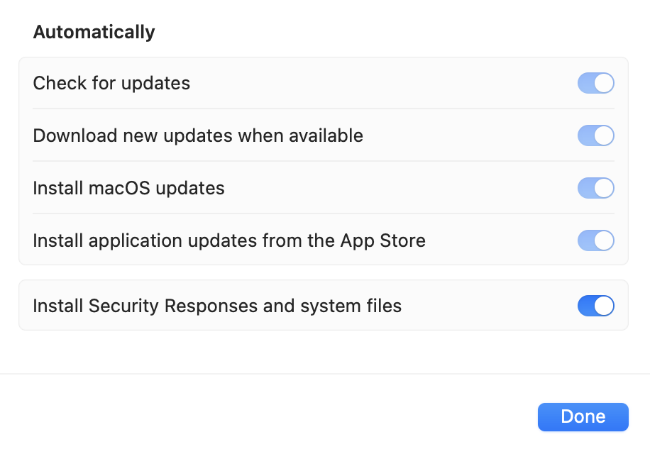

# Configuring Automatic Updates on your Computer

Source: https://help.drata.com/en/articles/4675832-configuring-automatic-updates-on-your-computer
Collection: Personnel Management › Device Compliance
Updated: 2026-08-05
Fetched: 2026-11-22
Description: Auto-updates on your computer

## Article text

**NOTE:** Your company may have alternate specific guidance for how you should configure auto-updates - please check with your IT and compliance teams.

### HERE'S HOW

**On MacOS prior to Ventura:**

1. Open **System Preferences**, then click on **Software Update**
2. Check **Automatically keep my Mac up to date**
3. Click **Advanced...**

4. Check **ALL** of the boxes in the **Advanced** panel

**On MacOS Ventura:**

1. Open System Settings
2. Click the "General" tab
3. Click the "Software Updates" option
4. Ensure Automatic Updates are On
5. Click the small information (`i`) icon
6. Toggle **ALL **of the options **on**
7. Click "Done"

**On Ubuntu Linux:**

Use the following guide to set up automatic updates: [https://help.ubuntu.com/community/AutomaticSecurityUpdates](https://help.ubuntu.com/community/AutomaticSecurityUpdates)

**On Windows:**

Use the following guides to set up automatic updates, depending on your Windows version:

1. [Windows 10 and 11](https://support.microsoft.com/en-us/windows/windows-update-faq-8a903416-6f45-0718-f5c7-375e92dddeb2#bkmk_check)
2. [Windows 8.1](https://support.microsoft.com/en-us/windows/windows-update-faq-8a903416-6f45-0718-f5c7-375e92dddeb2#ID0EBBD=Windows_8.1)
3. (*Support deprecated by Microsoft*) Windows 7: Press the Win key > type Windows Update > Click the Windows Update Program > click Change Settings > select Install updates automatically (recommended)
4. (*Support deprecated by Microsoft*) [Windows XP](https://support.microsoft.com/en-us/topic/how-to-change-your-automatic-updates-settings-by-using-windows-security-center-804009cd-7931-fc07-5ada-6b157a854201)

## Images

- [image 01] ../../images/documentation/configuring-automatic-updates-on-your-computer--01.png
- [image 02] ../../images/documentation/configuring-automatic-updates-on-your-computer--02.png
- [image 03] ../../images/documentation/configuring-automatic-updates-on-your-computer--03.png
- [image 04] ../../images/documentation/configuring-automatic-updates-on-your-computer--04.png
- [image 05] ../../images/documentation/configuring-automatic-updates-on-your-computer--05.png

## Related articles

- [Configure your computer for installing  Anti-Virus Software](configure-your-computer-for-installing-anti-virus-software.md)
- [Auto-Lock your Workstation with Screensaver](auto-lock-your-workstation-with-screensaver.md)
- [Computer Configuration via Ubuntu Linux](computer-configuration-via-ubuntu-linux.md)
- [Legacy: Microsoft Intune Integration Guide (Mac Devices)](legacy-microsoft-intune-integration-guide-mac-devices.md)
- [Install the Drata Agent](install-the-drata-agent.md)
