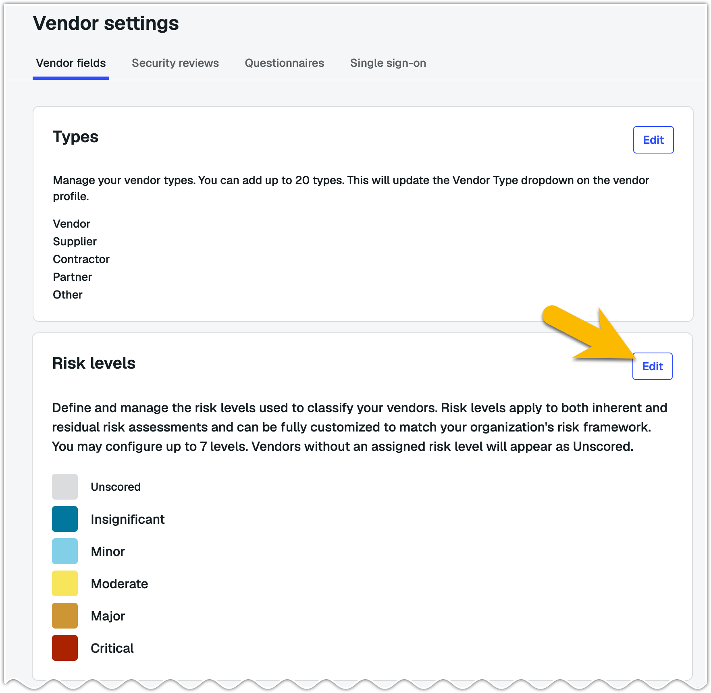
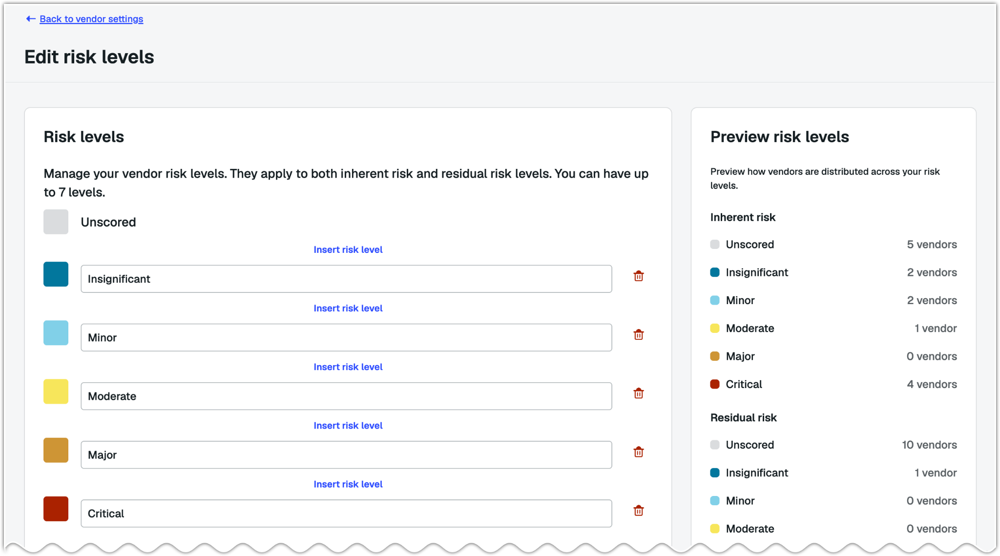
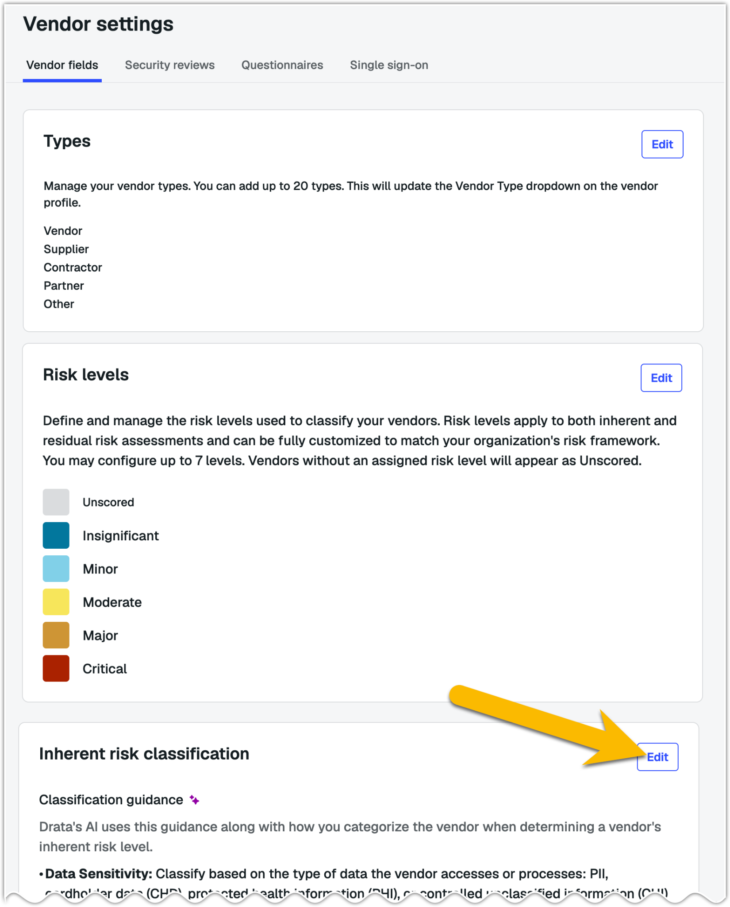
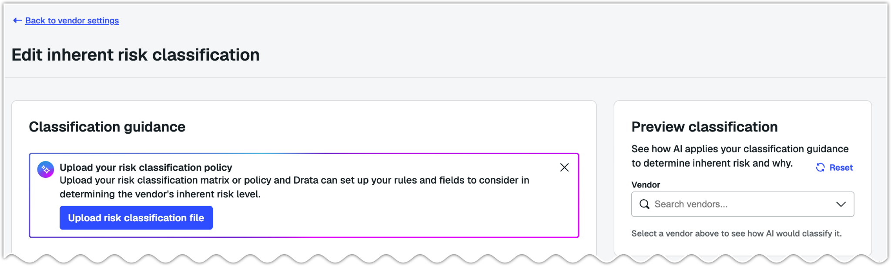
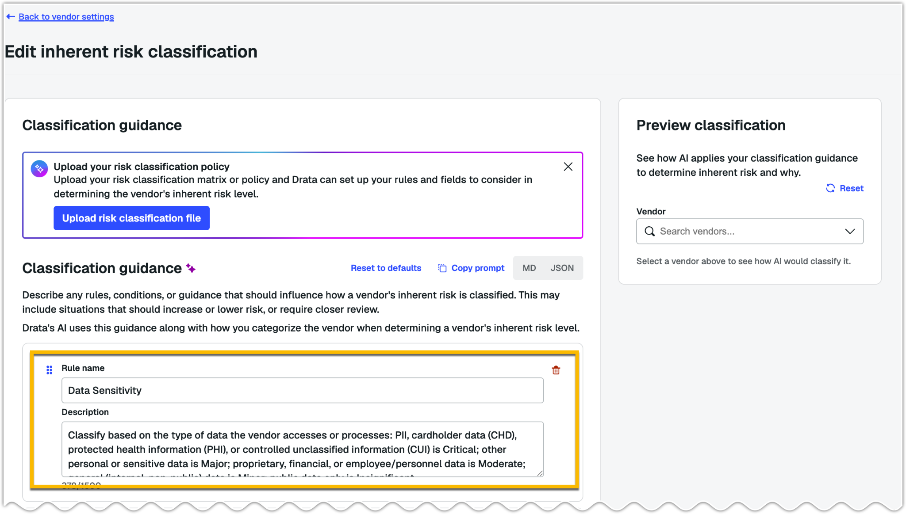
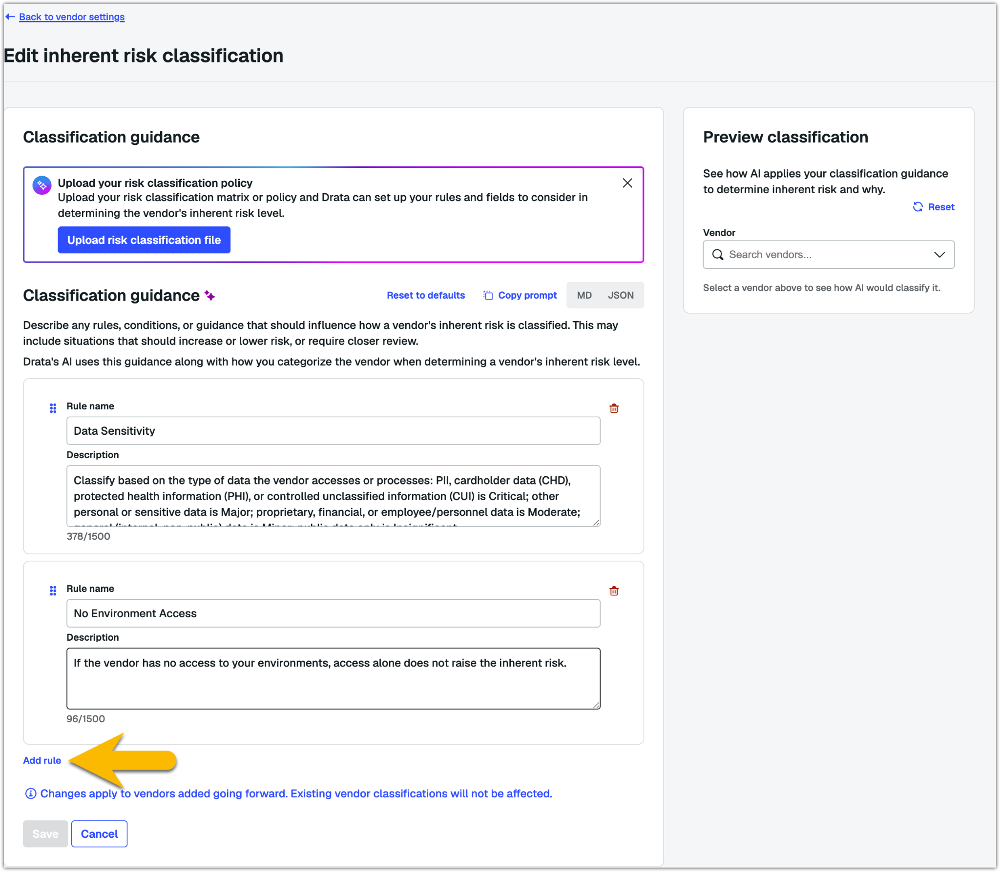
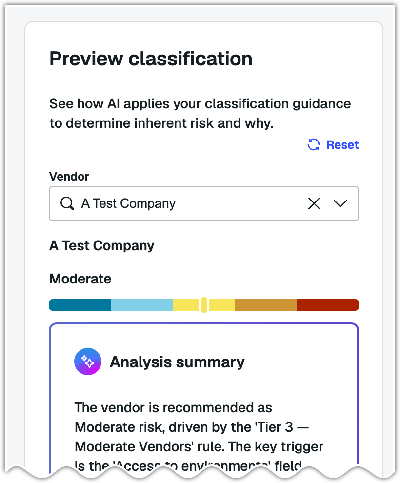
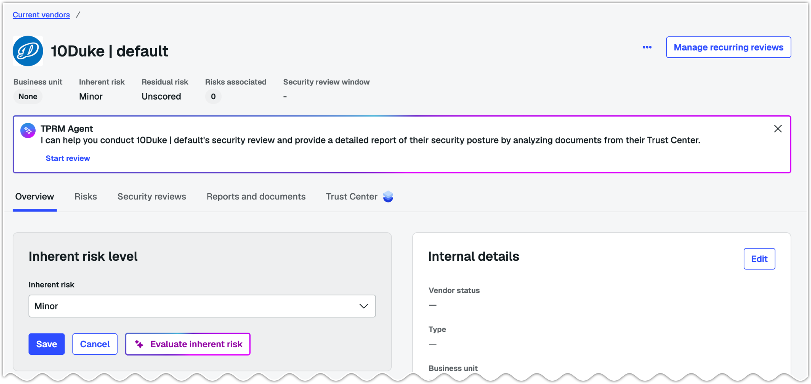

# Configuring inherent risk

Source: https://help.drata.com/en/articles/16880293-configuring-inherent-risk
Collection: Understand the Drata Platform › Vendors › TPRM Agent
Updated: 2026-11-14
Fetched: 2026-11-22

## Article text

Every vendor carries some level of risk before you evaluate their security controls — how critical they are to your operations, what data they touch, and what access they have. That starting point is the vendor's **inherent risk**.

Drata assigns inherent risk for you. You define the risk levels your organization uses and write the classification guidance that describes how vendors should be tiered — in your own words, or generated automatically from the vendor risk classification policy you already have. When a vendor is added, Drata's AI evaluates that vendor's profile against your guidance, recommends a risk level, and explains its reasoning rule by rule. You keep the final say: every recommendation can be reviewed, overridden, or re-assessed later as you learn more about the vendor.

If a vendor's profile is missing key details, Drata can also look up the vendor on the public web and use what it finds as extra evidence. This supplements the profile. It doesn't replace it. Details you've recorded on the profile always come first.

The result is that new vendors arrive with a consistent, defensible risk tier instead of waiting for manual triage — and the reasoning behind every tier is recorded for your team, your auditors, and your stakeholders.

**After following this article, you will be able to:**

- Define the risk levels your organization scores vendors against.
- Write classification guidance, or generate it from your existing risk classification policy.
- Test your guidance against real vendors before you save it.
- Review, override, and re-assess a vendor's inherent risk level.

---

## Prerequisites

- You need permission to manage vendor settings in Drata.
- Have your vendor risk classification policy or tiering matrix handy. Drata can read it and generate your rules for you.
- Public sources research requires **TPRM Pro**. It isn't turned on for every account yet. Contact your Drata representative to ask about access.

Additional Notes:

- Risk Rules and Risk levels need to match, this means that risk levels mentioned in your risk rules states “A vendor that processes PHI is automatically a Critical vendor,” your risk levels should also include risk level “Critical.” Otherwise this rule will be skipped.

---

## How inherent risk classification works

Three pieces work together:

- **Risk levels** — the scale your organization scores against. You can configure up to seven levels and choose the names at Vendor Settings. (Unscored is always available for vendors without an assigned level.)
- **Classification guidance** — a set of rules, each with a name and description, that tells Drata how to classify a vendor. This is where your tiering policy lives. This is configurable at the Vendor Settings
- **Vendor context** — the information on the vendor's profile.
   - Drata reads both structured fields—data and access (data accessed or processed, access to environments, stored data, PII and sub-processor flags)—plus business context (category, cost, location, type, integrations)—and free-text fields such as Provided services and Additional notes. A well-written description of what a vendor does carries real weight in the outcome.
- **Public sources (supplemental) **— If the vendor profile is missing core information, Drata can research the vendor on the public web to fill the gaps for that evaluation. Public findings are used as additional input only. They never edit the vendor profile, and they never override anything you’ve already recorded there. See [Using public sources when a vendor profile is incomplete](#using-public-sources).

When a vendor is added—or re-assessed later—Drata evaluates the vendor's context against each rule, recommends a risk level, and shows which rules applied and why. You can also test this against any vendor in the Preview panel before you save (see Step 3).

---

## Using public sources when a vendor profile is incomplete

A brand-new vendor often has only a name and a URL. Without more detail, Drata may not have enough to match the vendor to any of your rules. When that happens, Drata can research the vendor on the public web, using sources such as the vendor's website, trust center, and documentation, and add what it finds to the evaluation.

### When public research runs

Drata researches public sources only when **all** of these are true:

- Your account has TPRM Pro and has public sources turned on.
- The vendor profile is missing one or more core inputs.

Drata treats four profile fields as core inputs. These are also the only fields public research looks for:

| **Core input** | **Possible values** |
|---|---|
| Services provided | Free text |
| Operational impact | None, Low, Normal, Important, Critical |
| Data accessed or processed | Your vendor profile data types |
| Access to environments | No access, Read access only, Read/write access |

If all four are filled in, Drata scores the profile as-is and doesn't run public research. To keep a vendor's recommendation based on the profile alone, complete all four before you finish adding the vendor.

### How Drata researches the vendor

Drata uses only pages it actually reads about the vendor. It leaves a finding empty when no source supports it instead of guessing. If Drata can't confidently identify the vendor, for example because another company has a similar name, it doesn't use any public findings.

### Public sources don't replace your profile

Public research isn't an automatic fallback that always produces a risk level. Public information can be out of date, incomplete, or written for marketing, and tiering a vendor on public information alone risks putting it in the wrong tier. So Drata follows these rules:

- **Profile fields take precedence.** If you've set a field, such as **Operational impact**, Drata uses your value even when public research suggests something different.
- **Public findings fill gaps; they don't confirm a tier on their own.** If your rules depend on information the profile doesn't confirm, Drata may still recommend **Unscored** even after researching the vendor. The analysis summary explains what public research suggested and which profile information is missing.
- **Nothing is written back to the profile.** Public findings feed this evaluation only. Your vendor profile stays the record you control.

**Example:** A vendor was added with only **Employee / Personnel** selected under **Data accessed or processed**. Public research found that the vendor also handles personal, financial, and cardholder data and is important to day-to-day operations. Drata combined the two and recommended a high-risk tier.

**Example:** A different vendor was added with **Operational impact** set to *Normal* and no data types selected. Public research suggested the vendor handles sensitive data, but the profile didn't confirm it, and the profile takes precedence. Drata recommended **Unscored** and explained that the profile didn't hold enough confirmed information to assign a tier. After the team added the vendor's data types and other details to the profile and re-evaluated, Drata assigned a moderate tier.

### How to tell which sources were used

When a recommendation uses public research, the inherent risk analysis card shows:

*Based on public sources. Complete the profile to refine.*

The analysis summary and the **Risk guidance applied** reasoning also say which conclusions came from public research and which came from the profile.

A recommendation has one of three outcomes:

| **Outcome** | **When it happens** | **What you get** |
|---|---|---|
| Based on the vendor profile | The profile was complete enough, or public research found nothing usable but at least one rule still applied | A normal recommendation based on the profile |
| Based on public sources | Public research returned usable findings | A recommendation based on the profile plus public findings, with the note above |
| Not enough information | Public research found nothing usable, the profile is still missing core inputs, and no rule applied | **Unscored**. The analysis summary starts with what research found. Drata doesn't apply a risk level to the vendor. |

**Tip:** Treat a public-sources recommendation as a starting point. Confirm the key details with the vendor or the business owner, record them on the profile, and then re-evaluate.

---

## Step 1: Define your risk levels

Risk levels apply to both inherent risk and residual risk assessments, so set these up before writing your classification guidance.

1. Go to **Vendors > Settings > Vendor fields**.
2. Find the **Risk levels** card.
3. Select **Edit**.

Edit your levels:

- Rename any level by typing directly in its field.
- Select **Insert risk level** to add a level above or below an existing one, up to a maximum of seven.
- Select the trash icon to remove a level.

Use the **Preview risk levels** panel on the right to see how your current vendors are distributed across the levels for both inherent risk and residual risk. This is a useful sanity check before you commit to a change.

**Note:** Vendors without an assigned risk level appear as **Unscored**. Unscored is always present and cannot be removed or renamed.

**Expected outcome:** The **Risk levels** card on the Vendor fields tab lists your levels in order, with your names and their assigned colors. These names now appear everywhere vendors are scored — the risk level dropdown on each vendor, the inherent and residual risk columns in your vendor list, and the scale shown with every AI recommendation.

---

## Step 2: Configure your classification guidance

1. Go to **Vendors > Settings > Vendor fields**.
2. On the **Inherent risk classification** card, select **Edit**.

The **Edit inherent risk classification** page has two panes: **Classification guidance** on the left, where you author your rules, and **Preview classification** on the right, where you test them.

### Option A: Generate rules from your risk classification policy

If you already have a tiering policy or risk classification matrix, let Drata build the rules from it.

1. Select **Upload risk classification file**.
2. Select **Upload files**, or drag your document onto the drop zone.
3. Select **Upload**.

Drata reads the document and replaces the rule set with rules derived from your policy — one rule per tier, with the description drawn from your own language.

**Expected outcome:** The rule list is replaced with one rule per tier found in your document, each named after the tier and populated with a description in your policy's own wording. Uploading a policy overwrites the rules currently in the editor, so review every generated rule — and confirm the tier order — before you save.

### Option B: Write or edit rules directly

Author and manage your rules in the guidance editor. Each rule has two fields:

- **Rule name** — a short label, such as *Tier 2: High-Risk or Essential Vendors*.
- **Description** — the criteria in plain language, up to 1,500 characters. Strong descriptions state what the tier means, give examples of vendor types that belong in it, and describe the assessment, due diligence, monitoring, and risk tolerance expectations for that tier.

**Manage the rule set: **Select **Add rule** at the bottom of the list to add one.

- Drag the handle () at the top-left of a rule to reorder it—rules are evaluated top to bottom, and the highest-positioned matching rule wins.
- Select the trash icon to delete a rule.

> **Bulk-edit as Markdown or JSON:** Use the **MD** / **JSON** toggle above the list to switch the whole rule set into a single editable text field—the fastest way to bulk-edit, reorder, or move guidance between Drata workspaces. Edit or paste in a revised set (each numbered line becomes one rule, up to 20 rules), then select **Apply** to convert the text back into individual rule cards.
>
> If a line doesn't become its own rule, check that it's numbered and that you haven't exceeded 20 rules.

Two related controls sit alongside the toggle:

- **Copy prompt** copies your guidance so you can refine it in an AI assistant of your choice and paste the result back in.
- **Reset to defaults** restores Drata's out-of-the-box rule set. This discards your customizations.

**Expected outcome:** Your rules appear as cards in evaluation order, top to bottom, each showing a character count beneath its description. Nothing is live until you select **Save**.

Each rule has two fields:

- **Rule name** — a short label, such as Tier 2: High-Risk or Essential Vendors.
- **Description** — the criteria in plain language, up to 1,500 characters. Strong descriptions state what the tier means, give examples of vendor types that belong in it, and describe the assessment, due diligence, monitoring, and risk tolerance expectations for that tier.

To manage the rule set:

- Select **Add rule** at the bottom of the list to add a rule.
- Drag the handle at the top-left of a rule to reorder it.
- Select the trash icon to delete a rule.

**Expected outcome:** Your rules appear in the order they will be evaluated, top to bottom, each showing a character count beneath its description. Nothing is live yet — changes take effect only after you select **Save**.

---

## Step 3: Preview the classification before you save

The **Preview classification** panel shows how your guidance would score a real vendor, without changing anything.

1. In the **Vendor** field, search for and select a vendor.
2. Drata generates the analysis and returns:
   - The **recommended risk level**, shown against your risk level scale.
   - An **Analysis summary** explaining the recommendation.

Select **Reset** to clear the preview and try another vendor.

**Tip:** Preview against a few deliberately different vendors: one you consider critical, one clearly low-risk, and one with a sparse profile. A sparse profile shows you how Drata uses public sources and when it falls back to **Unscored**. If the results don't match your expectations, the reasoning text tells you which rule to sharpen.

**Expected outcome:** You see a recommended risk level for the selected vendor and a rule-by-rule explanation. Nothing about the vendor changes — the preview is read-only, and the vendor's actual risk level is untouched until you save your guidance and the vendor is classified.

---

## Step 4: Add a vendor and review its inherent risk

Inherent risk assessment is the final step of the **Add vendor** flow.

1. Go to **Vendors > Current** and select **Add vendor**.
2. On **Vendor details**, enter the vendor name and describe what the vendor does in **Provided services**. This description feeds the classification directly, so be specific about what the vendor is used for and what data is involved.
3. On **Internal details**, record how your organization uses the vendor: status, type, business unit, stored data, PII and sub-processor flags, integrations, owners, contract value, and any additional notes.
4. On **Risk details**, select the **Data accessed or processed** categories, the **Operational impact**, and the level of **Access to environments**.
5. On **Inherent risk assessment**, review the recommendation. You can change the level in the **Recommended inherent risk** dropdown before you finish.
6. Select **Complete**.

> **Tip:** The structured fields on **Risk details** are optional. Drata can still classify a vendor from your free-text descriptions and, if the profile is missing core inputs, from public sources. Fields you fill in always take precedence over public findings, so completing them produces the most accurate and defensible recommendation.

**Expected outcome:** Before you select **Complete**, the step shows a recommended risk level positioned on your risk scale, an **Analysis summary** in plain language, and a **Risk guidance applied** list showing which rule matched and why each of the others did not. After you select **Complete**, the vendor is created and its **Inherent risk** appears in the header summary and on the **Inherent risk level** card on the **Overview** tab.

---

## Step 5: Review and override a vendor's inherent risk

Open any vendor and look at the **Inherent risk level** card on the **Overview** tab.

To override the recommendation:

1. Select **Edit** on the **Inherent risk level** card.
2. Choose a different level from the **Recommended inherent risk** dropdown.

To re-evaluate the vendor after you update its profile, select **Edit** on the **Inherent risk level** card, then select **Evaluate**. Drata re-runs the analysis against your current guidance and the updated profile. Select **Save** to keep the new recommendation. For details, see [Re-assessing a vendor](https://docs.google.com/document/d/1lT2i57-u9lam8NqQbHXt-bZI8NzW9akCUqUOcohn9Lk/edit#h_abfb353815).

**Expected outcome:** The vendor's inherent risk changes to the level you chose, and the card keeps a record of the difference — it displays *Drata recommends: [original level]* alongside a **Revert** link, so anyone reviewing the vendor can see that a human made a different call. Select **Revert** at any time to return to Drata's recommendation.

---

## Re-assessing a vendor

Editing a vendor's details, such as adding an incident to their notes or describing new services they provide, does **not** automatically change their inherent risk. To re-score the vendor against your current guidance, use **Evaluate** on the vendor's profile or ask Drata AI.

Re-assess whenever you fill in core inputs on a vendor that was scored using public sources or recommended as **Unscored**. The new evaluation uses your profile values, which take precedence over public findings.

### Option A: Evaluate from the Inherent risk level card

1. Open the vendor and go to the **Overview** tab.
2. Select **Edit** on the **Inherent risk level** card.
3. Select **Evaluate**. Drata re-runs the analysis and shows the new recommendation, **Analysis summary**, and **Risk guidance applied** on the card.
4. Review the result. You can change the level in the **Recommended inherent risk** dropdown before you save.
5. Select **Save** to apply the new level, or **Cancel** to keep the current one.

**Expected outcome:** After you select **Save**, the vendor's **Inherent risk** updates in the header summary and on the **Inherent risk level** card.

### Option B: Ask Drata AI

1. Open the vendor, then open the **Drata AI** panel.
2. To see the guidance that will be used, ask: what are my inherent risk rules?
3. Ask Drata AI to re-evaluate this vendor, for example: yes assess inherent risk for this vendor [Enter the vendor name].
4. Review the response. Drata AI states the risk level it believes the vendor should be and explains why.
5. If you agree, tell Drata AI to apply it, for example: yes please apply.
6. Drata AI asks for confirmation before making the change. Select **Approve** to apply the new level, or **Decline** to leave the vendor as-is.

**Expected outcome:** After you select **Approve**, the vendor's **Inherent risk** updates in the header summary and on the **Inherent risk level** card.

**Example:** A vendor added as a marketing asset tool with no data access was classified at the lowest tier. After its profile was updated to describe payroll processing with employee SSNs, no backup provider, and a confirmed breach exposing employee records, re-assessing moved it to the highest tier, because the incident history and service description now matched the top-tier rule. The classification is only as good as the vendor information behind it, so re-assess whenever a vendor's profile materially changes.

---

## Troubleshooting

**A vendor is recommended as Unscored or lower than expected.** The vendor's profile is probably too thin for Drata to apply any rule. If public sources are on, Drata may have already researched the vendor and still not found enough confirmed information. The reasoning text names the missing fields. Start with the four core inputs: **Provided services**, **Data accessed or processed**, **Operational impact**, and **Access to environments**. Fill those in, select **Edit** > **Evaluate** on the **Inherent risk level** card, and confirm your guidance includes a fallback rule.

**I updated a vendor's details but the risk level did not change.** This is expected. Inherent risk is not recalculated automatically when vendor details change. Select **Edit** > **Evaluate** on the **Inherent risk level** card, or ask Drata AI to re-assess the vendor. You can also set the level manually.

**My guidance changes did not update existing vendors.** Also expected. Classification guidance applies to vendors added after the change. Re-assess existing vendors individually with **Evaluate** or Drata AI.

**The recommendation says "Based on public sources."** The profile was missing core inputs, so Drata added public research to the evaluation. Review the analysis summary, confirm the details with the vendor or business owner, record them on the profile, and re-evaluate.

**Public research suggested a higher risk, but the vendor is Unscored or in a lower tier.** This is expected. Profile fields take precedence over public findings, and Drata won't tier a vendor on public information that the profile doesn't support. If the public findings are accurate, add them to the profile and re-evaluate.

**A vendor matched two classification rules.** When a vendor fits more than one rule, the rule listed higher in the list applies. To change which one takes priority, go to the Vendor Settings page, open the classification rules section, and drag that rule higher in the list.

## Images

- [image 01] ../../images/ux/vendors/configuring-inherent-risk--01.png
- [image 02] ../../images/ux/vendors/configuring-inherent-risk--02.png
- [image 03] ../../images/ux/vendors/configuring-inherent-risk--03.png
- [image 04] ../../images/ux/vendors/configuring-inherent-risk--04.png
- [image 05] ../../images/ux/vendors/configuring-inherent-risk--05.png
- [image 06] ../../images/ux/vendors/configuring-inherent-risk--06.png
- [image 07] ../../images/ux/vendors/configuring-inherent-risk--07.png
- [image 08] ../../images/ux/vendors/configuring-inherent-risk--08.png

## Related articles

- [Vendor Automated Impact Assessment](vendor-automated-impact-assessment.md)
- [Terminology Updates: Inherent and Residual Risk in Vendor Risk Management](terminology-updates-inherent-and-residual-risk-in-vendor-risk-management.md)
- [Residual Risk in Security Reviews](residual-risk-in-security-reviews.md)
- [Add a vendor or prospective vendor](add-a-vendor-or-prospective-vendor.md)
- [Customize vendor risk levels](customize-vendor-risk-levels.md)
