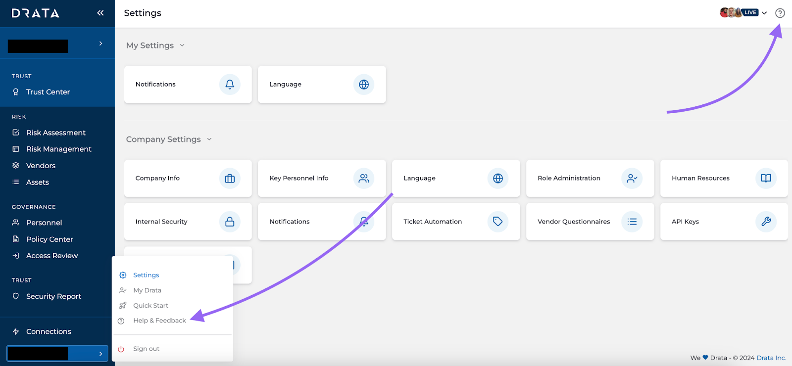

# Control managers overview

Source: https://help.drata.com/en/articles/8885256-control-managers-overview
Collection: Settings › Role Administration
Updated: 2026-06-30
Fetched: 2026-11-22
Description: Learn more about control managers role, permissions, and functionality in Drata.

## Article text

In this help article, learn and discover the functionalities available to Control managers roles within Drata.

## Read-Only permissions

If enabled, Control managers can only view, filter, and download data. They cannot modify data or perform certain actions.

## Restricted view

A control manager that has restricted view toggled on can only access the controls that they own and are assigned to for tasks or required approvals.

Restricted view is enabled by default and only available for control managers and risk managers. Toggle the restricted view off to allow control managers to access all controls.

### Control managers access

The side navigation of the Drata app is divided into several sections, each containing pages you can access based on your role.

Note: If your role has the read-only permissions enabled, you can only view, filter, and download the data on the pages available to the role. You cannot modify the data or do certain actions available on that page.

- Tasks
- Compliance
- Settings
- Help Menu

### Tasks

Access to general,  controls, and evidence renewals tasks. To learn more about Tasks, go to[Task](manage-tasks-in-drata.md).

### Compliance

Access the following pages under the Compliance section on the navigation bar:

- Controls page:[View control details](https://help.drata.com/en/articles/5330111-control-details),[change the scope of controls](https://help.drata.com/en/articles/5329662-marking-controls-in-and-out-of-scope), and[create controls](https://help.drata.com/en/articles/5465358-create-a-control).
- Monitoring page: Run tests, manage test notification, and map controls to tests on the Monitoring page. Learn about [Monitoring](https://help.drata.com/en/articles/4790546-monitoring).
- Event Tracking page: View all events and download raw evidence. Learn about[Event Tracking](https://help.drata.com/en/articles/4790526-event-tracking).
- Evidence Library page: Edit details or add evidence. Learn about [Evidence Library](evidence-overview.md).

### Settings

The Settings page can be found as an option under the user menu. Control managers have access to 'My Settings'.

### Help Menu

Select the help icon or Help & Feedback option to access the Help & Feedback drawer.

This drawer displays sections containing the help center, upcoming features, and community.

### Additional resources

- [Role Administration & RBAC](role-administration-rbac.md)

## Images

- [image 01] ../../images/ux/settings/information-security-leads-overview--01.png

## Related articles

- [Information security leads overview](information-security-leads-overview.md)
- [Risk managers overview](risk-managers-overview.md)
- [Access reviewer overview](access-reviewer-overview.md)
- [Personnel compliance managers overview](personnel-compliance-managers-overview.md)
- [Policy managers overview](policy-managers-overview.md)
