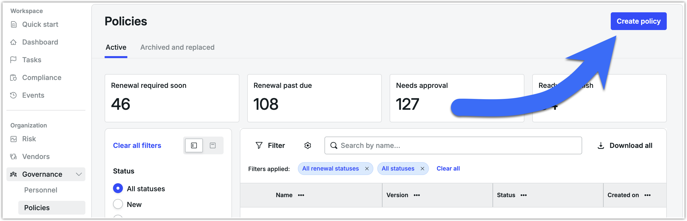
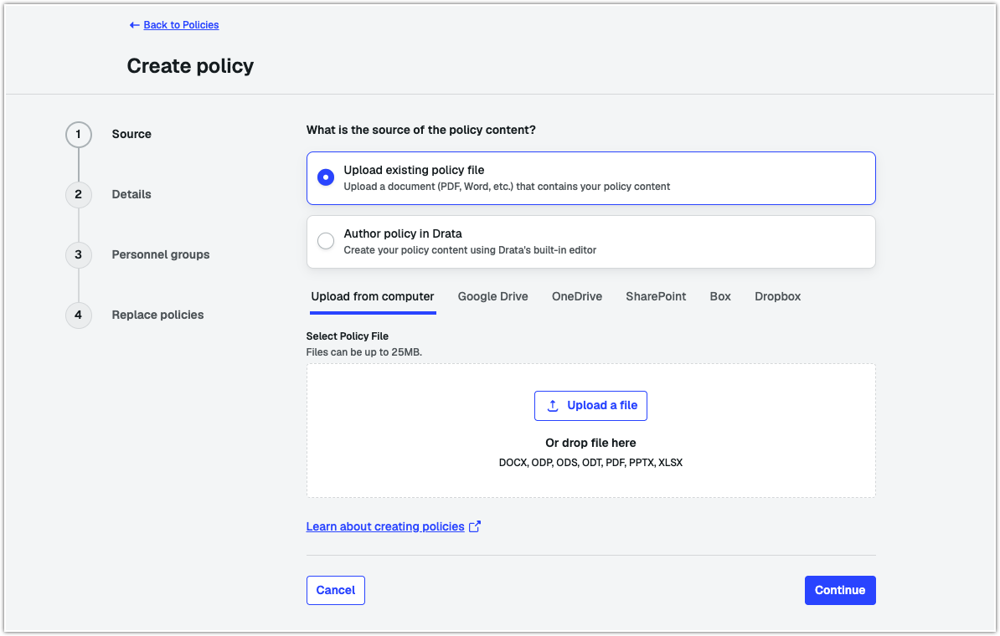
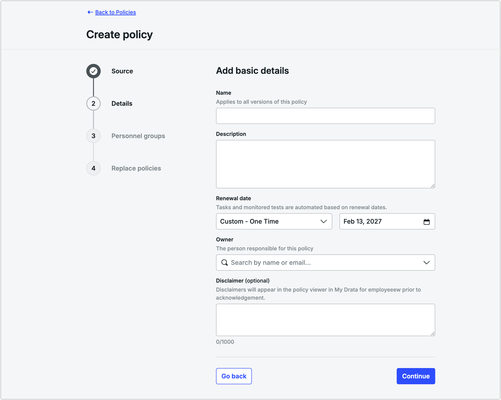
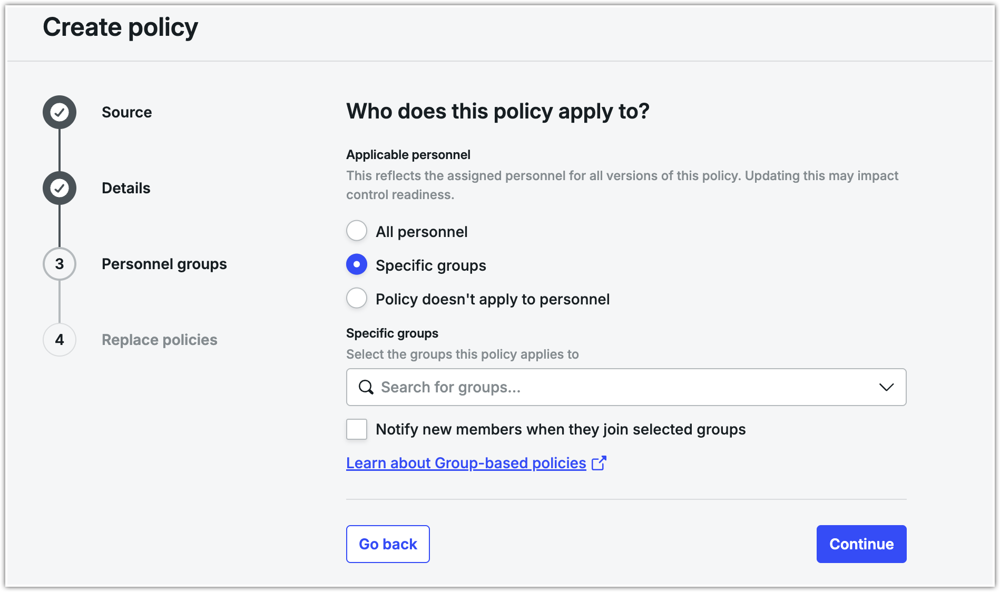
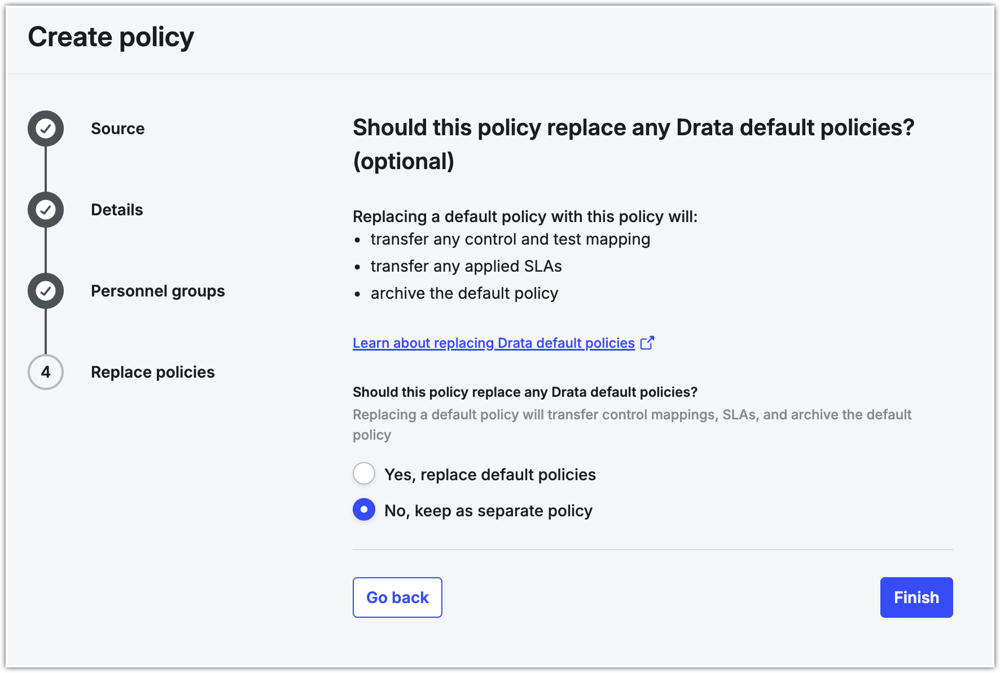
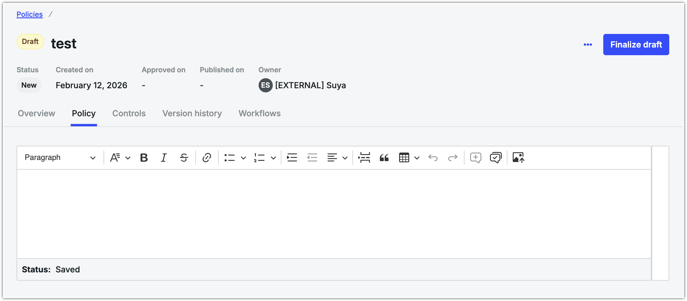

# Create a policy

Source: https://help.drata.com/en/articles/13550137-create-a-policy
Collection: Understand the Drata Platform › Policies
Updated: 2026-11-09
Fetched: 2026-11-22
Description: This article explains how to create a custom policy and replace an existing Drata template.

## Article text

You can create custom policies in Drata to meet your organization’s specific requirements. You can also replace a Drata-provided policy template with a custom policy while preserving control mappings and audit coverage.

## Prerequisites

- Admins, Information Security Leads, and Workspace Managers can create, approve, and update policies.
- You can’t create or replace policies in Drata if you use an external policy manager such as BambooHR or Confluence. If an external policy manager is connected, you’ll see **Import external policy** instead of **Create custom policy**.

## How policy replacement works

You can replace only **Drata template policies** with **custom policies**.

When you replace a policy:

- **Control and test mappings are preserved**
   Controls and related monitoring tests automatically transfer to the custom policy.
- **The original policy is archived**
   The replaced Drata template is archived and no longer active.
- **Replacement takes effect immediately**
   The replacement applies even if the custom policy is not yet published.
- **Unpublished policies may affect readiness**
   If the custom policy is not published, related controls may appear as **Not Ready** until publishing is complete.
- **SLAs may require configuration**
   If the replaced policy includes Service Level Agreements (SLAs), additional settings may appear during replacement.

Archived policies can’t be used for replacement. Restore an archived policy only if you intend to use it again.

## Create and replace a policy

### Step 1: Open Policies

1. Open **Governance → Policies**.
2. Select **Create policy**.

Note: Verify whether the Drata Policy Builder or an external policy manager interface (e.g., BambooHR) is active before proceeding. If the Drata Policy Builder is not visible, ensure that external integrations are disconnected.

### Step 2: Choose how to create the policy

Select a policy source:

- **Upload policy**: Upload a policy file from your computer (up to 25 MB), or import a file directly from a connected cloud storage service — Google Drive, SharePoint, OneDrive, Box, or Dropbox.
- **Author policy in Drata: **Use Drata’s editor to write and manage the policy directly.

### Step 3: Enter policy details

Enter required policy details, including:

- Policy name
- Description
- Renewal date
- Owner (Policy owner)
- Disclaimer (optional)

You can configure approval workflows after creation.

### Step 4: Select personnel groups

Choose which personnel must acknowledge the policy, or indicate if the policy does not apply to personnel.

#### Option 1: All personnel

All employees and contractors must acknowledge the policy.

- Default for existing Drata policies
- The monitoring test fails if **any required personnel** don’t acknowledge

#### Option 2: Specific groups

Only members of selected IdP groups must acknowledge the policy.

- Only group members see the policy during onboarding
- Monitoring tests apply **only** to assigned group members
- Tests fail only if members of the assigned groups don’t acknowledge

**Group membership changes**

- New members are assigned after the next Autopilot sync
- Removed members are no longer required to acknowledge the policy
- If all members are removed from assigned groups, the Policy Owner is notified

You can choose to notify new group members automatically when they’re added.

#### Option 3: Policy doesn’t apply to personnel

- No personnel acknowledgment is required.
- Use this option for policies that don’t require employee sign-off but still need to be stored and tracked.

**Important**

- If the policy has an acknowledgment-based monitoring test, that test will fail after the next Autopilot run
- You must disable the related test after changing this setting
- If someone other than the Policy Owner sets a policy to this option, the Policy Owner is notified

### Step 5: Replace a Drata policy (optional)

In the **Replace policies** section, select the Drata template you want to replace. The selected Drata policy is archived and replaced by your custom policy.

Replacing a default policy with this policy will:

- transfer any control and test mapping
- transfer any applied SLAs
- archive the default policy

## Next steps

If you authored the policy in Drata, draft the policy content and finalize it when ready. Once finalized, you can initiate the approval process.

After the policy is created, select the **Policy** tab to add or edit the policy content as needed.

## Images

- [image 01] ../../images/ux/policies/create-a-policy--01.png
- [image 02] ../../images/ux/policies/create-a-policy--02.png
- [image 03] ../../images/ux/policies/create-a-policy--03.png
- [image 04] ../../images/ux/policies/create-a-policy--04.png
- [image 05] ../../images/ux/policies/create-a-policy--05.png
- [image 06] ../../images/ux/policies/create-a-policy--06.png

## Related articles

- [Policy Center Overview](policy-center-overview.md)
- [Archive and restore policies](archive-and-restore-policies.md)
- [Assigning Policies to Specific Groups](assigning-policies-to-specific-groups.md)
- [External Policy: Use BambooHR to manage your policies](external-policy-use-bamboohr-to-manage-your-policies.md)
- [External Policy: Use Confluence or Notion to manage your policies](external-policy-use-confluence-or-notion-to-manage-your-policies.md)
