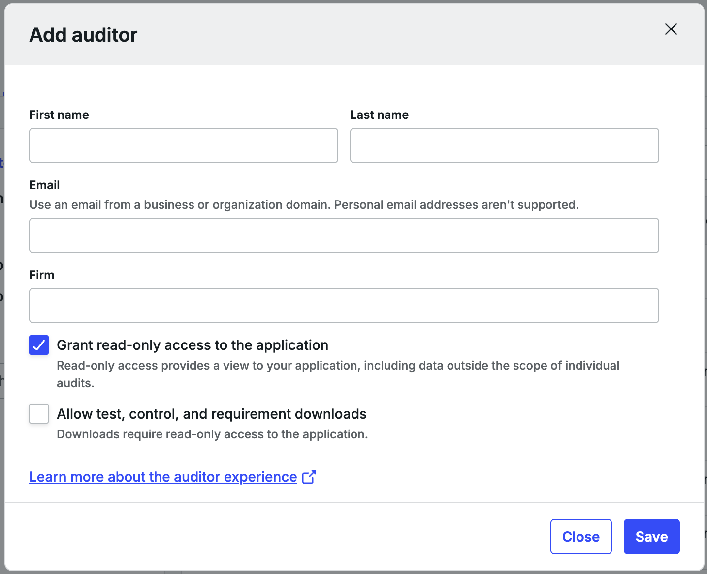
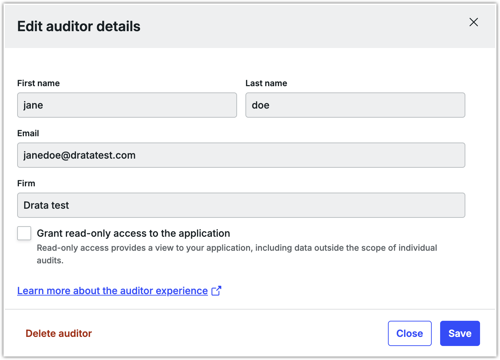

# Create and add auditors to an audit

Source: https://help.drata.com/en/articles/13605649-create-and-add-auditors-to-an-audit
Collection: The Auditor Experience
Updated: 2026-11-14
Fetched: 2026-11-22
Description: Use this article to create an audit, add auditors, and resolve common reasons an auditor may not have access in Drata.

## Article text

An audit in Drata is how you **share your compliance data, evidence, and controls with an auditor** in a structured, time-bound way.

Creating an audit defines:

- **What is being audited** (framework and audit type)
- **When it's being reviewed** (audit period)
- **Who can access it** (assigned auditors)

If these are set up incorrectly, auditors may not see the expected evidence or requests, or may be unable to work in the audit as intended.

## Prerequisites

- The auditor must use a **work email address**
- The auditor must exist on the **Auditor list**
- The audit period must be set to a valid date range

---

## Add an auditor

Adding an auditor to the **Auditors** tab creates their profile in the system, but it does **not** automatically grant them access to your audits. They must be manually assigned to a specific audit to begin their review.

Assigning an auditor to a specific audit triggers an invitation email with a magic link, enabling them to access the audit securely.

### Step-by-Step Instructions

1. Navigate to **Compliance > Audits** in the main sidebar.
2. Select the **Auditors** tab at the top of the page.
3. Click the **+ Add auditor** button.
4. Enter the auditor's name and contact information.
5. Enter the access levels for the auditor:

- **Read Only:** Allows the auditor to view evidence and controls without making changes.
- **Read Only with Downloads: Allows the auditor to view evidence and export/download files, including test, control, and requirement-related information. Grant Read-Only Access to the Application: Provides full application visibility for the auditor.**

If an auditor was added in error or is no longer part of your compliance ecosystem, you can **delete** the auditor directly from the Auditors tab.

**Note:** If you need to change your auditor's first or last name after inviting them, please ask the Auditor to do so after they log in to Drata, but before entering your specific audit. Once they sign in, instruct them to click their avatar icon in the upper right and choose **Settings** to change their personal name, audit firm name, and preferred language. If your auditor needs to use a different email address, simply invite them again using that new email. Removing and re-inviting your auditor at the same email address will not change their name.

## Troubleshooting Common Access Issues

1. **Auditor Did Not Receive Access:** Ensure the auditor is assigned to a specific audit. Being listed in the Audit List alone is insufficient.
2. **Error When Granting Read-Only Access:** Remove the auditor from the audit, save, and re-invite them. This clears stale sessions or cached permissions.
3. **Email Already Associated:** Use the search function in the Assigned Auditors list to link the existing account to the audit. **Note:** Auditors can only access control evidence linked to the audit. Files like organization charts must be added to the Evidence Library or linked directly to controls.

## Additional Resources

- [Auditor Experience in Drata](https://help.drata.com/en/articles/6928357-auditor-experience)

---

## Create an audit

1. Go to **Compliance > Audits.**
2. Select **Create Audit**.
3. Choose how you want to conduct the audit.
4. Enter the audit details, including **Framework** and **Audit period**.
5. Add auditors by selecting existing auditors from the dropdown or adding new auditors.
6. Save the audit.

---

## Add or update auditors on an existing audit

1. Go to **Compliance > Audits.**
2. Open the audit.
3. In **Assigned auditors**, select the **edit** icon.
4. Add or remove auditors as needed.
5. Confirm your changes. Assigned auditors receive an **email invitation** to access the audit.

## Images

- [image 01] ../../images/ux/audits/create-and-add-auditors-to-an-audit--01.png
- [image 02] ../../images/ux/audits/create-and-add-auditors-to-an-audit--02.png

## Related articles

- [How audit date ranges and evidence sampling affect auditor access](how-audit-date-ranges-and-evidence-sampling-affect-auditor-access.md)
- [Using the Drata Audit Portal (New Experience)](using-the-drata-audit-portal-new-experience.md)
- [Audits page overview (New Experience)](audits-page-overview-new-experience.md)
- [What auditors can see in Audit Portal](what-auditors-can-see-in-audit-portal.md)
- [Creating and Navigating an Audit in Drata Training Video](creating-and-navigating-an-audit-in-drata-training-video.md)
