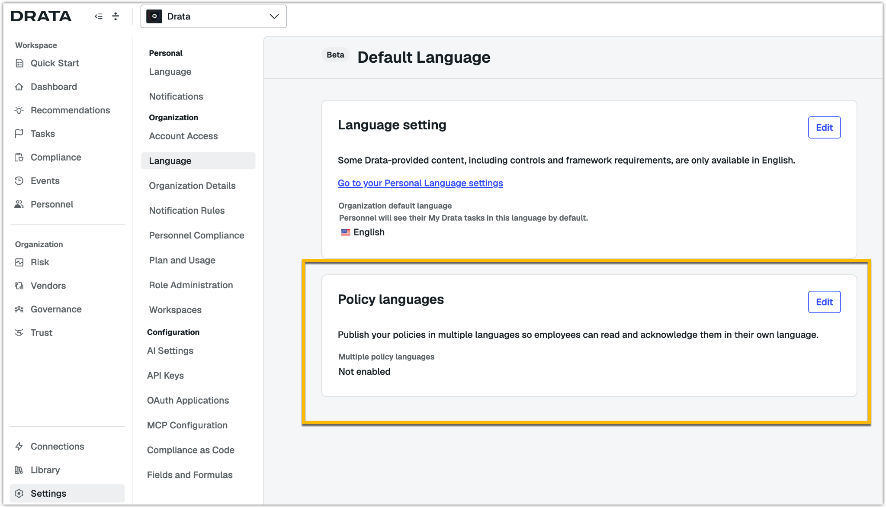
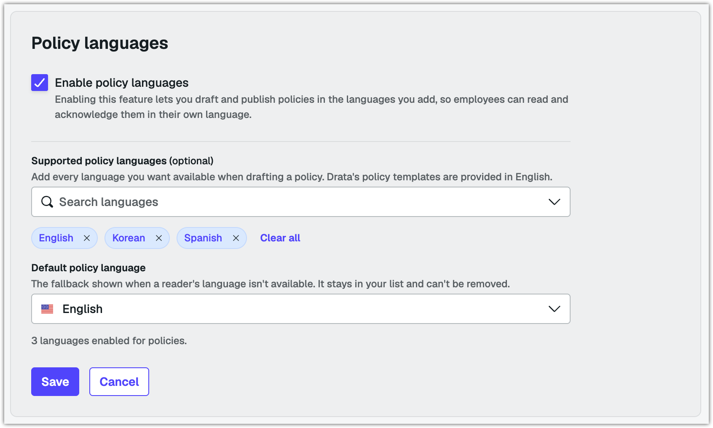
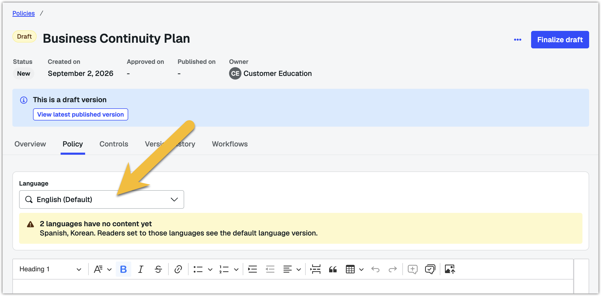
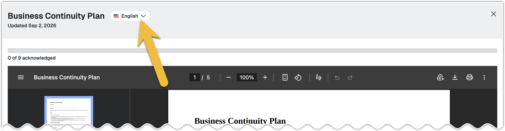

# Create and manage policy translations

Source: https://help.drata.com/en/articles/16786664-create-and-manage-policy-translations
Collection: Understand the Drata Platform › Policies
Updated: 2026-11-12
Fetched: 2026-11-22

## Article text

Create policy versions in multiple languages so people can read and acknowledge published policies in a language that works for them.

Only published policy versions are available in My Drata. End users can select from the languages included in the published policy version.

## Prerequisites

- Identify the languages your organization will support.
- Prepare the translated content or files for each language.
- You need the Admin role to enable language translations for your organization in the Settings page. Once the feature is enabled, anyone with permission to edit policies — including Policy Managers — can add translations to a policy version.

**Additional Note:**

- This is not available for organizations with an external policy connection (such as
   Confluence, BambooHR, and Notion)

## Enable policy translations

Configure the languages that your organization can use for policy versions.

1. Open **Settings > Organization**.
2. Select edit for Policy languages.
   
3. Turn on policy languages.
4. Add each language that your organization will support.
5. Set one supported language as the default language.
   
6. Save your changes.

The default language is the primary language for new policy versions. You cannot remove the default language until you assign another language as the default.

## Add a translation to a policy

Add translated content only while a policy version is in **Draft**. The language selector doesn't appear for versions in **Needs approval**, **Approved**, or **Published** status.

To add a translation to a version that's already past Draft, create a new draft of that policy version first, then add the translation.

1. Open the policy that you want to update.
2. Open the Policy tab and start a draft.
3. Select a language and add the content or upload the file.
   
4. Repeat these steps for each language that you want to include in My Drata.

Only languages with content in the published policy version appear as options in My Drata.

## Understand default language changes

Changing the default language affects new versions and does not change versions that are already published.

- Changing the default language does not change the language of existing policy versions. For example, a policy version published in English remains in English.
- New policy versions, including drafts, use the current default language.
- To publish a policy version in the new default language, create a new draft after changing the default language, then publish the draft.

## Update content after publishing

Create a new policy version when you need to update a published policy.

- Content from the previous version carries forward when you continue using the same policy format.
- If you change the policy format—for example, from authored content to an uploaded file—previous translations do not carry forward.

## View a published policy in another language

Switch languages when you read a published policy in My Drata.

1. Open the published policy in My Drata
2. Select the desired language in the language selector next to the policy title.
   
3. Review the policy in the selected language.

The language selector appears only when the published policy version contains more than one language. When you switch languages, the document reopens at page 1.

## Acknowledge a policy in your selected language

Select the language you want to use before acknowledging the policy.

1. Open the policy that you need to acknowledge.
2. Select a language from the language selector, if one is available.
3. Review the policy.
4. Select Acknowledge.

When you return to the policy, it appears in the language you used to acknowledge it.

## Frequently asked questions

**Can I configure a language without adding a translation to every policy?**

Yes. Add the language to your organization’s supported list, then add translations to individual policy versions as they become available. Only languages with published translations appear in My Drata.

**Can I use multilingual versions with an external policy connection?**

No. Multilingual policy versions support authored policies and uploaded-file policies only.

**Can a policy version use authored content or uploaded files?**
Yes. Every policy version is either authored content or an uploaded file, not both. Each translation you add to that version has to match the same format. For example, if a policy version is authored directly in Drata, its translations must also be authored — not uploaded files.

**Why does a language not appear in My Drata?**

Only languages with content in the published policy version appear in My Drata. Draft or unpublished language versions are not available to end users.

**Why don't I see the language selector for a policy in My Drata?**

The language selector only appears on policies whose published version has more than one language. If a policy only has one language, there's nothing to switch between, so the selector won't show.

**Why don't I see the language selector for a policy on the Policies page?**

The language selector only appears while you're editing a policy version in **Draft** status. It doesn't appear for versions in Needs approval, Approved, or Published.

If you don't see it on a Draft version, language translations may not be enabled in your Settings page.

## Images

- [image 01] ../../images/ux/settings/create-and-manage-policy-translations--01.png
- [image 02] ../../images/ux/settings/create-and-manage-policy-translations--02.png
- [image 03] ../../images/ux/policies/create-and-manage-policy-translations--03.png
- [image 04] ../../images/ux/personnel/create-and-manage-policy-translations--04.png

## Related articles

- [Policy Center Overview](policy-center-overview.md)
- [View and edit a policy](view-and-edit-a-policy.md)
- [Create a policy](create-a-policy.md)
- [Manage policy renewals](manage-policy-renewals.md)
- [External Policy: Use BambooHR to manage your policies](external-policy-use-bamboohr-to-manage-your-policies.md)
