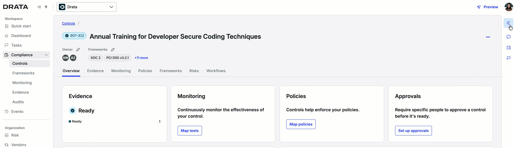

# Create and Manage Tickets in Drata

Source: https://help.drata.com/en/articles/13688350-create-and-manage-tickets-in-drata
Collection: Enhancing your workflow › Tickets
Updated: 2026-11-10
Fetched: 2026-11-22

## Article text

Managing security compliance often requires collaboration across teams. Drata makes this easier by integrating with the ticketing tools your organization already uses.

By connecting a supported ticketing integration with **Write Access** enabled, you can create and manage tickets for:

- **Controls** (DCF and Custom)
- **Monitoring **
- **Risks**

Tickets created in Drata remain accessible both in Drata and in your connected ticketing system.

---

## How Ticketing Works in Drata

Ticketing in Drata allows compliance and security teams to track remediation work directly from the Control, Test, or Risk where the issue originates. Tickets help you:

- Assign work to the right team
- Track remediation progress
- Centralize evidence for audit readiness
- Reduce manual follow-up across tools

| **Action** | **Who can do it** |
|---|---|
| Set up or edit ticketing connections | Admin |
| Create, view, or download tickets in Drata | Admin, Information Security Lead, Workspace Manager |
| Enable write access for connections | Admin |

---

## Prerequisites

- An active integration with write access enabled is required to create tickets in Drata.
- If write access is disabled:
   - You can view existing linked tickets.
   - You cannot create new tickets from Drata.

**Why Ticket Creation Fails**

If write access is enabled, ticket creation can still fail if the connected ticketing system has **required fields** that Drata cannot access or populate.

If your ticketing provider requires fields that Drata cannot surface or populate:

- Make those fields optional, **or**
- Use a project or issue type that does not require those fields

### What Does Not Sync into Drata

Only tickets created or linked through Drata appear in Drata. Drata does **not** pull in tickets that were created directly in the external ticketing system.

For example:

- A Jira issue created in Jira will not automatically appear in Drata
- Only Jira issues created or linked from Drata will display

## Integration-Specific Notes (Summary Table)

The table below highlights key limitations and unique behavior by provider.

| Provider | What to watch out for |
|---|---|
| **Jira** | - Map existing tickets runs with URL validation (must belong to the connected Jira instance and not already be linked). |
| **ServiceNow** | - Only **Incidents, Problems, and Service Catalog Tasks** supported.  - Drata **does not enforce ServiceNow UI/Data policies** (required fields and form rules won’t show as required in Drata).  - If Assigned to isn’t valid for the Assignment group, ServiceNow will error.  - Dropdown search matches only the **first word/character**.  - **PNG attachments are excluded** from downloaded zips. |
| **Asana** | - You must choose **Task** or **Subtask**. If you pick **Subtask**, you **must select a Parent Task**, and only **open** parent tasks appear. - Field validation (e.g., numeric‑only) follows Asana’s config, not Drata defaults. |
| **Freshdesk** | - **Sprout plan** doesn’t expose the API → no integration.  - Fields **cannot be numbers‑only**; they must contain letters too (affects title/description and any such fields). |
| **Freshservice** | - **Contact** is required on every ticket. Auto‑filled **Summary** and **Description** may need editing if they’re numbers‑only;  - Fields **cannot be numbers‑only**; they must contain letters too (affects title/description and any such fields). |
| **GitLab Issues** | - You must choose **Issue** or **Incident**. Only **open** epics/milestones are available to select.  - Status grouping in Drata: **In Progress** = anything not closed; **Completed** = closed/done. |
| **Height** | - Same as Freshdesk: fields cannot be **numbers‑only**; they must include letters. |
| **Aha!** | - Only **“To‑do”** is supported as the ticket type.  - Optional Aha fields are not exposed in Drata’s ticket wizard; only required/core fields appear. |

---

## Where Tickets Can Be Created

When **Write Access** is enabled, you can create tickets directly from the following areas in Drata:

- **Controls: **Select a specific control to create a ticket for that control.
- **Monitoring: **Select a specific test to create a ticket for that test.
- **Risk: **Select a specific risk register, then choose a risk to create a ticket for that risk.

Then, select the side arrow near the right side of the screen.

### Download Ticket Information

Most integrations support downloading ticket details from Drata.

Downloads typically include:

- A ZIP file containing a PDF of ticket details
- Any associated attachments (provider-dependent)

Provider-specific differences are listed below.

### Remove or Unlink Tickets

Removing a ticket from Drata:

- **Does not delete** the ticket in the connected ticketing system
- Only removes the association in Drata

In many integrations, once a ticket is unlinked, it cannot be re-linked.

## Images

- [image 01] ../../images/ux/tickets/create-and-manage-tickets-in-drata--01.gif

## Related articles

- [ServiceNow Integration Guide](servicenow-integration-guide.md)
- [Zoho Desk Integration Guide (Ticketing & UAR)](zoho-desk-integration-guide-ticketing-uar.md)
- [Ticket Automation (Jira-only) (New experience)](ticket-automation-jira-only-new-experience.md)
- [Create and Manage Workspace Tickets](create-and-manage-workspace-tickets.md)
- [Manage Risk Tasks in Drata (New Experience)](manage-risk-tasks-in-drata-new-experience.md)
