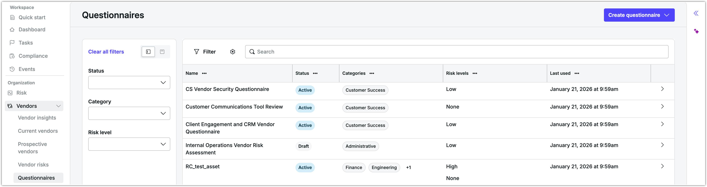
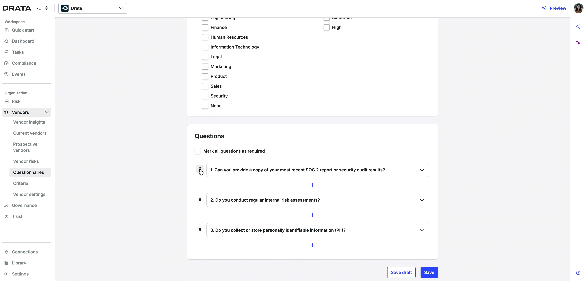
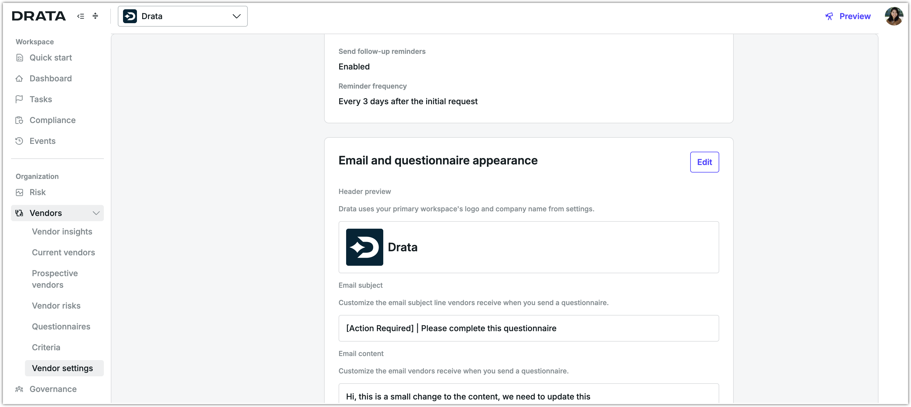
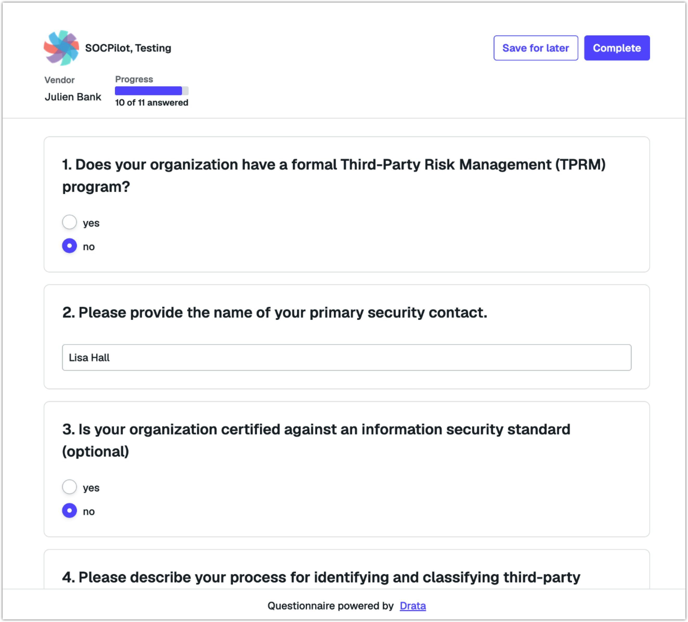

# Create and Manage Vendor Questionnaires

Source: https://help.drata.com/en/articles/13557330-create-and-manage-vendor-questionnaires
Collection: Understand the Drata Platform › Vendors
Updated: 2026-11-14
Fetched: 2026-11-22

## Article text

Vendor questionnaires help you assess and document third-party security practices using structured, customizable questions. They are commonly used during vendor onboarding and periodic security reviews.

In Drata, questionnaires are **templates**. You build and manage them once, then send them to vendors as part of a security review.

---

## What you can do with vendor questionnaires

With vendor questionnaires, you can:

- Create questionnaires from scratch or import questions in bulk
- Customize the default email sent to vendors
- Send questionnaires as part of vendor security reviews
- Track responses and download completed evidence packages

---

## Access vendor questionnaires

To manage questionnaires, select **Vendors → Questionnaires**.

From this page, you can view, create, edit, and preview questionnaires.

 (links to https://downloads.intercomcdn.com/i/o/am69aeco/2054406656/579ff96e3e4ecb2be99b7fbfe6e1/image.png?expires=1780056000&signature=7425767229171386e9bd417f601a76af1769f14e3a19c5159e7b22786cad44b2&req=diAiEs1%2Bm4daX%2FMW3nq%2BgVhKxrbtvHEPH4bgwpnR82pC3msW916%2BMfGv218q%0A8fJvebAMMTEcoX324lqgkafMl78%3D%0A)

---

### Create a questionnaire

1. Select **Create questionnaire**.
2. Choose one of the following options:
   - **From scratch**: Manually add questions
   - **Import questions**: Upload a CSV file using the provided template. You can import up to **500 questions per file**.
      - Import considerations
         - Avoid commas in question text. Text after a comma is treated as a new column.
         - Conditional follow-up questions are **not supported** during import.
         - Custom response fields are **not supported** during import.
         - Importing into an existing questionnaire **overwrites the entire questionnaire**.
3. Save the questionnaire.

You can save questionnaires as **drafts**. To make a questionnaire available for sending, save it as **active**.

---

## Add and reorder questions

- To add a question, select the **Add (+)** icon where you want it inserted.
- To reorder questions, drag and drop them into the desired position.

 (links to https://downloads.intercomcdn.com/i/o/am69aeco/2054429095/5c52da0b1f182654dbcc93c19860/vendorquestionnaire+%281%29.gif?expires=1780056000&signature=db5e20af3a8fdeeeaa86e355cb8fc33362d7409e20a3f1e8c9366188fd154eb4&req=diAiEs18lIFWXPMW3nq%2BgV4RtZjIWLN8HTN3tLo%2Fwp3UCOcoqViVcNJgKbwT%0A0zkWfCcs%2BRlKCerowIPkHm7NbbI%3D%0A)

---

### Choose a response type

Each question supports one of the following response types:

- **Short answer** (text, email, URL, or phone number)
- **Long answer**
- **Multiple choice**
   - Optional custom response
- **Checkboxes**
   - Optional custom response
- **Yes / No**
   - Optional follow-up question
- **Date**
- **File upload**
   - Supported file types: `.doc`, `.docx`, `.jpeg`, `.json`, `.pdf`

---

### Require responses

You can mark questions as required.

- To require all questions, enable **Mark all questions as required**
- To require a specific question:
   1. Expand the question
   2. Enable **Mark question as required**

---

### Preview a questionnaire

Preview lets you see exactly what a vendor will see before you send it — useful for checking wording, question order, and formatting on both draft and active questionnaires.

1. Go to **Vendors → Questionnaires**.
2. Select the questionnaire you want to check.
3. Select **Preview** in the top-right corner.

The preview opens in a new tab labeled **Questionnaire Preview**, with a banner confirming **"This is a preview of what your vendor would see."** All questions appear blank and read-only, in the same order and format a vendor would get from the emailed link.

**Note:** Since no vendor is attached to a preview, the **Vendor** field shows as blank (**—**) and progress always starts at **0 of [X] answered**.

---

## Customize the default questionnaire email

You can set a default email message that vendors receive when you send a questionnaire.

To edit the default email template:

1. Select **Vendors → Vendor settings**.
2. Scroll to **Email and questionnaire appearance**.
3. Edit the email subject and message.

 (links to https://downloads.intercomcdn.com/i/o/am69aeco/2054441065/40e03acdec7f3ced0202d6ecbd60/image.png?expires=1780056000&signature=4c34a4bbfcb451f8d3c8081cc1f2a3ad2fb1945025f003be006fff002f9c5e55&req=diAiEs16nIFZXPMW3nq%2BgfpZ2zOXIlNYui4XYi1wGeHvmEfeOaA4l7rPP%2F7w%0AzSB%2FMM7Wxwvnlfx0VcbwNKKw9kE%3D%0A)

You can still customize the message for individual vendors when sending a questionnaire.

---

## Send a questionnaire to a vendor

Questionnaires are sent as part of a **security review**.

1. Open **Vendors → Current vendors** or **Prospective vendors**.
2. Select a vendor.
3. Open the **Security reviews** section.
4. Select **New review → Security review**.
5. Select **Questionnaire**, then **Send via Drata**.
6. In the send modal:
   - Select the questionnaire
   - Enter up to **5 recipient email addresses**
   - (Optional) Customize the message for this vendor
7. Send the questionnaire.

The vendor receives an email with a secure link to complete the questionnaire.

---

### What vendors receive

- An email with a direct link to the questionnaire
- Only the questions included in the selected questionnaire

Standard questionnaires may include predefined security questions. Custom questionnaires include only the questions you created.

**While completing the questionnaire, vendors can:**

- Track their progress with a **"X of Y answered"** counter at the top of the page.
- Select **Save for later** at any point — a confirmation screen confirms progress was saved, and they can return to the same link later via **Resume questionnaire**.
- Share the link with colleagues to fill out different sections together (a banner reminds them to refresh the page to see teammates' changes).

Required questions are validated before submission — if any are missing, the vendor sees a **"Required questions are missing answers"** banner and each incomplete field is flagged **"is required."** Selecting Complete prompts a final confirmation. Completing the questionnaire locks it from further edits and sends it back to you immediately.

---

### Track responses and download results

After a vendor submits a questionnaire:

- The sender receives an email notification
- Responses appear in the vendor profile

From the vendor profile, you can:

- View all sent questionnaires
- Download the response package

Each response package includes a non-editable PDF of responses.

### File upload note

Unsupported file types are removed and marked with a `.removed` extension. Ask the vendor to resend the file or contact Support if needed.

## Images

- [image 01] ../../images/ux/vendors/create-and-manage-vendor-questionnaires--01.png
- [image 02] ../../images/ux/vendors/create-and-manage-vendor-questionnaires--02.gif
- [image 03] ../../images/ux/vendors/create-and-manage-vendor-questionnaires--03.png
- [image 04] ../../images/ux/vendors/create-and-manage-vendor-questionnaires--04.png

## Related articles

- [Vendor Management Policy Guidance](vendor-management-policy-guidance.md)
- [Add a prospective vendor](add-a-prospective-vendor.md)
- [Start and manage security reviews for your vendors](start-and-manage-security-reviews-for-your-vendors.md)
- [Customize the vendor questionnaire email subject line (New Experience)](customize-the-vendor-questionnaire-email-subject-line-new-experience.md)
- [Bulk actions for Current Vendors (New Experience)](bulk-actions-for-current-vendors-new-experience.md)
