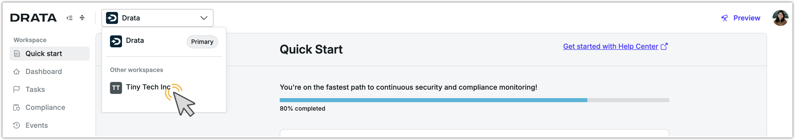
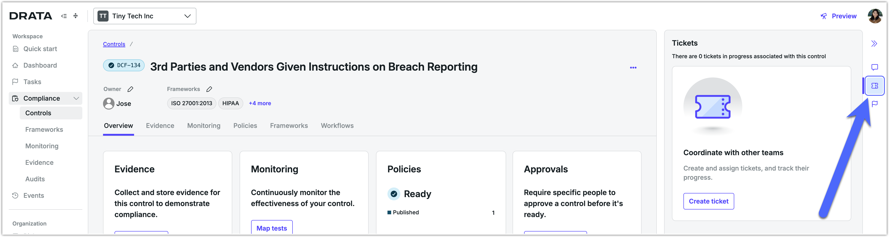
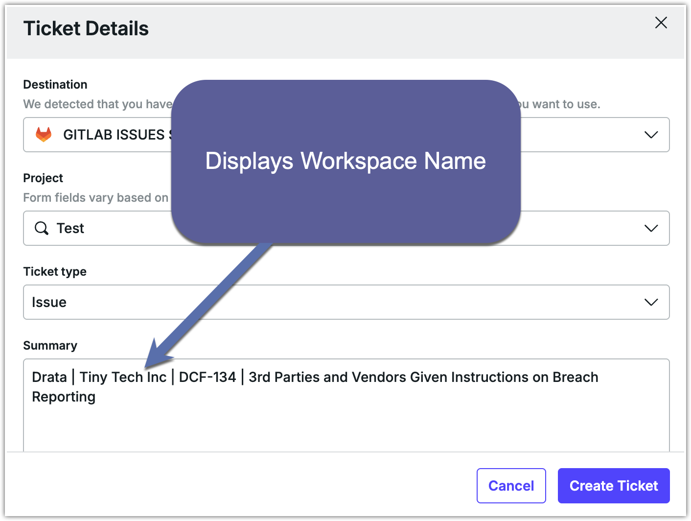

# Create and Manage Workspace Tickets

Source: https://help.drata.com/en/articles/13756148-create-and-manage-workspace-tickets
Collection: Getting Started › Workspaces
Updated: 2026-11-11
Fetched: 2026-11-22
Description: Create, triage, and track work for your compliance program from controls and tests, including tickets that are scoped to a specific workspace.

## Article text

Workspace-aware ticketing lets you:

- Create tickets from **controls** and **tests** in non-primary workspaces.
- Route work to the right **product** or **team** by including the **workspace name** in the ticket data.
- Allow **workspace managers** to manage tickets for only the workspaces they own.

Tickets created from a workspace still live in your external ticketing tool (for example, Jira or ServiceNow), but are linked back to the originating control or test in Drata.

Ticket scope depends on the workflow that created the ticket. Control- and test-related tickets can include Workspace context, while some Risk Management workflows and Jira automations remain at the account level.

---

## Prerequisites

To create and manage tickets:

- You must have one of these **roles**:
   - **Admin**
   - **Information Security Lead**
   - **Workspace Manager** (for the specific workspace)
- You **cannot** be using the **Risk Manager** role to create workspace-level tickets.
- You must have an active connection to a **supported [ticketing provider](https://help.drata.com/en/collections/16504775-ticketing-guidance)** with **Write Access** enabled.
- **Risk Management** is not supported for creating tickets per workspace. Ticket creation in the Risk Management area continues to work at the tenant level.
- **Jira Automation** rules are not applied on a per-workspace basis; they continue to operate at the global (tenant) level.

If you do not see ticketing options where expected, confirm your role and ticketing connection with an Admin.

---

## How ticketing works with workspaces

When you select a workspace, any tickets created from that context are associated with that workspace.

Key behavior:

- When you create a ticket from a **control** or **test** in a non-primary workspace, Drata:
   - Associates the ticket with that specific workspace.
   - Sends the **workspace name** into the ticket payload (for example, in the ticket title or a custom field) so teams working in Jira, ServiceNow, or other tools can see where the ticket came from.
- **Workspace Managers** can:
   - Create tickets from controls and tests in their assigned workspaces.
   - View and manage existing tickets for those workspaces from within Drata.

---

## Create a ticket from a control

1. **Select a workspace**
   - Use the workspace selector in the app header to choose the **workspace** you want to work in (for example, a specific product or environment).
   
2. **Open the control**
   - Navigate to the **Controls** area for that workspace.
   - Search for and open the control that needs follow-up work.
3. **Open the ticketing panel**
   - Select the side arrow to create tickets
   - Review any existing tickets already linked to this control.
   
4. **Create the ticket**
   - Select **Create ticket**.
   - Choose the ticketing provider (if prompted) and fill in required fields such as:
      - Project or board
      - Issue type
      - Summary and description
      - Priority or assignee (if applicable)
   - Confirm that the **workspace name** appears in the auto-generated title or in the workspace field, so downstream users can see the origin.
      
5. **Save and link**
   - Select **Create** (or the equivalent action).
   - The new ticket appears in the control’s ticket list in Drata, linked to that control and workspace.

---

## Create a ticket from a test

1. **Select a workspace**
   - From the workspace selector, choose the workspace whose tests you want to work on.
2. **Open the test**
   - Navigate to the **Monitoring** page within that workspace.
   - Open the specific test that requires investigation or remediation.
3. **Create the ticket**
   - In the test details view, go to the **Tickets** section or tab.
   - Select **Create ticket** and complete the required fields for your connected ticketing provider.
   - Confirm that the **workspace name** is included in the ticket information so the owning team can quickly identify scope.
4. **Track ticket status**
   - After creation, the ticket shows in the test’s ticket list, with status synchronized from your ticketing tool (where supported).

---

## Limitations and tips

- Workspace-level ticketing is currently available for **controls** and **tests**; Risk Management tickets remain global.
- Jira-specific automation and configuration (such as JQL-based rules) still apply at the **tenant** level, not per workspace.
- For the cleanest downstream workflows:
   - Use consistent naming conventions in ticket summaries.
   - Consider filters or boards in your ticketing tool keyed on the **workspace name** or related field, so individual product or team owners can quickly find their tickets.

## Images

- [image 01] ../../images/ux/workspaces/create-and-manage-workspace-tickets--01.png
- [image 02] ../../images/ux/tickets/create-and-manage-workspace-tickets--02.png
- [image 03] ../../images/ux/tickets/create-and-manage-workspace-tickets--03.png

## Related articles

- [Zoho Desk Integration Guide (Ticketing & UAR)](zoho-desk-integration-guide-ticketing-uar.md)
- [Add Jira Tickets as Evidence](add-jira-tickets-as-evidence.md)
- [Create and Manage Workspaces](create-and-manage-workspaces.md)
- [Create and Manage Tickets in Drata](create-and-manage-tickets-in-drata.md)
- [Ticket Automation (Jira-only) (New experience)](ticket-automation-jira-only-new-experience.md)
