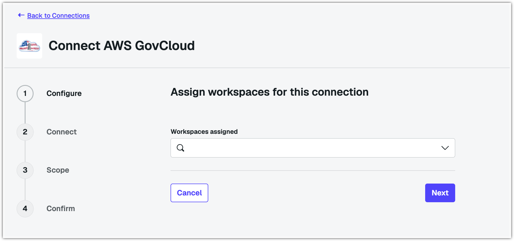
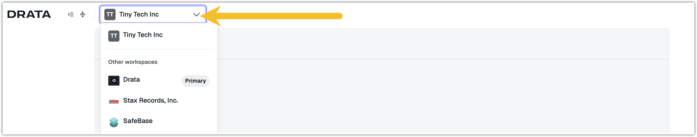

# Create and Manage Workspaces

Source: https://help.drata.com/en/articles/13604282-create-and-manage-workspaces
Collection: Getting Started › Workspaces
Updated: 2026-11-09
Fetched: 2026-11-22
Description: Learn how workspaces can be managed, used, and changed.

## Article text

Workspaces let you manage multiple products or business units with different infrastructure and compliance frameworks while still sharing company-wide operations such as personnel, vendors, and assets.

Each Workspace contains its own compliance data, while certain resources remain shared across the organization.

---

## Prerequisites

- The **Workspaces feature** must be enabled for your tenant.
- Must have a Drata Admin role to:
   - Create or delete a workspace
   - Add or remove frameworks for a Workspace
   - Assign/remove a Workspace Manager

**Rule:** You cannot create or manage multiple Workspaces until this feature is enabled.

---

## Create a Workspace

When your Drata tenant is provisioned, a **primary workspace** is created automatically.

To add additional Workspaces:

1. Go to **Settings page. **
2. Select **Organization** > **Workspaces page.**
3. Select **Create workspace**
4. Complete the required information.
5. Select **Add**.

An informational message appears while Drata builds the required frameworks and tests for the new Workspace. This process may take a few minutes.

---

## Delete a Workspace

Primary workspaces are required and cannot be removed. Only **Admins** can delete Workspaces.

This action cannot be undone.

1. Select a workspace.
2. Select **Deleteworkspace.**
3. Confirm when prompted.

---

## Add or remove frameworks for a Workspace

1. Select a workspace.
2. Select **Edit** for the Frameworks section.
3. Select the **X** next to a framework to remove it, or search and select a framework to add one.
4. Select **Save**.

**Result:** Enabled frameworks become clickable on the Frameworks page for that Workspace.

Frameworks are enabled **per Workspace**, not from the Frameworks page.

- Framework availability depends on your purchase agreement.
- Frameworks must be **activated at the tenant level** before they can be enabled for individual Workspaces.
- If a framework isn’t visible, contact **your Account Manager**.
- AI-related features such as the AI Awareness Training Campaign and the Artificial Intelligence Management System (AIMS) template depend on specific frameworks like NIST AI RMF and ISO 42001 being activated.

---

## Assign connections to a Workspace

When setting up Infrastructure, Observability, Ticketing, Version Control, Codebase, CSPM, Vulnerability, or Custom connections, you can select the specific Workspaces to associate with the connection. Other connection types apply across all Workspaces.

***Example: AWS GovCloud is an Infrastructure connection. When you set one up, the first step of the setup wizard is Select Workspace — if your account uses Workspaces, you choose which Workspace to associate with that AWS GovCloud connection before moving on to the rest of setup (creating the IAM role, entering the Role ARN, and configuring scope).*

---

## Use the Workspace picker

The Workspace picker lets you switch between Workspaces. Select a Workspace to view and manage information for that particular Workspace.

---

## Navigation menu for Workspaces

The nav bar is grouped into two labeled sections:

- **Workspace** (top section): Quick Start, Dashboard, Recommendations, Tasks, **Compliance**, Events, Personnel. These reflect information specific to the selected Workspace.
- **Organization** (bottom section, applies across all Workspaces): **Risk**, Vendors, **Governance**.

Compliance, Risk, and Governance are parent menus, not final destinations — selecting one expands into more specific pages.

---

## Summary

Workspaces let you:

- Isolate compliance data by product or business unit
- Share core operational data across the organization
- Manage frameworks, connections, and navigation intentionally

Customers need to manage multiple products or business lines that have different infrastructure and compliance framework needs while sharing operations such as personnel, vendors, and assets

## Images

- [image 01] ../../images/ux/connections/configure-workspace-details-frameworks-and-connections--03.png
- [image 02] ../../images/ux/workspaces/create-and-manage-workspaces--02.png

## Related articles

- [Google Workspace Integration Guide](google-workspace-integration-guide.md)
- [Configure Workspace Details, Frameworks, and Connections](configure-workspace-details-frameworks-and-connections.md)
- [Scope personnel to a Workspace](scope-personnel-to-a-workspace.md)
- [Understand Accounts, Workspaces, and MIM](understand-accounts-workspaces-and-mim.md)
- [Identify What Can Be Shared Workspace Resources](identify-what-can-be-shared-workspace-resources.md)
