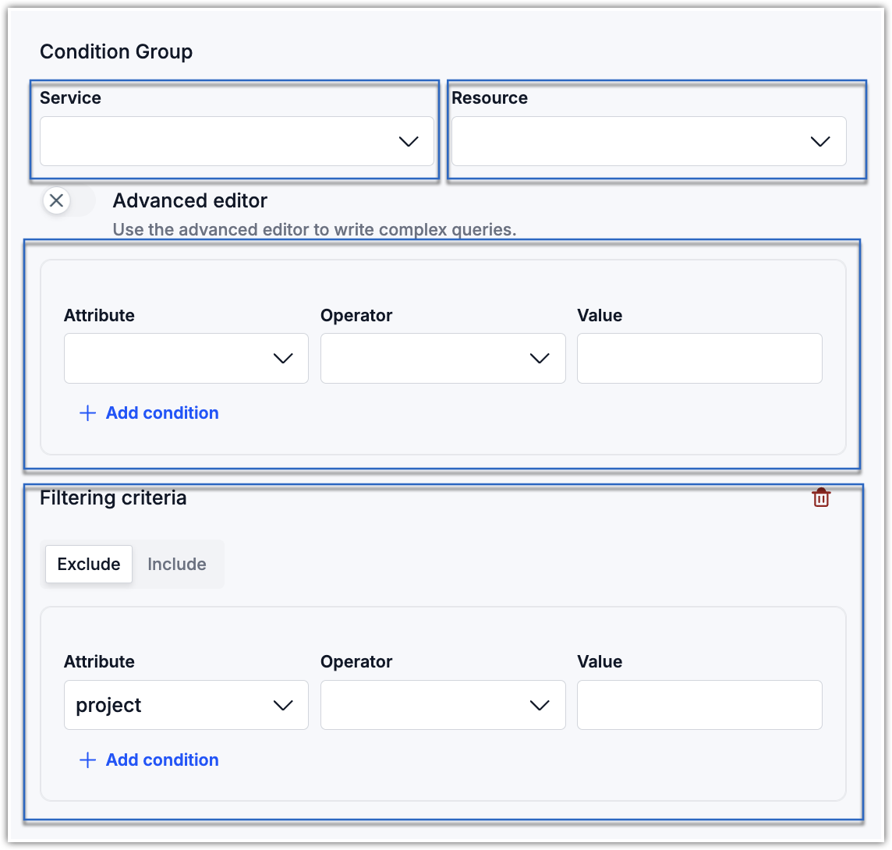
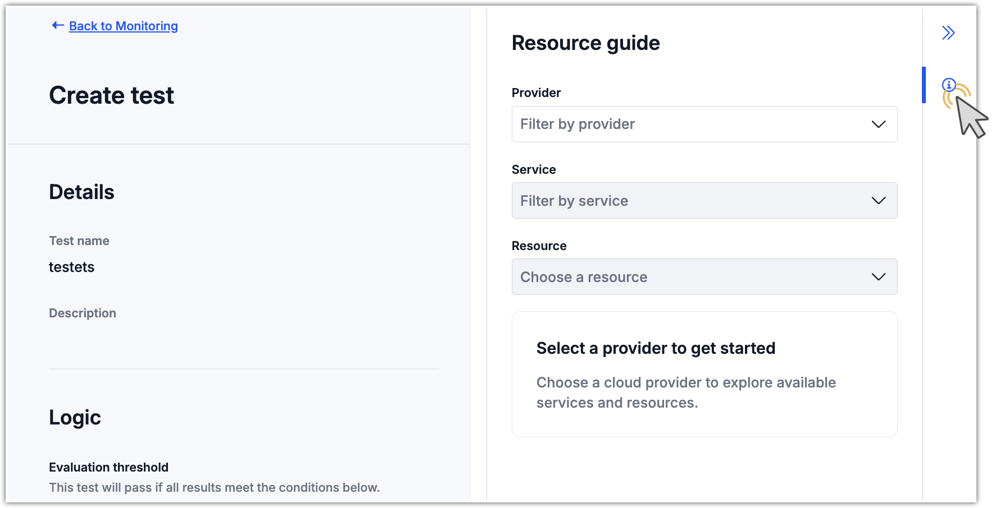

# Create and Publish Custom Tests

Source: https://help.drata.com/en/articles/13401776-create-and-publish-custom-tests
Collection: Understand the Drata Platform › Monitoring › Custom Tests
Updated: 2026-11-09
Fetched: 2026-11-22
Description: Create custom tests in Drata to monitor controls that are not covered by Drata's out-of-the-box tests, using your own logic and integrations.

## Article text

Custom tests let you monitor your environment using your own logic, so compliance checks reflect how your organization actually operates. You can create, review, and publish custom tests from the Monitoring page, then map them to controls once they're ready.

Once published, custom tests run automatically and generate audit-visible evidence.

## Prerequisites

- At least one infrastructure or custom connection enabled (for example, AWS, GCP, or Azure)
- One of the following roles:
   - Admin
   - Information Security Lead
   - Workspace Manager
   - Control Manager
   - DevOps Engineer
- Your account has not reached the maximum number of custom tests. Draft and published versions count as a single test
- A Drata Advanced plan or higher

## Understand These Concepts Before Creating a Custom Test

Before creating a custom test, it's helpful to think through the decisions below. While you don't need to follow this order exactly when creating the test, making these decisions ahead of time can make building the test easier and more predictable.

1. **Define the intent: **Decide what risk or requirement you want to validate and what outcome represents compliance.
2. **Select the provider and accounts: **Choose the system and the connected accounts to determine what data is available for evaluation.
3. **Create a condition group: **Define the type of resources being evaluated by selecting a service and resource type. Each condition group represents one logical data set.
4. **Narrow the scope (optional): **Use filtering criteria to include or exclude specific resources before rules are applied, such as limiting the test to production resources or excluding tagged items.
5. **Define conditions (rules): **Specify what must be true for each resource using attributes, operators, and values.
6. **Add additional condition groups (if needed): **Add another condition group when you need to evaluate a different service, resource type, or independent logic.
7. **Select the evaluation threshold: **Choose how strict the test should be by determining how results from all condition groups roll up into a single pass or fail outcome.
   - **All results must pass: **Every condition group must pass for the test to pass (recommended for most compliance use cases)
   - **At least one result must pass: **The test passes if any condition group passes
   - **Only one result may fail: **Allows limited failure without failing the entire test

### Condition Groups, Conditions, and Filters (How They Work Together)

This is the most important concept to understand when building custom tests. A **condition group** defines:

- One **service**
- One **resource type**
- A set of rules applied to that resource
- (Optional) Filtering criteria

Use **multiple condition groups** when:

- You need to evaluate **different resource types**
- You want different logic applied to different resources
- You want results to be evaluated independently, then rolled up by the logic threshold

**Example: **One condition group evaluates S3 buckets. Another condition group evaluates EBS volumes.

---

Available resources depend on:

- Selected provider
- Selected service
- Data available in your environment

Once a resource is used for a service, that service will no longer appear when adding another condition group.

⚠️ If you change the selected service or resource after configuring conditions, the test may reset and require reconfiguration.

---

Each condition includes:

- **Attribute**: The data field being checked
- **Operator**: How the value is compared
- **Value**: What the attribute is compared against

Use **multiple conditions** when:

- Multiple requirements must be true for the same resource
- You want to enforce stricter checks on the same resource type

**Example:**

- Encryption equals `true`
- Public access equals `false`

---

**Filtering criteria** narrow the scope of a condition group before conditions are evaluated. Use filtering criteria when:

- Only certain resources should be evaluated
- Some resources should be excluded by tag, label, name, or property
- You want to reduce noise without excluding results after the fact

**Example:** Evaluate all S3 buckets **except** those tagged with `DrataExclude`.

### Advanced Editor (Optional)

Use the **Advanced editor** to write complex queries instead of selecting attributes, operators, and values manually.

The Advanced editor supports:

- Nested logic
- Array-based evaluations
- Complex filtering

This is recommended for users familiar with structured data and JSON-like logic.

## Create a Custom Test

1. Go to **Monitoring**
2. Select **Create test**
3. Enter a **test name** and **description**
   - The name must be unique
   - Both appear in audit evidence
4. Continue to create the test
5. Complete **Logic details**
   - Evaluation threshold
   - Category
   - Provider and accounts
6. For each condition group:
   - Select a service and resource
   - Add conditions (attribute, operator, value). Optionally, you can use the advanced editor instead.
   - Add filtering criteria if needed
7. Save your configuration

While building a custom test, select the info icon to open the Resource Guide and explore available services, resources, and their attributes.

After saving, the test is created as a **draft**.

## Save as Draft

- Draft tests can run and return results
- Draft tests do **not** affect control readiness
- Draft tests are **not auditor-facing**

This allows you to validate logic safely. Draft test runs are logged as **Autopilot Draft Test** events.

## Publish the Test

When ready:

- Open the draft test and select **Publish**, **or**
- Select one or more draft tests from the Monitoring table and publish in bulk

After publishing:

- The draft label is removed
- The test can be mapped to controls
- Tickets can be created
- Audit evidence is generated automatically

ℹ️ Test logic and exclusions carry over; draft history and notes do not.

## What Happens Next

- The test runs automatically
- Results appear in Monitoring
- You can map the test to controls
- Evidence becomes available for audits

## Images

- [image 01] ../../images/ux/monitoring/create-and-publish-custom-tests--01.png
- [image 02] ../../images/ux/monitoring/create-and-publish-custom-tests--02.png

## Related articles

- [Resource Guide for custom tests](resource-guide-for-custom-tests.md)
- [Common use cases for custom test](common-use-cases-for-custom-test.md)
- [View and Manage Test Details (New Experience)](view-and-manage-test-details-new-experience.md)
- [Edit a Custom Test](edit-a-custom-test.md)
- [Advanced Editor in the Test Builder](advanced-editor-in-the-test-builder.md)
