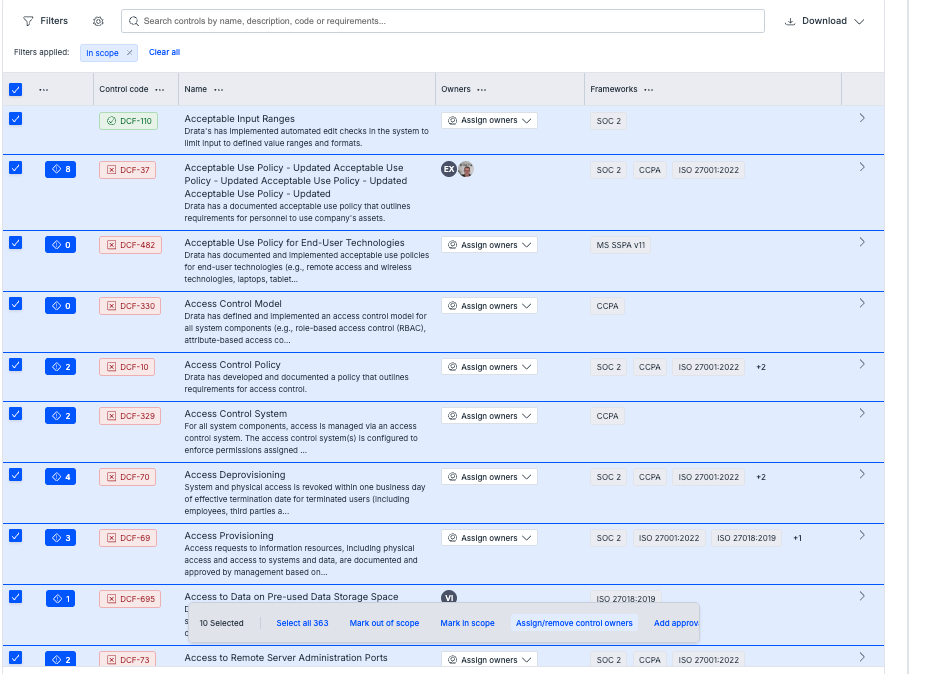
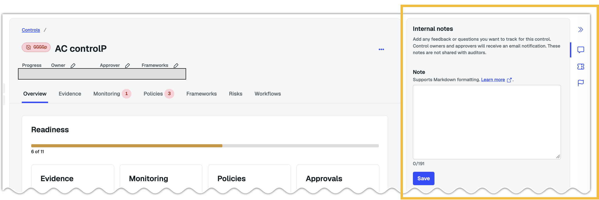
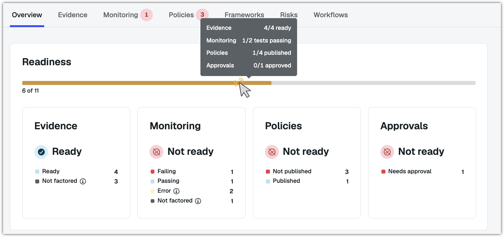

# Create, Edit, and Manage Controls

Source: https://help.drata.com/en/articles/13380335-create-edit-and-manage-controls
Collection: Understand the Drata Platform › Controls
Updated: 2026-11-09
Fetched: 2026-11-22

## Article text

Controls implement and articulate the policies, processes, and activities your organization uses to meet compliance requirements.

In Drata, you can:

- Create custom controls to meet specific needs.
- Map controls to framework requirements.
- Link evidence (policies, reports, external files).
- Edit both Drata Common Framework (DCF) controls and your custom controls.
- Assign control owners and approvers.
- Add internal notes, tickets and tasks for context, collaboration, and management.

## Prerequisites

- Only **Administrators** and the **Information Security Lead** can create, edit, and annotate controls.
- Control owners can be **Administrators, Information Security Leads, Control Managers, or Workspace Managers**.
- Workspace Managers with **read-only access** cannot be control owners.
- Assign roles to individuals with the necessary authority, context, and access to perform their duties effectively.
- Ensure role assignments comply with your organization's internal governance and audit requirements.

## Create a Control

**Goal: Add a custom control to meet compliance needs.**

1. Go to the **Controls** page.
2. Select **Create Control < Create a single control. **
3. In the **Create control**, complete required fields:
   - **Name** (required)
   - **Code** (required; supports letters, numbers, and symbols)
   - **Description** (required)
4. Map the control to one or more framework requirements.
5. Map the control to additional objects:
   - One or more framework requirements, automated tests, evidences, and policies
6. Select **Save** to create the control.

To learn how to add or update in bulk, go to[Import or Update Controls in Bulk](import-controls-in-bulk-new-experience.md).

## Edit a Control

**Goal: Update existing DCF or custom controls.**

1. Go to the **Controls** page.
2. Select a control to open **its detail page**.
3. Select the **Edit** icon on Info section.
4. Update required and optional fields:
   - **Name** (required)
   - **Code** (required, but only editable for custom controls)
   - **Description** (required)
   - **Question** (optional)
   - **Activities** (optional)
5. Select **Save**.

After saving:

- Select **See all updates** to open the **Events** page and view full history.

## Assign or Remove Control Owners

**Goal: Manage responsibility for controls.**

- Control owners ensure evidence is linked, automated tests pass, and controls are audit-ready.
- Owners can be assigned from the **control detail page** or the **control list view** on the **Controls** page.
- Control owners do not necessarily need to be business stakeholders; they can be admins or analysts responsible for coordinating policy approvals and evidence collection.
- This flexibility allows organizations to streamline control management while adhering to governance standards.

### Assign an Owner

1. Open a control’s detail page
2. In the **Control Owners** section, click **assign** and select a person to assign them.

### Remove an Owner

1. Open a control’s detail page
2. In the **Control Owners** section, select the **X** on the owner pill.

### Bulk Assignment or Removal

1. From the Controls page, select one or more controls.
2. Select the **Assign/remove control owners **in the grey bar to open the modal.
   
3. Assign or remove control owners:
   - Assign: Add new owners to all selected controls.
   - Remove: Remove owners from all controls where the owner exists by selecting the **X** on the owner pill.
4. Confirm to save changes and close the modal.

## Annotate a Control

**Goal: Add internal notes, tickets, and tasks for control management. **

Open a control's detail page, then select the arrow (») on the right edge to expand the Utilities panel. From there, you can:

- Add, edit, or delete notes in the Internal Notes section
- Create tickets
- Create tasks

## Manage control details

When you select a control, a detail page opens with the following tabs: Overview, Evidence, Monitoring, Policies, Frameworks, and Risks.

On the **Overview** tab, you can do the following:

- **Progress indicator**: Alongside the Ready/Not Ready status, each control now shows a **Progress** percentage and bar, reflecting how close the control is to Ready. Hover the bar to see how many underlying items are ready vs. not ready. The percentage is calculated as `Ready items ÷ (Ready items + Not Ready items)`; items marked **Not factored** or **out of scope** are excluded, consistent with how readiness is calculated elsewhere on this page.
- **Top-Level Cards:** View a high-level summary of factors related to your control, including **Evidence**, **Monitoring**, **Policies**, and **Approvals**.
- **Info:** Edit the details of your control.
- **Owners:** Assign or remove **Control Owners**.
- **Required Approvals:** Manage required approvals for this control.

Each top-level card provides details about your control’s readiness. You can select any card to view more information.

## Can I delete a control in Drata?

To ensure continuous compliance and maintain a robust audit trail, **controls cannot be deleted** in Drata's new experience.

When preparing for an audit, auditors require a complete history of your compliance posture. Deleting a control would erase historical data that might be necessary to prove past compliance. If a control is no longer relevant to your organization, or if it was created by mistake, you can mark the control as out of scope instead.

## Notes / Troubleshooting

- **Scope requirement**: Controls must be mapped to at least one requirement.
- **Evidence**: Add or remove evidence at any time.
- **Control codes**: Editable only for custom controls, not DCF controls.
- **History tracking**: All updates are logged in the **Events** page.
- **Owner eligibility**: Owners must hold a qualifying role. If a user’s role is removed, or they are marked “Former Employee/Contractor,” they are no longer a control owner.
- **Filtering**: Filter controls by owner in the list view to find controls quickly.
- **Exports**: Owners are included in CSV downloads in the **Control Owners** column.

> 🎓 **Want to learn more?** Dive deeper into this topic and see it in action! Check out our dedicated Controls course over at the **[Drata Academy](https://academy.drata.com/controls-monitoring-1)**.

## Images

- [image 01] ../../images/ux/controls/create-edit-and-manage-controls--01.png
- [image 02] ../../images/ux/controls/create-edit-and-manage-controls--02.png
- [image 03] ../../images/ux/controls/create-edit-and-manage-controls--03.png

## Related articles

- [NIST SP 800-53 (Rev. 5) Control & Policy Mapping Updates](nist-sp-800-53-rev-5-control-policy-mapping-updates.md)
- [Pre-Audit Checklist: How to Prepare for Your Audit with Drata](pre-audit-checklist-how-to-prepare-for-your-audit-with-drata.md)
- [Section 5: Control Owners](section-5-control-owners.md)
- [Section 5: Evidence Owners](section-5-evidence-owners.md)
- [NIST SP 800-171 Rev. 2 Self-Assessment](nist-sp-800-171-rev-2-self-assessment.md)
