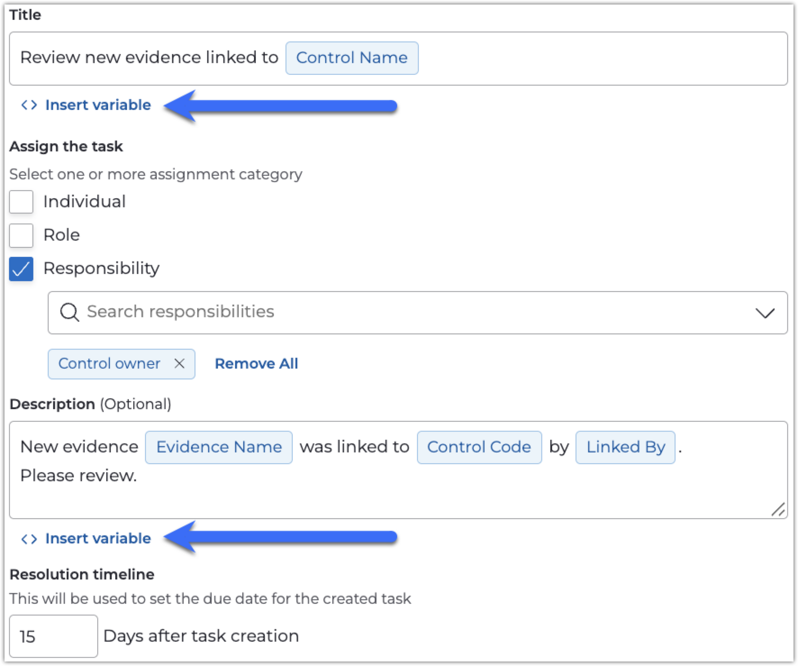
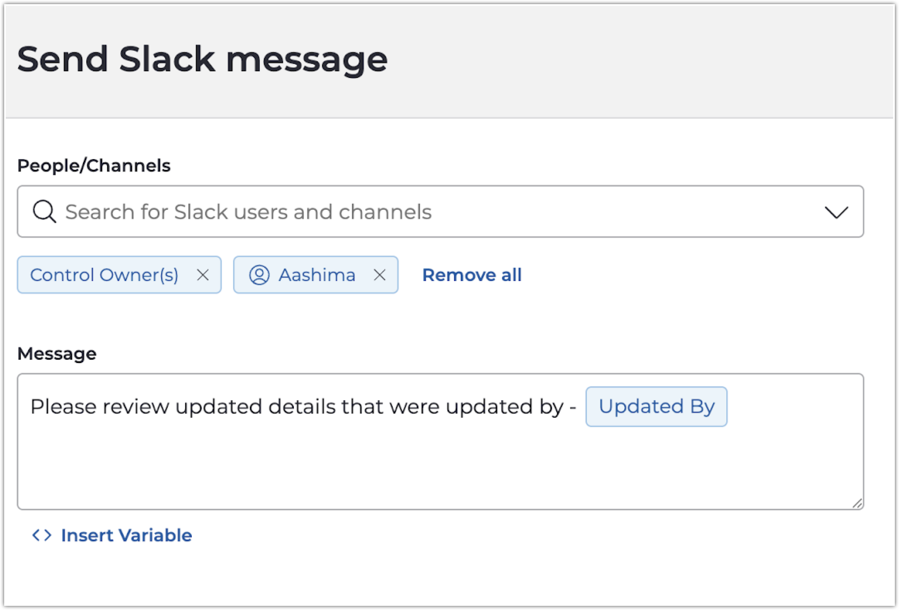
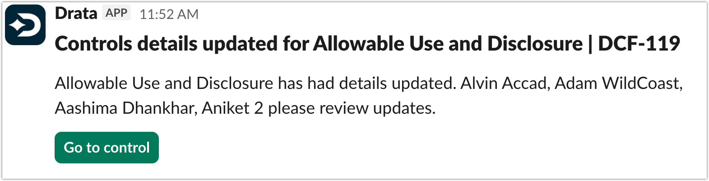

# Create Workflow for Control

Source: https://help.drata.com/en/articles/12876602-create-workflow-for-control
Collection: Enhancing your workflow › Custom Workflows
Updated: 2026-11-11
Fetched: 2026-11-22
Description: Learn how to build automated control workflows in Drata to improve compliance efficiency, trigger actions, and integrate with external tools.

## Article text

> **API Developer Resource 💡**
> For API documentation and resources to extend workflow automation, visit the **[Drata Developer page](https://developers.drata.com/)**.

## Overview of Control Workflows

Control workflows help you stay proactive by automatically responding to important changes across your controls. Whether a control becomes “Not ready,” evidence is linked, or ownership changes, Drata can notify the right people, assign follow-up tasks, or send data to connected tools.

For an introduction to workflows, explore our [Workflows article](automate-actions-with-drata-s-workflows.md).

## Prerequisites

Before creating a workflow, ensure that:

- You have the **Admin** or **Workspace Manager** role.
- You can access **Settings > Workflows**.

You may also need to:

- Identify the Slack channel or Teams group you want to notify.
- Prepare any webhook URLs needed to send data from Drata to external applications.

Each control workflow is made up of a trigger and the actions you want Drata to take when that trigger occurs. After choosing the controls you want to monitor, you’ll define what event should activate the workflow and what should happen next. Use the instructions below to configure your workflow.

## Step 1: Select the Controls

Start by choosing which controls to monitor.

- **All controls**: All current and future controls in the selected workspace
- **Selected controls**: Specific controls to target

## Step 2: Choose a Trigger

Select the event that should activate the workflow. The workflow will run whenever one of the following changes occurs:

- Controls details updated
- Control readiness changed to "Not ready"
- Control readiness changed to "Ready"
- Evidence linked
- Evidence unlinked
- Policy linked
- Policy unlinked
- Test mapped
- Test unmapped
- Requirement mapped
- Requirement unmapped
- Mapped test passing
- Mapped test failing
- Control owner updated
- Control marked in-scope
- Control marked out-of-scope

## Step 3: Add Steps

Each step defines what should happen when the workflow is triggered. You can add multiple steps, and all steps run in parallel when the workflow activates. If a step fails, the others will still run, and Drata will automatically retry the failed step up to three times.

Workflows support the following step types (availability depends on your connected integrations):

- **Create task**: Assign a follow-up task to a user, role, or owner.
- **Send email**: Available to all users.
- **Send Slack message**: Available when Slack is connected.
- **Send MS Teams message**: Available when Microsoft Teams is connected.
- **Send webhook**: Transmit structured data from Drata to external systems.

### Step Type: Create Task

Use the Create task step to assign a follow-up action to a user, role, or the control owner. You can:

- Enter a task title and description.
   - (Optional) Use dynamic variables such as {{control_name}} to automatically insert control-specific information.
   - Select **Insert Variable** to browse all available options.
- Assign the task to an individual user, a role, or a responsibility group (such as the control owner or control approver).
- Set a due date as part of the resolution timeline (for example, **10 days from task creation**).

**Example:**

The following image shows a task automatically created and assigned to the control owner to review newly linked evidence.



### Step Type: Send notification

Use the **Send notification** step to deliver real-time alerts to stakeholders when the workflow is triggered.

Each email/message will contain a link to route to the Control. Notifications can be sent through:

- **Email** (always available)
- **Slack message** (available when Slack is connected)
- **Microsoft Teams message** (available when Microsoft Teams is connected)

You can:

1. Enter recipients or channel names (such as security-alerts, [compliance-team@examplecompany.com](mailto:compliance-team@examplecompany.com)).
2. Compose a subject line and message, embedding variables such as:
   - `{{control_name}}`
   - `{{control_code}}`
   - `{{control_owners}}`
   - Select **Insert Variable **for more options.

**Example control notification:**

The following image shows a user configuring a Send Slack message step. The message notifies all control owners and Aashima to review the updated details, including the name of the user who made the update.



**Example Slack notification:**

Below is an example of the Slack message that recipients will view when this workflow is triggered.



### Step Type: Send webhook

Use the Send Webhook step to transmit structured data from Drata to external systems through a specified endpoint. This enables real-time integration with tools like Zapier, Torq, or ServiceNow.

**How it works**

When triggered, Drata sends a POST request to the specified endpoint. You can include:

- Authentication (as custom headers)
- Custom headers with additional context
- Control and trigger properties in the request body

**Example Use Case**

When evidence is linked to a control, Drata sends webhook data to Zapier. Zapier can then automate actions in other tools.

In Zapier:

1. Create a new Zap.
2. Set the trigger to Webhooks by Zapier – Catch Hook.
3. Copy the generated webhook URL.

In Drata:

1. Add a Send Webhook step to your custom workflow.
2. Paste the Zapier URL into the URL field.
3. (Optional) Add authentication or custom headers.
4. Choose the properties you want to include in the webhook payload.

Back in Zapier, add an action to process the data.

When the workflow runs in Drata, the webhook delivers data to Zapier, where you can configure it to take further automated actions.

## Webhook Implementation Notes

**Property Structure**

Each webhook payload contains the following components:

- [Base properties (common to all triggers)](#h_dc4cc397ab)
- [Selected Control-specific properties](#h_077b719cc9) (based on scope type: control, risk, evidence, or personnel)
- [Selected Trigger-specific properties](#h_1fbc500bbf) (unique to the specific trigger that fired)

**Data Formats**

- Object arrays (like owners, categories, etc.) are sent as structured JSON
- Dates are sent as strings in ISO format
- Boolean values are sent as true/false

**Custom Fields**

Custom fields vary by organization and are configured through Drata's admin interface. They follow the format:

```
[{"key": "field_name","value": "field_value"}]

```

## Available webhook properties

### Base Properties (Included in ALL Webhook Events)

- event_type: The specific trigger event name
- timestamp: When the event occurred
- organization_id:  ID of the organization
- workspace: Workspace context object

### Base Control Properties

- control_name
- control_code
- control_id
- control_owners (name + email list)
- control_readiness
- control_description
- control_approval_status
- control_approvers
- control_mapped_requirements
- control_mapped_tests
- control_evidence
- control_policies
- control_notes
- control_custom_fields
- control_workspace_name
- control_workspace_id

### Trigger-Specific Properties

CONTROL_DETAILS_UPDATED

- updated_by

---

CONTROL_READINESS_CHANGED_TO_NOT_READY / CONTROL_READINESS_CHANGED_TO_READY

- date_changed

---

CONTROL_EVIDENCE_LINKED / CONTROL_EVIDENCE_UNLINKED

- evidence_artifact
- evidence_id
- evidence_implementation_guidance
- evidence_name
- evidence_owner_name
- evidence_status
- linked_by / unlinked_by

---

CONTROL_POLICY_LINKED / CONTROL_POLICY_UNLINKED

- policy_doc
- policy_id
- policy_name
- policy_owner
- policy_status
- linked_by / unlinked_by

---

CONTROL_TEST_MAPPED / CONTROL_TEST_UNMAPPED

- test_description
- test_name
- test_result
- test_type

---

CONTROL_REQUIREMENT_MAPPED / CONTROL_REQUIREMENT_UNMAPPED

- requirement_framework
- requirement_name
- mapped_by / unmapped_by

---

CONTROL_TEST_CHANGED_TO_PASS / CONTROL_TEST_CHANGED_TO_FAIL

- test_description
- test_name
- test_type

---

CONTROL_OWNER_UPDATED

- new_control_owner
- old_control_owner
- updated_by

---

CONTROL_MARKED_IN_SCOPE / CONTROL_MARKED_OUT_OF_SCOPE

- changed_by
- date_changed

---

## Additional Resources

- [Automate Actions with Drata's Workflows](automate-actions-with-drata-s-workflows.md)
- [View and Manage Workflows](view-and-manage-workflows.md)
- [Create Workflow for Evidence](create-workflow-for-evidence.md)
- [Create Workflow for Personnel](create-workflow-for-personnel.md)
- [Create Workflow for Risk](create-workflow-for-risk.md)
- [Drata Developer page](https://developers.drata.com/)

## Images

- [image 01] ../../images/ux/workflows/create-workflow-for-control--01.png
- [image 02] ../../images/ux/workflows/create-workflow-for-control--02.png
- [image 03] ../../images/ux/notifications/create-workflow-for-control--03.png

## Related articles

- [Create Workflow for Personnel](create-workflow-for-personnel.md)
- [Create Workflow for Evidence](create-workflow-for-evidence.md)
- [Create Workflow for Risk](create-workflow-for-risk.md)
- [Section 5: Control Owners](section-5-control-owners.md)
