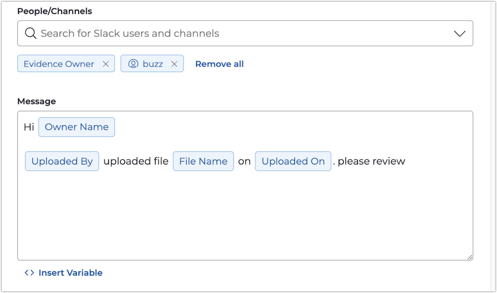

# Create Workflow for Evidence

Source: https://help.drata.com/en/articles/12876880-create-workflow-for-evidence
Collection: Enhancing your workflow › Custom Workflows
Updated: 2026-02-10
Fetched: 2026-11-22
Description: Learn how to build evidence workflows in Drata to manage renewals and notify stakeholders.

## Article text

> **API Developer Resource 💡**
> For API documentation and resources to extend workflow automation, visit the **[Drata Developer page](https://developers.drata.com/)**.

## Overview of Evidence Workflows

If you selected Evidence as the object type, you can create a workflow that runs when specific Evidence events occur.

If you would like to learn more about workflows, refer to our [Workflows article](automate-actions-with-drata-s-workflows.md).

## Prerequisites

Before creating a workflow, ensure that:

- You have the **Admin** or **Workspace Manager** role.
- You can access **Settings > Workflows**.

You may also need to:

- Identify the Slack channel or Teams group you want to notify.
- Prepare any webhook URLs needed to send data from Drata to external applications.

Each evidence workflow is made up of a trigger and the actions you want Drata to take when that trigger occurs. After choosing the evidence you want to monitor, you’ll define what event should activate the workflow and what should happen next. Use the instructions below to configure your workflow.

### Step 1: Select the Evidence

Start by choosing which evidence to monitor.

- All manual evidence: This will include all current and future evidence where the source is file, url, and ticket
- Source of evidence: This will include all current and future evidence of the chosen source type(s)
- Framework evidence: This will include all current and future evidence that are linked to the chosen framework(s)
- Select evidence: Specific evidence to target

### Step 2: Choose a Trigger

Choose the event that will trigger this workflow. You can trigger the workflow when one of the following changes occurs:

- Upcoming renewal
   - Enter number of days before renewal when you wish the workflow to trigger
- Renewal past due
- New artifact uploaded
- Evidence linked to a control
- Evidence unlinked from a control

### Step 3: Add Steps

Each step defines what should happen when the workflow is triggered. You can add multiple steps. Each step runs at the same time when the workflow is triggered. All steps in a workflow run in parallel. If one step fails to run, the others still run. Drata automatically retries failed steps up to three times.

### Step Type: Send notification

Send real-time alerts to stakeholders through:

1. Email (always available)
2. Slack message (shown if Slack is connected)
3. Microsoft Teams message (shown if Microsoft Teams is connected)

You can:

1. Select user type, recipients or channel names (such as security-alerts, [compliance-team@examplecompany.com](mailto:compliance-team@examplecompany.com)).
2. Compose a subject line and message, embedding variables such as:
   - `{{evidence_name}}`
   - `{{evidence_owner}}`
   - `{{evidence_renewal_date}}`
   - You can select Insert Variable for more options.
3. Note: Each email/message will contain a link to route to the Evidence.

**Example evidence notification:**

The following image shows a Slack notification that is automatically sent to the evidence owner and buzz whenever a new artifact is uploaded to the evidence.



### Step Type: Send webhook

Use the Send Webhook step to transmit structured data from Drata to external systems through a specified endpoint. This enables real-time integration with tools like Zapier, Torq, or ServiceNow.

### How it works

When triggered, Drata sends a POST request to the specified endpoint. You can include:

- Authentication (as custom headers)
- Custom headers with additional context
- Evidence and trigger properties in the request body

## Webhook Implementation Notes

**Property Structure**

- Each webhook payload contains:
   - [Base properties (common to all triggers)](#h_e23cafc2b6)
   - [Selected Evidence-specific properties](#h_b283dccb54) (based on scope type: control, risk, evidence, or personnel)
   - [Selected Trigger-specific properties](#h_02d5acc598) (unique to the specific trigger that fired)

**Data Format**

- Object arrays (like owners, categories, etc.) are sent as structured JSON
- Dates are sent as strings in ISO format
- Boolean values are sent as true/false

**Custom Fields**

Custom fields vary by organization and are configured through Drata's admin interface. They follow the format:

```
[{"key": "field_name","value": "field_value"}]
```

## Available webhook properties

### Base Properties (Included in ALL Webhook Events)

- event_type — The specific trigger event name
- timestamp — When the event occurred
- organization_id — ID of the organization
- workspace — Workspace context object

### Base Evidence Properties

- evidence_name
- evidence_description
- evidence_owner_name
- evidence_renewal_date
- evidence_status
- evidence_source
- evidence_linked_controls
- evidence_linked_workspaces
- evidence_custom_fields

### Trigger-Specific Properties

NEW_ARTIFACT_UPLOADED

- new_artifact_uploaded_by
- new_artifact_uploaded_file_name
- new_artifact_uploaded_on
- new_artifact_uploaded_workspace_id
- new_artifact_uploaded_workspace_name

---

LINKED_TO_CONTROL / UNLINKED_FROM_CONTROL

- evidence_linked_control_by / evidence_unlinked_control_by
- evidence_linked_control_code
- evidence_linked_control_name
- evidence_linked_control_on
- evidence_linked_control_workspace_id
- evidence_linked_control_workspace_name

---

RENEWAL_PAST_DUE

- evidence_renewal_date

---

UPCOMING_RENEWAL

- evidence_upcoming_renewal

## Additional Resources

- [Automate Actions with Drata's Workflows](automate-actions-with-drata-s-workflows.md)
- [View and Manage Workflows](view-and-manage-workflows.md)
- [Create Workflow for Control](create-workflow-for-control.md)
- [Create Workflow for Personnel](create-workflow-for-personnel.md)
- [Create Workflow for Risk](create-workflow-for-risk.md)
- [Drata Developer page](https://developers.drata.com/)

## Images

- [image 01] ../../images/ux/workflows/create-workflow-for-evidence--01.png

## Related articles

- [View and Manage Workflows](view-and-manage-workflows.md)
- [Create Workflow for Control](create-workflow-for-control.md)
- [Create Workflow for Personnel](create-workflow-for-personnel.md)
- [Create Workflow for Risk](create-workflow-for-risk.md)
