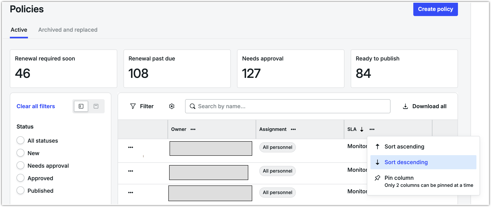

# Creating an SLA for Employee Onboarding Completion

Source: https://help.drata.com/en/articles/13553190-creating-an-sla-for-employee-onboarding-completion
Collection: Understand the Drata Platform › Policies
Updated: 2026-11-14
Fetched: 2026-11-22
Description: Use this article to understand and configure the onboarding grace period that determines when compliance tests begin evaluating new personnel.

## Article text

A **service level agreement (SLA)** defines the amount of time employees or contractors have to complete required onboarding steps before related compliance tests may begin to fail.

Drata uses SLAs to provide a grace period so new personnel can complete required tasks without immediately impacting your compliance results.

During the SLA window:

- Personnel are monitored in Drata
- Tasks and reminders appear
- Compliance tests remain in a passing state

Once the SLA period ends, incomplete requirements may begin affecting compliance tests and control readiness.

## Why this matters

Onboarding tasks are rarely completed on the first day. SLAs help you:

- Avoid immediate compliance failures for new hires
- Give personnel reasonable time to complete required actions
- Align onboarding timelines with audit expectations

Auditors generally expect onboarding requirements to be completed within a defined timeframe.

---

## Policies that include SLA monitoring

Some Drata policy templates include SLA monitoring by default, such as:

- **Information Security Policy**
- **System Access Control Policy**
- **Vulnerability Management Policy**

These policies help ensure key onboarding, access, and vulnerability management requirements are completed within expected timeframes.

## Configure an SLA

> **💡 SLA (grace period) for policy acknowledgements**
>
> The grace period you configure in the **Information Security Policy** for policy acceptance applies to all policy acknowledgements.
>
> When you set a grace period in this policy, it becomes the single control point for acknowledgements. The same grace period is automatically applied to any published policies that are distributed to personnel.

1. Navigate to **Governance → Policies**.
2. Ensure you are on the Active tab on the Policies page.
3. Search and open the **Information Security Policy** policy.
4. In the **Overview** tab, select **Edit** in the **Details** section.
5. Scroll to the **Service level agreements** section.
6. Enter the timeframe allowed for personnel to complete required steps.
7. Select **Save**.

The updated SLA applies going forward.

### To view other policies with SLA:

1. Navigate to **Governance → Policies**.
2. Open a policy that shows **Monitored by Drata** in the **SLA** column.
   - Policies that show "None" in that column do not have an SLA that Drata is monitoring.
   - You can sort the SLA column if desired.
      

## What happens after you update this setting

After you update and save an SLA in Drata, a few things happen behind the scenes:

1. **New grace window is applied**
   - For onboarding (Information Security Policy), the updated SLA sets the grace period starting from each employee's HRIS start date. During this time, onboarding-related compliance tests will not fail. Once the grace period ends, incomplete onboarding tasks may begin impacting compliance results.
   - For offboarding (System Access Control Policy), access removal for terminated employees is evaluated against the updated SLA timeframe (for example, 24 hours instead of 3 days).
2. **Vulnerability due dates are recalculated**
   - For policies tied to vulnerability management, Drata updates remediation timelines automatically.
   - On the **Vulnerabilities** page, Drata recalculates the **SLA Due Date** for open findings and reflects the updated deadlines in the table.
   - Notification timing also adjusts based on the warning period you've configured.
3. **Monitoring tests start using the new thresholds**
   - Compliance tests tied to onboarding, offboarding, or vulnerability SLAs will begin using the updated timeframe during the next monitoring cycle.
4. **Policy cannot be archived**
   - Policies with an active SLA display **Monitored by Drata** in the SLA column. Because these policies are tied to ongoing compliance monitoring, they may not be eligible for archiving while SLA enforcement is active.

## Images

- [image 01] ../../images/ux/policies/creating-an-sla-for-employee-onboarding-completion--01.png

## Related articles

- [Create a policy](create-a-policy.md)
- [Archive and restore policies](archive-and-restore-policies.md)
- [Assigning Policies to Specific Groups](assigning-policies-to-specific-groups.md)
- [Vulnerabilities](vulnerabilities.md)
- [Managing Personnel Compliance in Drata Training Video (New Experience)](managing-personnel-compliance-in-drata-training-video-new-experience.md)
