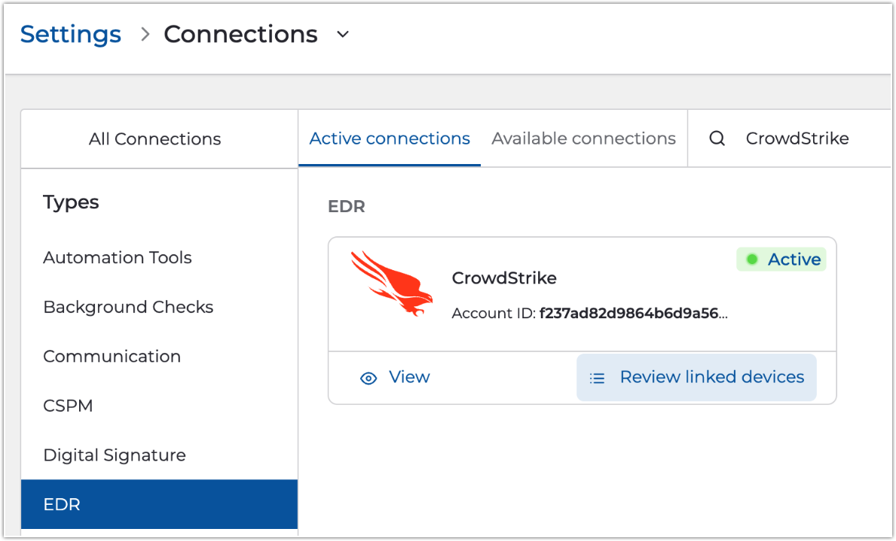
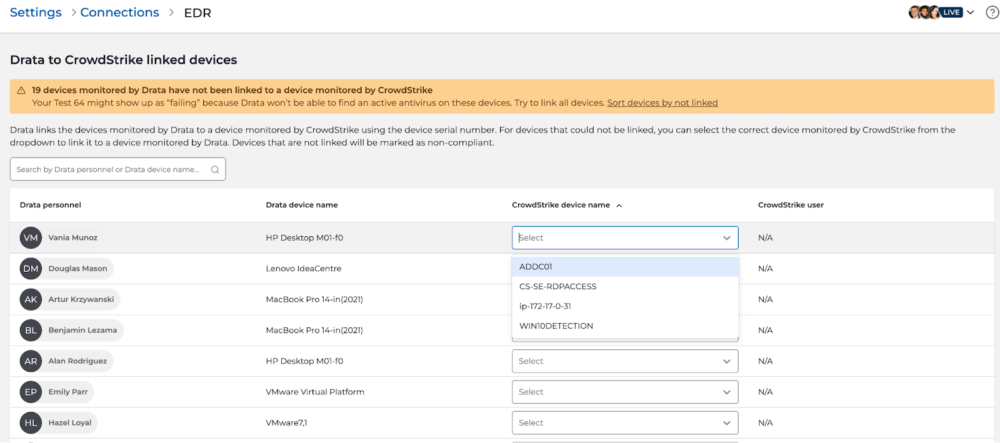
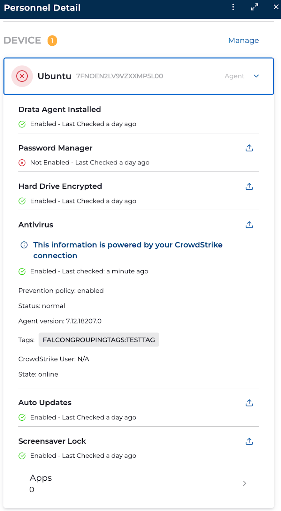
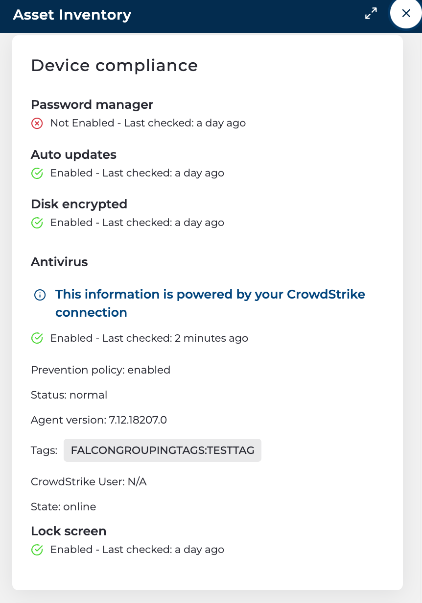

# CrowdStrike Integration Guide

Source: https://help.drata.com/en/articles/9175449-crowdstrike-integration-guide
Collection: Connection Support › Other Guidance
Updated: 2026-07-23
Fetched: 2026-11-22

## Article text

CrowdStrike is an Endpoint Detection and Response (EDR) platform that provides real-time threat detection, automated response, and forensic investigation. Connecting CrowdStrike to Drata allows you to collect antivirus and device health compliance evidence for your devices.

## Prerequisites & Data Access

- **Connect only one CrowdStrike account** per Drata workspace.
- **Install CrowdStrike Falcon** on all devices you want Drata to monitor.
- **Create a CrowdStrike API client** with the following scope:
   - Hosts permission with Read enabled.
- **Set up an MDM connection in Drata** (e.g., Jamf, Intune, Kandji) **or install the Drata Agent on devices.**
   - Provides the device serial numbers Drata needs to link with CrowdStrike.

### Permissions & Data Table

| **Permission/Scope** | **Why It’s Needed** | **Data Accessed (Read Only)** |
|---|---|---|
| `Hosts: Read` | Allows Drata to retrieve device details and agent installation status | Device hostname, serial number, policy state, prevention status |
| API Client Credentials | Authenticates Drata to access the CrowdStrike Falcon API | Secure API token for read-only access |

---

### Step 1: Create an API Client in CrowdStrike

1. Log in to your CrowdStrike Falcon admin console.
2. Go to **Support and Resources > Resources and Tools > API Clients and Keys**.
3. In the API Clients and Keys window, select **OAuth2 API Clients > Create API Client**.
4. Enter:
   - **Name:** Drata Integration
   - **Description:** (optional)
5. Enable **Read for the Hosts permission.**
6. Save and copy the generated values:
   - **Client ID**
   - **Client Secret**
   - **Base URL** (depends on your CrowdStrike cloud region, e.g. `https://api.crowdstrike.com`, `https://api.us-2.crowdstrike.com`, or `https://api.eu-1.crowdstrike.com`).

> **Note: **Do not apply any IP restrictions for this connection, as Drata does not require them. You may apply them if you are also connecting [CrowdStrike Falcon Exposure Management](crowdstrike-falcon-exposure-management-integration-guide.md#h_1e6535371e) and require them there, but do not apply the same IP restrictions to this EDR connection.

---

### Step 2: Connect CrowdStrike in Drata

1. In Drata, go to **Connections** (left navigation).
2. Select the **Available Connections** tab.
3. Search for CrowdStrike and click **Connect**.
4. Enter the values from your API client:
   - Base URL
   - Client ID
   - Client Secret
5. Select **Save Connection**.

After connecting, **Test 64: Malware Detection Software Installed on Employee Computers** is automatically enabled.

---

### Step 3: Verify the Connection

1. Go to **Connections > Active Connections**.
2. Locate your CrowdStrike connection and select **Review Linked Devices**.

Devices are matched by serial number:

- Devices with matches are linked and marked compliant.
- Devices without matches appear unlinked; you can manually link them.

---

## Test 64: Malware Detection Software Installed

This test runs automatically after connecting CrowdStrike. It verifies that the CrowdStrike Falcon agent is installed and active.

- To view results, go to the **Monitoring** page and search for *Malware Detection Software Installed on Employee Computers*.
- If the test fails:
   - Empty serial number column → device is not linked.
   - Prevention policy = false → device is unprotected.
- You can export failed devices as a CSV.
- See **Test: Malware Detection Software Installed** for remediation steps.

You can also exclude devices from this test by:

- [Excluding the associated Personnel](https://help.drata.com/en/articles/8157137-personnel-exclusion), or
- Unlinking the device.

---

## Where to View Device Data

- **Personnel Page** → Filter by Device compliance. CrowdStrike data appears under Antivirus.

- **Assets Page** → Filter by Class = Hardware. Device compliance reflects CrowdStrike antivirus data.

---

## Troubleshooting

**Manually Link a Device**

1. Go to **Connections > Active Connections > Review Linked Devices**.
2. Drata displays a table showing your devices.
3. If the **CrowdStrike device name** column is empty, the device is unlinked.
4. In that column, select the appropriate CrowdStrike device for the Drata device and save your changes.

If all devices are linked but Test 64 still considers them failing, contact Drata Support.

## Images

- [image 01] ../../images/ux/connections/crowdstrike-integration-guide--01.png
- [image 02] ../../images/ux/devices/crowdstrike-integration-guide--02.png
- [image 03] ../../images/ux/personnel/crowdstrike-integration-guide--03.png
- [image 04] ../../images/ux/assets/crowdstrike-integration-guide--04.png
- [image 05] ../../images/ux/devices/crowdstrike-integration-guide--02.png

## Related articles

- [JumpCloud Integration Guide (MDM)](jumpcloud-integration-guide-mdm.md)
- [SentinelOne (EDR) Integration Guide](sentinelone-edr-integration-guide.md)
- [CrowdStrike Falcon Exposure Management Integration Guide](crowdstrike-falcon-exposure-management-integration-guide.md)
- [Custom Device Connections](custom-device-connections.md)
- [Microsoft Intune Integration guide](microsoft-intune-integration-guide.md)
