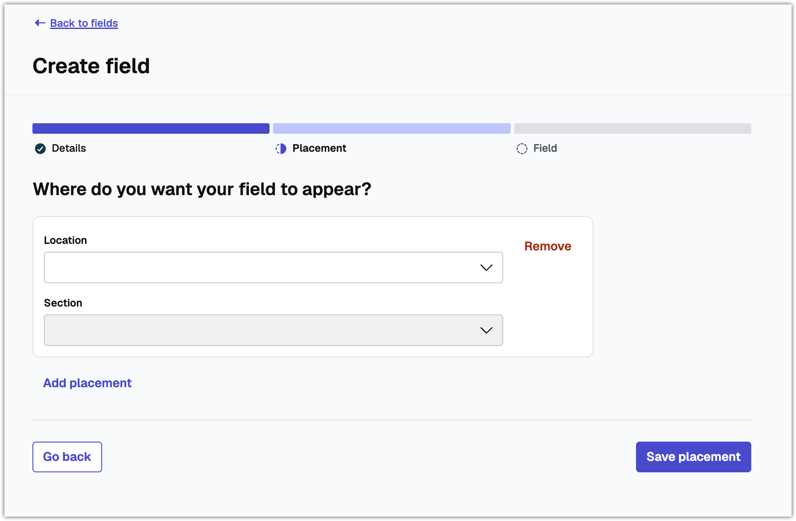
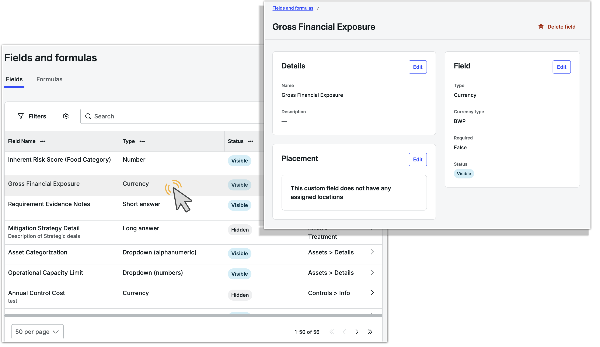

# Custom Fields Overview

Source: https://help.drata.com/en/articles/13687561-custom-fields-overview
Collection: Enhancing your workflow › Custom Fields and Formulas
Updated: 2026-11-17
Fetched: 2026-11-22
Description: By creating custom fields, you can tailor data collection to your organization's specific needs for risks, controls, vendors, and personnel.

## Article text

Follow these steps if you are using the **New Experience** UI.

The goal of custom fields is to support enterprise-scale compliance by enabling consistent data collection and reporting across your risks, controls, vendors, and personnel.

## Prerequisites

- **Role: You must have a Drata Admin role.**
- **Plan:** Available on **Advanced** and **Enterprise** plans.
- **Total field limit (500):** You can create a total of 500 custom fields. Every field you create counts toward this limit, including fields that are hidden.
- **Placement limit (50):** By default, you can assign **placements** to 50 of your custom fields.
   - **What is a placement?** A placement is a specific area in the Drata interface where the field is visible.
   - **Why create a field without a placement?** You might create a field without a placement if you only intend to use it for API integrations or backend reporting rather than manual data entry in the UI.

## Create a custom field

Go to **Settings** > **Fields and formulas**. Then, Select **Create field**.

Enter and complete the form to create the custom field.

- **Details: **Enter a unique **Name** and a **Description** to define the field's purpose.
- **Placement: **Select the **Location** (the page) and the **Section** (the specific area on that page) where the field should appear.
   

| **Location** | **Available Section(s)** |
|---|---|
| Assets | Details |
| Controls | Info |
| Framework requirements | Overview  Note: You can select the frameworks. |
| Personnel | Personnel Details |
| Policies | Details |
| Risks | Details, Assessment, Treatment |
| Vendors | Vendor Details, Internal details |

- **Field: **Choose how the data should be entered.
   - **Type:**
      - **Currency**: Select the desired currency type. The input must be less than `999,999,999,999,999.99`, and can be a negative amount.
      - **Dropdown**: Create at least 2 options and have a maximum of 100 dropdown options.
      - **Number**: The input must be fewer than 1,000,000,000 and can be negative numbers.
      - **Short answer**: The input must be fewer than 191 characters.
      - **Long answer**: The input text must not exceed 30,000 characters.
         - **URL**: The input text must be a valid URL format.
      - **Date**: Ability to add a date.
   - **Make this required field**: Check the box to make the custom field a requirement. Uncheck the box to make the custom field optional.
      - For previous risks, if the custom field is required, when you edit the risks, you are required to enter the information for the required field.
   - **Hide this field**: Check the box to hide the custom field or uncheck the box to display the field. Hiding a field does not remove your data. The data from the field is restored when re-displaying the field.

Select **Save**. After saving, the **field type** and **currency code** cannot be changed. This ensures your historical data remains consistent and accurate.

## Edit, delete, or download the data from your custom fields

**Where to find it:** Go to **Settings** > **Fields and formulas** and select a field from the list.

**Edit the field:**

You can edit the details, placement, or field options by selecting the edit button on each.

**Delete a field:**

Select **Delete field**. This permanently removes the field and all stored data across your account. This action cannot be undone.

**Download data:**

Navigate to the page where the field is placed (such as the **All risks** page) and select **Download CSV**. Custom fields appear as their own columns in the spreadsheet. The Risk Register is the source for CSV exports, and Risk IDs are included as a column in the exported file. Note that exporting directly from the Risk Library is not supported.

- **Full Download:** Exports all objects in that category.
- **Filtered View:** Exports only the objects currently visible based on your active filters and selections.

## Images

- [image 01] ../../images/ux/workflows/custom-fields-overview--01.png
- [image 02] ../../images/ux/workflows/custom-fields-overview--02.png

## Related articles

- [Manual Import (CSV) Identity Provider Integration Guide](manual-import-csv-identity-provider-integration-guide.md)
- [Custom fields and formulas to represent the FAIR model](custom-fields-and-formulas-to-represent-the-fair-model.md)
- [Personnel Overview](personnel-overview.md)
- [Managing Personnel Compliance in Drata Training Video (New Experience)](managing-personnel-compliance-in-drata-training-video-new-experience.md)
