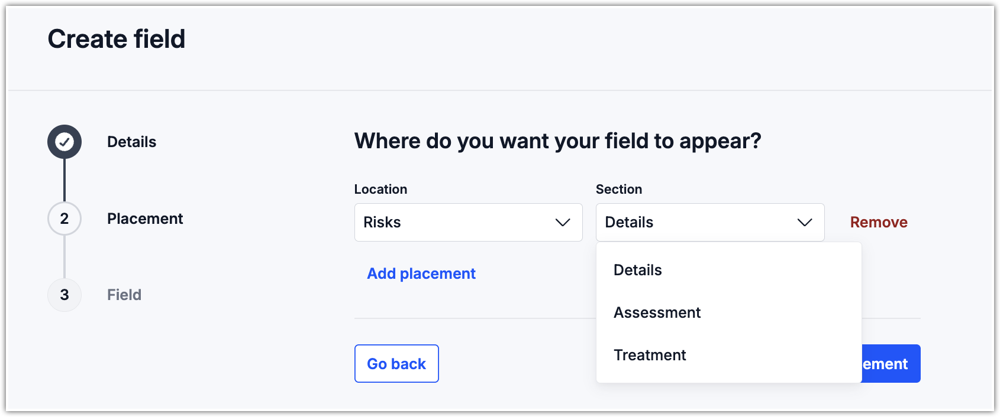

# Custom Formulas for Risks

Source: https://help.drata.com/en/articles/13372425-custom-formulas-for-risks
Collection: Understand the Drata Platform › Risk
Updated: 2026-11-09
Fetched: 2026-11-22

## Article text

### Overview

There are multiple ways to measure and evaluate risk. Drata provides a flexible and configurable approach to risk measurement, allowing you to tailor calculations to match your organization's workflows.

You can use custom formulas to calculate values such as risk appetite, risk modifiers, or financial impact. Drata also supports **Advanced Formulas**, which allow you to use one custom formula inside another.

## Prerequisites

- **Plan availability:** Drata Enterprise
- **Permissions:** Admin, Information Security Lead, or Workspace Manager
   - Risk Managers must also be assigned one of the roles listed above
- **Field limitations:** Only numeric and currency-based fields can be used
- **Formula limits:** Up to 50 custom formulas per account

The following field types can be used in the expression builder within Risk Management:

- Number
- Currency
- Dropdown (number)

## Common Use Cases

The following examples demonstrate how custom formulas can be used to support common risk assessment workflows. These examples are illustrative and can be adapted to meet your organization's needs.

### Financial Impact

Use a custom formula to estimate the potential financial impact of a risk event.

- Create a custom field representing **Risk Probability**, or use Drata's **Inherent Likelihood** field.
- Create a custom field representing **Financial Loss** using a Currency field.
- Create a custom formula using these fields.

**Note:** Divide the risk probability value by 100 if it is entered as a percentage.

The calculated result appears in the Risk drawer and updates dynamically as values change.

### Risk Appetite

You can calculate an individual financial risk appetite for each risk using a custom formula. While risk appetite is often aggregated across risks, this approach allows for per-risk evaluation using the same method as the financial impact example.

### Operational Risk Tolerance

To calculate operational risk tolerance (for example, related to business continuity or temporary system outages):

- Create numeric or currency-based fields representing operational impact.
- Use a custom formula to calculate tolerance based on downtime, cost, or likelihood.

## Create a Custom Formula

1. Navigate to **Settings** > **Configuration > Fields and formulas** page.
2. Select **Formulas tab**.
3. Select **Create formula**.
4. In the **Details** step, enter a name for the formula, then select **Next**.
5. Choose the section the formula should appear.
6. Build the expression using operators, custom fields, and risk fields.

The expression builder provides real-time validation and allows:

- Up to 35 terms per expression
- Manual entry of numeric values and operators

**Note:** Only valid expressions can be saved.

Once saved, the formula result displays in the Risk drawer and updates in real time as inputs change.

### More complex formulas

Advanced Formulas is when you use an existing custom formula inside another formula. Important considerations:

- If a custom formula is used within another formula, it cannot be deleted until it is removed from all dependent formulas.
- Formula chaining is not supported.
- If a formula already references another formula, it cannot be used inside a third formula.

## View a Custom Formula in a Risk

To view a custom formula and its calculated result:

- Select a risk to open the specific details.
- Locate the section (Details, Assessment, Treatment) where the formula was placed during setup.
    (links to https://downloads.intercomcdn.com/i/o/am69aeco/1935247717/2714ff0670d42a00799e00ce1dc0/image.png?expires=1780056000&signature=61f6ea7ae5f34b929d4b1b09f8400f63b379065a3de20f706c7798c8d3b94422&req=dSkkE8t6moZeXvMW3nq%2BgdsoBMLZ0typrl1u0R5uYoahXqQc47QyS8wsEi4i%0A7IKzFBWarL04zp4KW3HmhN6kfLc%3D%0A)

The result updates in real time. You can also:

- View the formula beneath the field name
- Hover over individual terms to see the values used in the calculation

## Risk scoring

Many organizations use scoring methods other than a standard 5 x 5 Impact vs. Likelihood model. Drata lets you configure your scoring scale and thresholds so they better match how your organization assesses and treats risk.

**Important Notes:** If you've modified your risk scoring, you may need to complete some sections manually such as the heatmap and definitions.

Reducing the Impact or Likelihood scale resets scores only for risks that fall outside the new range. Risks that still fit within the new scale keep their scores.

If any inherent or residual Impact or Likelihood value is higher than the new maximum, the risk is reset. Raising the scale again does not restore cleared scores, so you'll need to reassess the affected risks.

For example, if you change a 5 x 5 scale to a 3 x 3 scale, only risks scored above 3 for Impact or Likelihood are reset. Risks that still fall within the new range keep their scores.

It may take a few minutes for your risk register to update with the new scoring methodology.

### Update scoring

Go to Risk Management, then open Risk Settings and select Scoring. On the Scoring page, you can:

- Adjust the Impact and Likelihood values to build your scale. You can set each value between 3 and 10.
- Define the Impact and Likelihood levels with numerical values and labels.
- Set your thresholds, such as Low, Medium, High, and Critical. Threshold ranges automatically readjust based on your Impact and Likelihood selections. You can add up to five thresholds and must keep at least two.

Select Save settings to apply your changes.

### Confirmation when you reduce the scale

If you reduce the Impact or Likelihood values and you already have scored risks, Drata asks you to confirm before applying the change. Only risks that fall outside the new range are reset. Risks within the new range keep their scores.

## Images

- [image 01] ../../images/ux/workflows/custom-formulas-for-risks--01.png

## Related articles

- [Risk Assessment Policy Guidance](risk-assessment-policy-guidance.md)
- [Getting started with a risk assessment (Concept Guide)](getting-started-with-a-risk-assessment-concept-guide.md)
- [Import Risk in Bulk (New Experience)](import-risk-in-bulk-new-experience.md)
- [Risk management in Drata: An overview](risk-management-in-drata-an-overview.md)
- [Assess and Manage Individual Risks](assess-and-manage-individual-risks.md)
