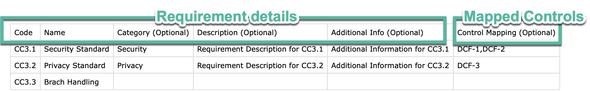
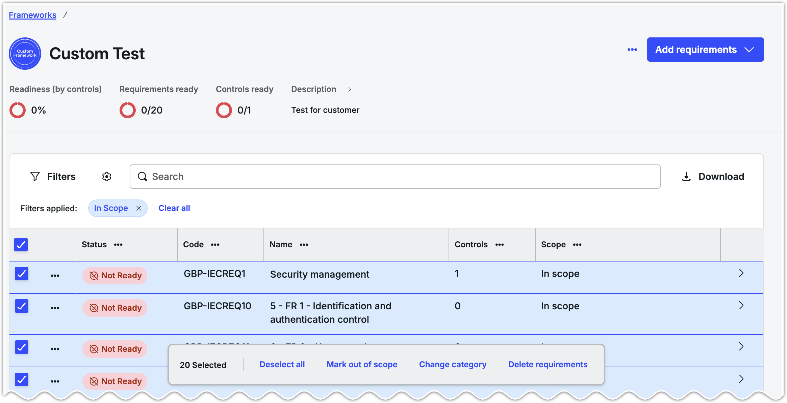

# Custom Framework

Source: https://help.drata.com/en/articles/6346623-custom-framework
Collection: Framework Information › Custom Frameworks
Updated: 2026-11-09
Fetched: 2026-11-22
Description: This article covers creating and managing Custom Frameworks.

## Article text

Custom Frameworks allow you to generate your own framework and associated requirements. Once created, custom frameworks support the same functionality as regular frameworks.

Drata provides tools to manage and customize frameworks according to organizational compliance needs, enabling alignment with various standards, including standards like HITRUST CSF that are not natively integrated.

## Step 1: Create a Custom Framework

1. In Drata, go to the **Frameworks** page.
2. In the upper-right corner, select **Create new custom framework**.
3. Enter your framework details:
   - **Name:** This name appears on the Frameworks page.
   - **Short name:** This short name is used for filters on the Controls page.
   - **Description:** This description appears at the top of the specific framework overview page.
4. (Optional) Upload your requirements. You can also add them later.
   - Download and review the provided template.
   - Replace the template data with your own requirements.
   - Ensure that your template data follows the requirements and control mapping guidelines.

## Step 2: Upload Requirements and Map Controls

**Note:** Control mappings are optional.

Use the template provided during the custom framework creation flow. When uploading requirements or mapping controls, you must:

- Use the exact column headers from the template. The spelling, spacing, and capitalization must match exactly.
- The following special characters aren't allowed anywhere in the CSV file: `< > \`
- **Code** and **Name** columns are required.
- The **Code** must be unique — both within the file and compared to any existing requirements in Drata. Rows with duplicate codes will be skipped.
- **Category** (Optional): Only one category is allowed per requirement.
- **Control Mapping** (Optional):
   - To map controls during import, add a comma-separated list of control codes (for example, DCF-1, DCF-2, DCF-3) in the Control Mapping column.
   - All control codes you want to map must meet all of the following criteria before importing:
      - The control exists in Drata.
      - The control is enabled. (If you can't find a control, contact Drata Support.)
      - The control is in scope.
   - If a control that you would like to map does not meet all these criteria, the entire requirement row will be skipped. That requirement won't be created, and no controls in that row will be mapped.

## Step 3: Confirm

1. Save and upload the CSV file.
2. Select **Next**.
3. Confirm the upload:
   - Review the number of requirements that will be imported.
   - Review any skipped requirements and fix formatting issues as needed.
4. Select **Save**.

Your custom framework is now ready. You can begin mapping additional controls or adding more requirements.

---

## Add Requirements

To add a requirement to your custom framework:

1. Go to your custom framework page.
2. Select the **Add Requirements** button.
3. In the dropdown, select **Add requirement** or **Add/update in bulk**.
4. If you select **Add/update in bulk**, download and review the provided template.
   - Then update and upload the template with your own requirements.
   - Your template data must follow the Requirements and control mapping guidelines above.
5. Confirm the upload:
   - Review how many requirements will be imported.
   - Review any skipped requirements and address formatting issues as needed.
6. Select **Save**.

**Note:** Re-uploading will only add requirements that do not already exist in Drata. Any updates to existing requirements should be done within Drata.

---

## Edit a Requirement

To edit a requirement in your custom framework:

1. Go to your custom framework.
2. Select the requirement you want to edit.
3. Select the edit button and update the requirement details as needed.
4. Select **Save**.

---

## Update, Delete, or Mark Multiple Requirements Out of Scope

To perform a bulk action on multiple requirements:

1. Go to your custom framework.
2. Select the checkboxes next to the requirements you want to update.
3. Select **Change category**, **Delete**, or **Mark out of scope**.
   - For **Change category**: Each requirement can only have one category. This action updates the category for all selected requirements.
4. Select **Save**.

---

## Mark, Delete, or Change Category for an Individual Requirement

To perform an action on a single requirement:

1. Go to your custom framework.
2. Select the ellipsis (...) next to the requirement.
3. Select **Mark out of scope**, **Delete**, or **Change category**.
4. If marking out of scope, enter a business rationale and select **Submit**.

---

## Edit Framework Details

To update the details of a custom framework:

1. Go to your custom framework.
2. In the upper-right corner, select the gear icon.
3. Select **Edit details**.
4. Update the framework details as needed.
5. Select **Save**.

---

## Delete a custom framework

> ⚠️ **Warning:** Deleting a custom framework is permanent. Drata does not restore a deleted custom framework or its associated audit history, auditor comments, or mapped requirements. Make sure you export or document any information you need before proceeding.
>
> Before deleting a custom framework, we recommend:
>
> - Exporting your requirements and any mapped controls
> - Saving any auditor comments or evidence associated with the framework
> - Confirming with your team that the framework is no longer needed

1. Go to your custom framework.
2. Select the **gear icon** in the upper-right corner of the list.
3. Select **Edit details**.
4. In the framework details pane, select the **More options** icon (**⋮**).
5. Select **Delete framework**.
6. Confirm the deletion.

Removing a framework can affect your overall compliance readiness. Retain a record of progress or requirements before proceeding, as re-enabling the framework later will typically require starting over.

**Troubleshooting tip:**
If you're unable to delete the framework, verify your existing dependencies. A framework can't be deleted if it's linked to:

- Auditors
- Mapped controls
- Requirements

---

## Utilize a Custom Framework

Explore the [Frameworks section](frameworks.md) for more information

For example, users can create Custom Frameworks to align with the HITRUST CSF and manage the compliance process effectively in Drata, even though HITRUST audits themselves are conducted in the MyCSF platform.

---

## Using Custom Frameworks for SOC 2

⚠️ **Important:** If you are pursuing SOC 2, we strongly recommend using Drata's native SOC 2 framework instead of building a custom one.

Drata's native SOC 2 framework offers several advantages over a custom framework:

- **It cannot be deleted**, protecting your audit history and progress
- **It is pre-mapped** to SOC 2 criteria, reducing manual setup time
- **It receives ongoing updates** from Drata as SOC 2 requirements evolve

To get started, go to the **Frameworks** page and select the SOC 2 framework.

Custom frameworks are best suited for compliance standards that Drata does not natively support, or for organizations that need a highly tailored control structure outside of a standard framework.

## Images

- [image 01] ../../images/documentation/custom-framework--01.png
- [image 02] ../../images/ux/frameworks/custom-framework--02.png

## Related articles

- [Frameworks](frameworks.md)
- [Framework Requirements](framework-requirements.md)
- [CMMC Framework Updates](cmmc-framework-updates.md)
- [The Drata Control Framework & Requirement Relationship](the-drata-control-framework-requirement-relationship.md)
- [Introduction to the Drata Control Framework (DCF)](introduction-to-the-drata-control-framework-dcf.md)
