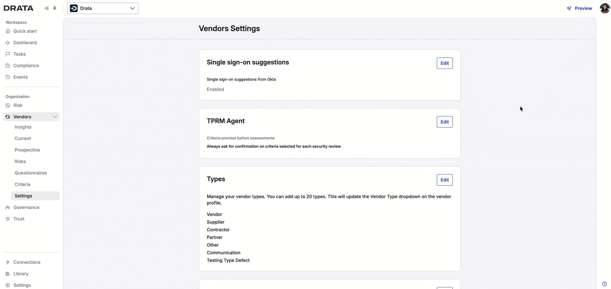
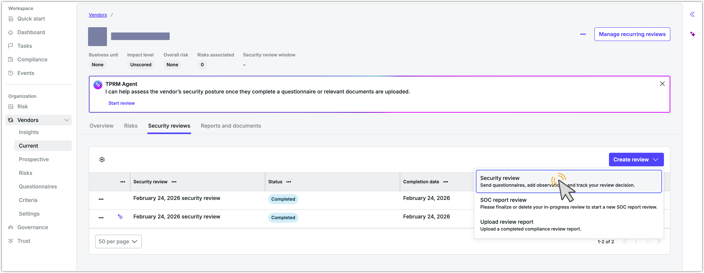
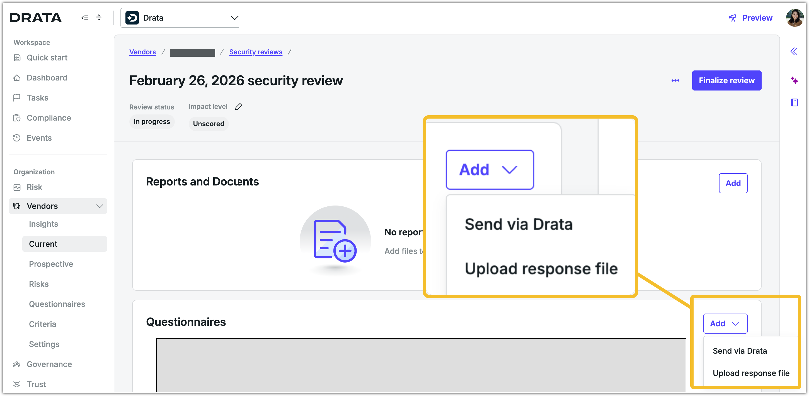
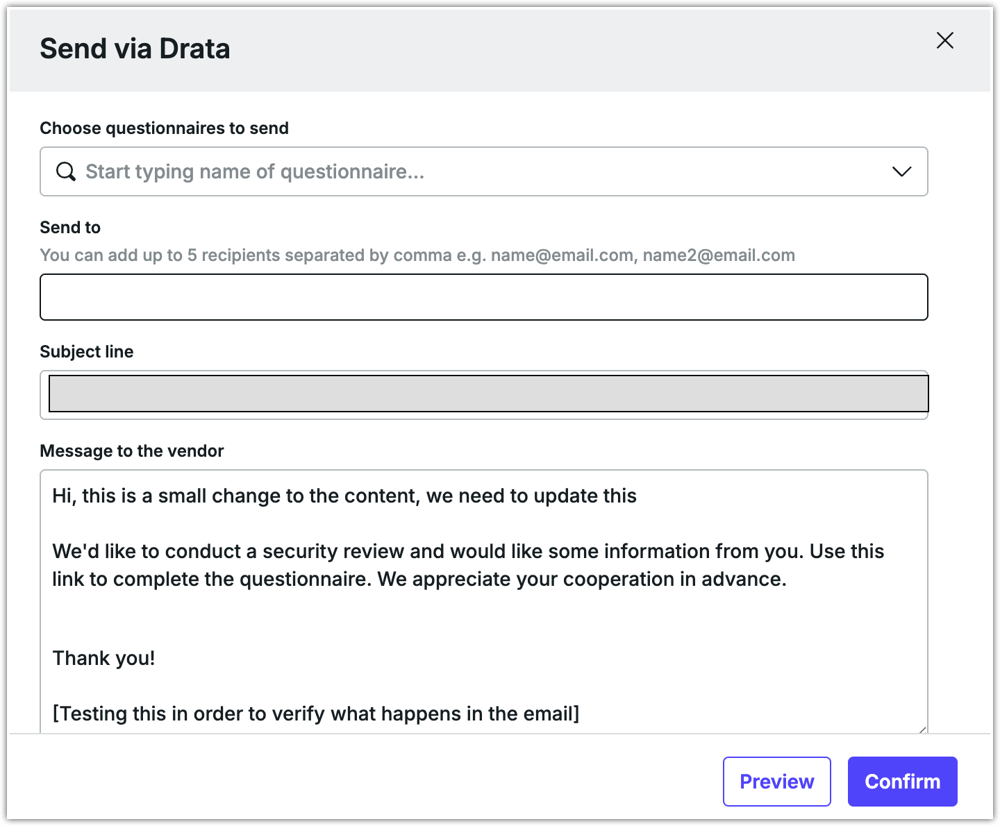

# Customize the vendor questionnaire email subject line (New Experience)

Source: https://help.drata.com/en/articles/13880127-customize-the-vendor-questionnaire-email-subject-line-new-experience
Collection: Understand the Drata Platform › Vendors
Updated: 2026-02-27
Fetched: 2026-11-22
Description: Only in the New experience, you can customize the subject line used for vendor questionnaire emails.

## Article text

You can customize the subject line used for vendor questionnaire emails. This helps reduce the likelihood that emails are flagged as spam or ignored and allows you to align messaging with your organization’s branding and communication standards.

You can:

- Set a default subject line for vendor questionnaires.
- Edit the subject line when sending a one-time questionnaire.

This customization applies to both external vendors and internal stakeholders.

## Prerequisites

- Only available in the New Experience.

### Update the default subject line

1. Go to **Vendors > Settings**.
2. Scroll down to **Email and questionnaire appearance **section.
3. Select **Edit**.
4. Enter your preferred default subject line.
5. Save your changes.

The updated subject line will apply to:

- All future recurring questionnaire emails.
- The prefilled subject line when sending new one-time questionnaires.

## Edit the subject line for a one-time questionnaire

When sending a one-time questionnaire, you can edit the subject line before sending the email.

To customize the subject line:

1. Select the desired vendor.
2. Go to the **Security reviews** tab and start a new one-time questionnaire.
   
3. Select the option to send the questionnaire through Drata.
   
4. Before sending, you can preview or update the email message.
   
5. Send the questionnaire.

The subject line defaults to the value set in Vendor Settings, but you can modify it for that specific send.

## Images

- [image 01] ../../images/ux/vendors/customize-the-vendor-questionnaire-email-subject-line-new-experience--01.gif
- [image 02] ../../images/ux/vendors/customize-the-vendor-questionnaire-email-subject-line-new-experience--02.png
- [image 03] ../../images/ux/vendors/customize-the-vendor-questionnaire-email-subject-line-new-experience--03.png
- [image 04] ../../images/ux/vendors/customize-the-vendor-questionnaire-email-subject-line-new-experience--04.png

## Related articles

- [Add a prospective vendor](add-a-prospective-vendor.md)
- [Create and Manage Vendor Questionnaires](create-and-manage-vendor-questionnaires.md)
- [Customize vendor types (New Experience)](customize-vendor-types-new-experience.md)
- [Training Videos: Review and Custom Vendor Criteria (New Experience)](training-videos-review-and-custom-vendor-criteria-new-experience.md)
- [Bulk actions for Current Vendors (New Experience)](bulk-actions-for-current-vendors-new-experience.md)
