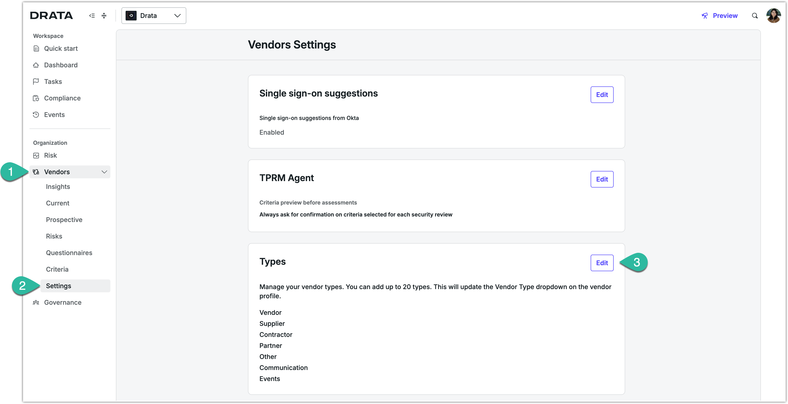
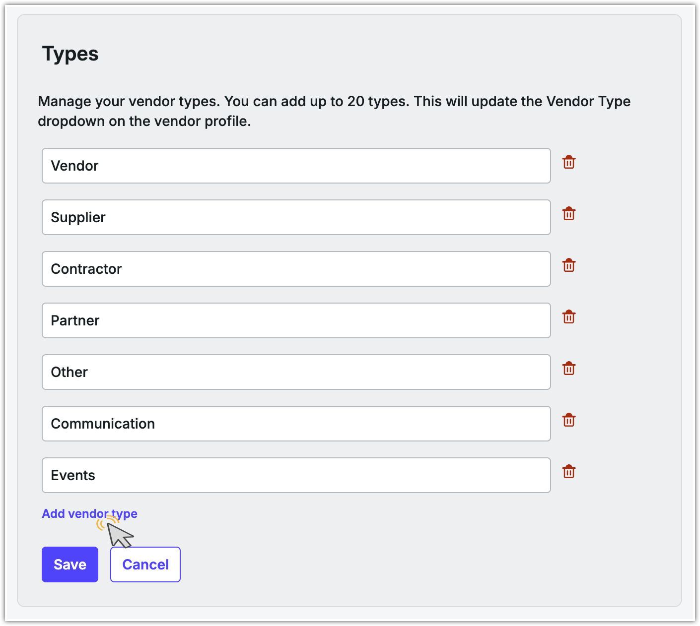
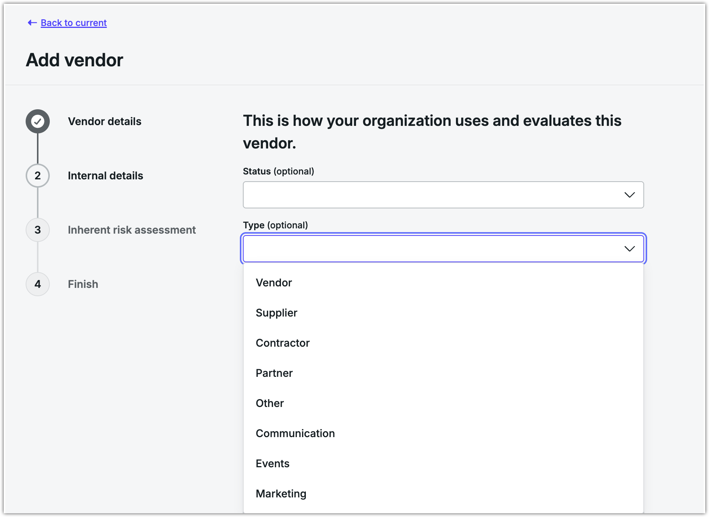

# Customize vendor types (New Experience)

Source: https://help.drata.com/en/articles/14647131-customize-vendor-types-new-experience
Collection: Understand the Drata Platform › Vendors
Updated: 2026-11-14
Fetched: 2026-11-22
Description: Learn how to customize vendor types in Drata

## Article text

You can customize **vendor types** to match how your organization classifies vendors (for example, *SaaS*, *Infrastructure*, *Processor*, *Professional Services*). This helps you keep vendor records consistent, support internal reporting, and align Drata with existing procurement or risk categories.

---

## What are vendor types?

Vendor types are labels used to describe *what kind of vendor* you’re working with.

For example:

- Cloud infrastructure provider
- HR SaaS
- Law firm
- Marketing / analytics tool

Vendor types help you:

- Quickly understand the services a vendor provides.
- Group vendors for reviews and reporting.
- Align Drata with existing internal taxonomies (for example, categories used by procurement or TPRM teams).

Custom vendor types replace or extend Drata’s default list, so you are not locked into a static set of options.

---

## Where vendor types are used

Once configured, custom vendor types appear anywhere vendor type is referenced in the vendor experience, including:

- **Current vendors**
- **Prospective vendors**
- The **Add vendor** form
- **Bulk vendor import** via CSV (template download, validation, and import)

This keeps vendor classification consistent whether you add vendors one at a time or in bulk.

---

## Manage vendor types

1. Sign in to Drata.
2. Switch to the **New Drata experience** if prompted.
3. Go to **Vendors**.
4. Open **Vendor settings.**
5. Navigate to the **Types** section.

You’ll see all existing vendor types, including any default and custom entries.

### Add a new vendor type

1. From the **Vendor Settings** page, go to the **Types section**, select **Edit**, and then select **Add vendor type**.
   
2. Enter the **Name** of the type (for example, *Cloud infrastructure*, *HR SaaS*, *Legal services*) and then save.

After saving, the new type is available to use. It will display as an option in the Vendor type field when adding or editing a vendor and in the vendor_type column of the bulk import template (using the type's name).

### Change the name of an existing vendor type

You can update a vendor type name or description if your taxonomy changes.

1. From the **Vendor Settings** page, go to the **Types section**, select **Edit**.
2. You can directly change the name of the vendor type.
3. Select **Save**.

After saving, your new type is available in two ways:

- **Individual Updates:** As an option in the **Type** field when adding or editing a vendor.
- **Bulk Imports:** In the **vendor_type** column of your import template. (Ensure the name matches exactly so the system recognizes it).

**Note:** All associated vendors will be updated to reflect the new name automatically.

### Delete a vendor type

Delete a vendor type that is no longer needed.

1. From the Vendor Settings page, go to the Types section and select Edit.
2. Select the trash icon next to the type you wish to remove.
   - ⚠️ Important callouts:
      - **Automatic Re-assignment:** Deleting a vendor type will automatically re-assign any associated vendors to **"None."**
      - **Warning Modal:** If the type is currently linked to any vendors, a warning will appear showing exactly how many vendors will be affected.

**What Happens After Deletion?**

- **Dropdowns:** The deleted vendor type will no longer appear as an option when adding or editing vendors.
- **Vendor Records:** Any vendors previously assigned to this type will have their category cleared (set to **"None"**).

---

## Use custom vendor types for individual vendors

You can assign vendor types when you create or edit a vendor.

### Assign a vendor type to a current or prospective vendor

1. Go to **Vendors > Current or Prospective page.**
2. Select a vendor from the list or select **Add vendor**.
3. Within the **Internal detail section**, for the **type** field, choose a value from your list
   
4. Complete the remaining vendor details.
5. Select **Save**.

---

## Best practices

To make vendor types useful across security, procurement, and legal teams:

- **Keep the list focused** Avoid dozens of near-duplicate types. Use a smaller set that meaningfully groups vendors.
- **Align with internal processes** Mirror categories your organization already uses in procurement, intake forms, or risk assessments.
- **Standardize naming** Use clear, descriptive names and short descriptions so different teams interpret each type consistently.
- **Review periodically** As your vendor landscape evolves, review vendor types and deactivate or rename entries that are no longer needed.

## Images

- [image 01] ../../images/ux/vendors/customize-vendor-types-new-experience--01.png
- [image 02] ../../images/ux/vendors/customize-vendor-types-new-experience--02.png
- [image 03] ../../images/ux/vendors/customize-vendor-types-new-experience--03.png

## Related articles

- [Training Videos: Review and Custom Vendor Criteria (New Experience)](training-videos-review-and-custom-vendor-criteria-new-experience.md)
- [Add a vendor or prospective vendor](add-a-vendor-or-prospective-vendor.md)
- [TPRM Agent: Create a Criteria](tprm-agent-create-a-criteria.md)
- [Training Videos: Add Prospective and Existing Vendors to Drata (New Experience)](training-videos-add-prospective-and-existing-vendors-to-drata-new-experience.md)
- [Customize vendor risk levels](customize-vendor-risk-levels.md)
