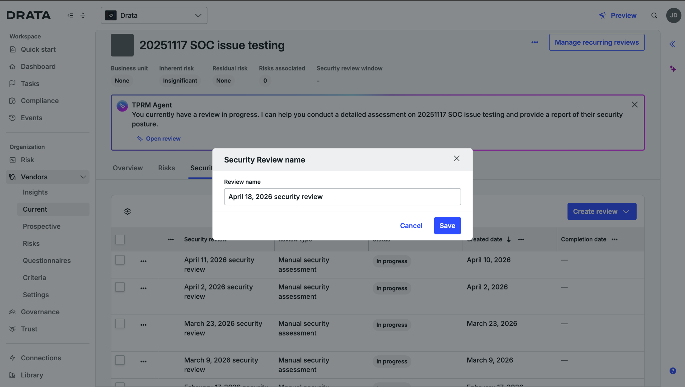
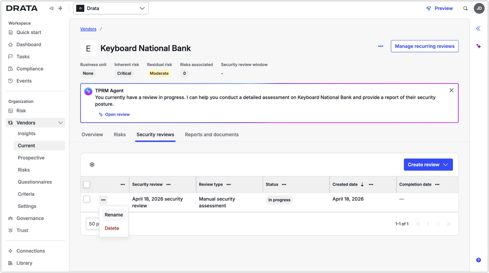
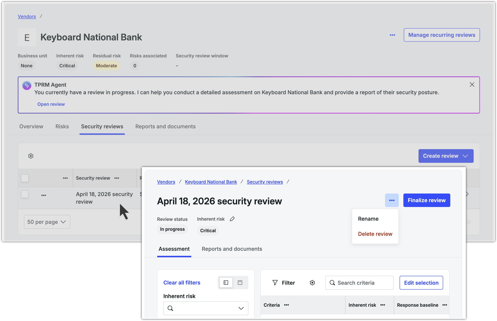
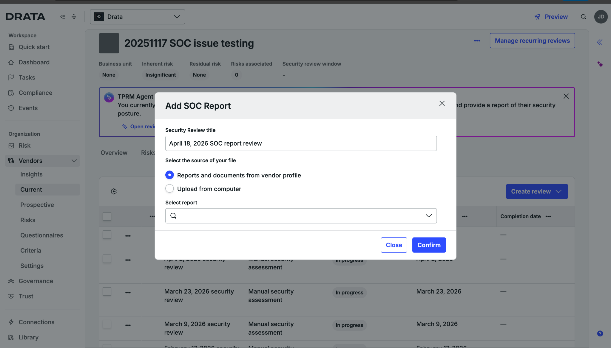
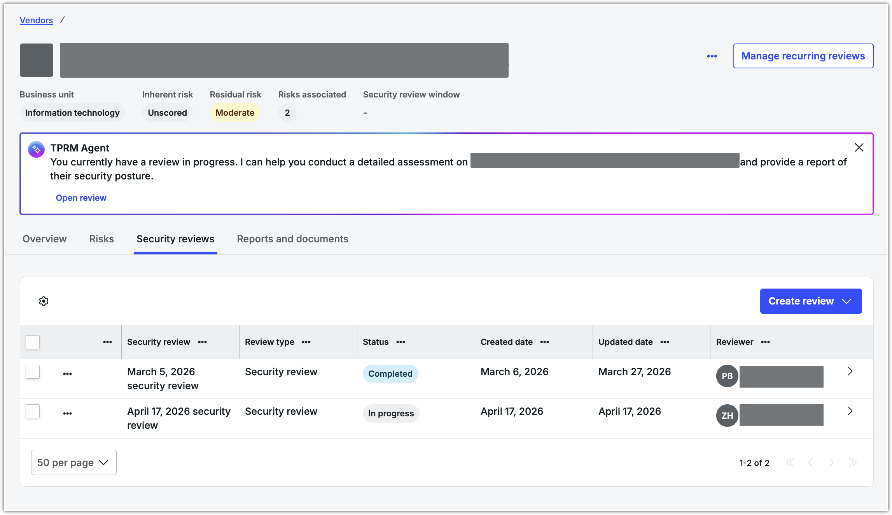

# Customizing Security Review Titles

Source: https://help.drata.com/en/articles/14811526-customizing-security-review-titles
Collection: Understand the Drata Platform › Vendors
Updated: 2026-04-28
Fetched: 2026-11-22
Description: You can now customize the titles of Security, SOC, and Uploaded reviews in Drata.

## Article text

You can now personalize the titles of **Security**, **SOC**, and **Uploaded** reviews. This replaces generic system names with project-specific titles, making your Vendor Management dashboard easier to navigate and your reporting more precise.

## Overview

You can edit the title for the following review types:

- **Security Review**
- **SOC Report Review**
- **Upload review report**

When you rename a review:

- The new title appears on the **security review page**.
- The new title is also reflected wherever that review appears in your **vendor lists** (for example, in the vendor’s Security Reviews section).

---

## Name a newly created security review

When creating a new security review, you can enter a new name or accept the default security review name provided. Default names are a combination of the date and review name.

**From the vendor profile**

1. Navigate to the **Vendor profile** to create a security review.
2. All review types will provide you with a means to rename or accept the default name
   - For **security review**, you will be prompted to rename or accept the default name before proceeding to the security review page
   - For **SOC reviews**, you can rename or accept default name above the SOC upload review area
   - For **Uploaded review, **you can rename or accept default name above the upload review area

---

## Rename an existing security review

Use the page-level overflow menu to rename a review from its detail page.

1. Navigate to the current or prospective vendor page and select the **vendor** that owns the security review.
2. Select the **Security Review** tab you want to rename.
3. In the **Security Reviews** table, locate the review you want to rename.
4. In that row, click the **overflow menu (⋯)**. Select **Rename.**
   
5. In the dialog, enter the new **Review name**.
6. Click **Save**.

You can also click on a specific review to view more details and update its name. After **selecting** the specific review, click the **More (⋯)** menu next to the title at

the top of the page to rename it.

**After saving the name change:**

- The updated name appears immediately wherever the review title is shown, including the review page header and the Security Reviews table.
- The updated name is reflected on the **vendor list** and anywhere else the review title is displayed.

---

## Validation rules for titles

When you rename a security review, Drata applies validation to keep titles clean and usable in the UI.

- **Maximum length:** Titles can be up to **191 characters**.
- **Special characters:** Titles are validated for unsupported or unsafe special characters.
- **Error handling:** If the title is too long or contains invalid characters:
   - An **error message** appears under the field.
   - The title is **not saved** until the issue is fixed.

If you see an error:

1. Shorten the title so it’s clearly under 191 characters.
2. Remove or replace any unusual symbols.
3. Try saving again.

---

## Behavior for SOC report reviews

By default, Drata automatically generates a security review title based on the review type and related context (for example, SOC report type and date).

- SOC reports will continue to have a default title until customized
- Once you **rename** the review, Drata will **not overwrite your custom title**
- You can always return to the review detail page and use the **overflow menu** to update the name again.

---

## Update to security review table

The security review table on the Vendor profile will now include additional columns to display type and review creation date.

- **Review type**: Security review, SOC review, Uploaded review
- **Created date**: Date the review was created
- **Updated date**: Last date that the review was updated

## Images

- [image 01] ../../images/ux/vendors/customizing-security-review-titles--01.png
- [image 02] ../../images/ux/vendors/customizing-security-review-titles--02.png
- [image 03] ../../images/ux/vendors/customizing-security-review-titles--03.png
- [image 04] ../../images/ux/vendors/customizing-security-review-titles--04.png
- [image 05] ../../images/ux/vendors/customizing-security-review-titles--05.png

## Related articles

- [Test 39: Security Policies are Reviewed](test-39-security-policies-are-reviewed.md)
- [SOC 2 Checklist](soc-2-checklist.md)
- [Start and manage security reviews for your vendors](start-and-manage-security-reviews-for-your-vendors.md)
- [Conducting a Security Review (Legacy)](conducting-a-security-review-legacy.md)
- [Conducting a Security Review](conducting-a-security-review.md)
