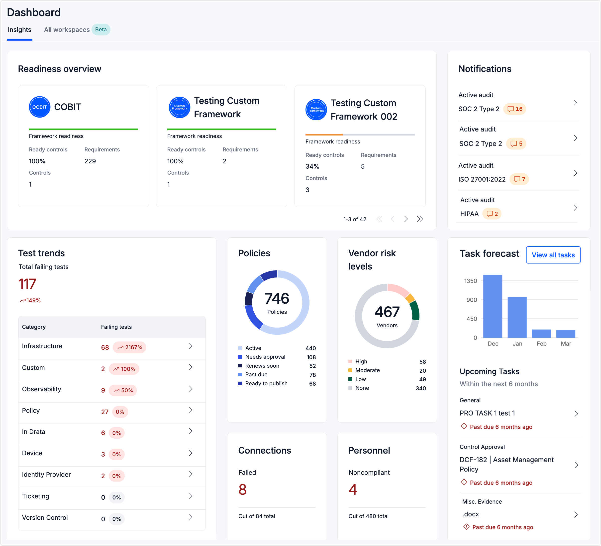
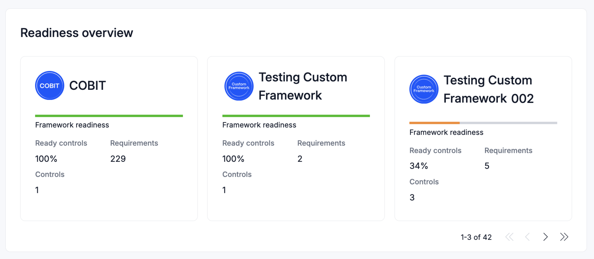
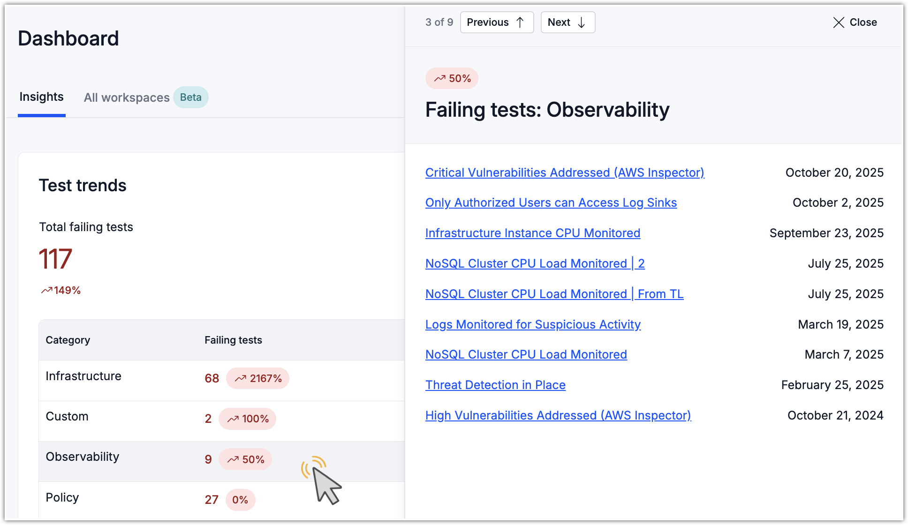
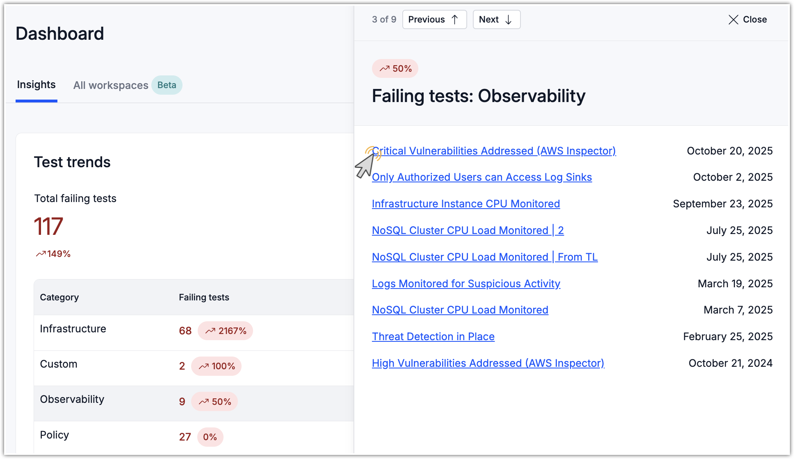

# Dashboard overview

Source: https://help.drata.com/en/articles/13259515-dashboard-overview
Collection: Understand the Drata Platform › Dashboard
Updated: 2026-11-14
Fetched: 2026-11-22
Description: Get an overview of the Drata Dashboard, including compliance readiness, alerts, test trends, tasks, and key risk indicators.

## Article text

The Dashboard provides a high-level view of your organization’s compliance posture. It brings together readiness, alerts, trends, and tasks so you can quickly identify where attention is needed.

To learn more about the All workspaces tab, refer to this [Workspace Dashboard](navigate-the-workspaces-dashboard-beta.md) article.

## Prerequisite

- Required Drata Roles: Admins, Information Security Leads, Workspace Managers, and DevOps Engineer.
   - Ensure that your role does not have read-only permissions enabled.
- Each Dashboard is specific to the workspace you have selected.

## Readiness overview

View progress toward compliance for each framework. From the Readiness overview section, you can:

- View the percentage of controls that are ready for each framework
- View remaining controls
- Track progress using a visual progress bar

Frameworks with **0% readiness** do not appear on the Dashboard. Once progress is made, the framework card is displayed.

Select a framework card to be redirected to the **Controls page**, with the following filters applied:

- **In scope** controls
- The selected framework

On the **Controls **page, you can view which controls are not ready, address gaps, and improve your compliance readiness for that framework.

**▸ ℹ️ What does “in-scope controls” mean? **

> **In-scope controls** are the controls your organization has designated as applicable to a specific compliance framework and that Drata actively tracks for readiness, evidence, and audit progress.
>
> A control is **in scope** when it:
>
> - Is marked **In Scope** in Drata
> - Is mapped to a specific compliance framework
> - Is actively tracked for readiness, evidence, and/or monitoring
> - Contributes to readiness percentages
>
> Controls that are **out of scope**:
>
> - Do not affect readiness calculations
> - Are not required for audit purposes
> - Are intentionally excluded based on your organization’s scoping decisions

## Notifications

Review high-priority items that require attention to gain or maintain compliance.

Notifications may include:

- Auditor messages
- Trust Center alerts
- Other time-sensitive compliance items

Select a notification to navigate directly to the related area.

## Test trends

The Test trends widget shows the **number of failing tests** and **how that number has changed over the last seven days**.

The percentage reflects the relative increase or decrease compared to the previous period. Large percentage changes can occur when the number of failing tests was previously low.

From this widget, you can:

- Select a category to view failing tests in that area, ordered by most recent failure
   
- Select a test to open its detail page on the Monitoring page.
   

## Policies status

The **Policies** widget summarizes the current state of all policies in your organization and highlights where action may be needed. It displays:

- The **total number of policies**
- How policies are distributed across key lifecycle stages

**What each status means:**

- **Active: **Policies that are currently in effect for compliance and do not require immediate action.
- **Needs approval: **Policies that have been created or updated but are awaiting approval.
- **Ready to publish: **Policies that have completed review and are ready to be published.
- **Renews soon: **Policies approaching their renewal date and requiring review.
- **Past due: **Policies that have exceeded their renewal date and require immediate attention.

Select the widget to be redirected to the Policies page.

## Vendor risks

Assess your current vendor risk posture. The **Vendor Risks** widget displays a donut chart representing current vendor risk distribution.

**What each status means:**

- **High: **Vendors with risk indicators that may require immediate review or remediation.
- **Moderate: **Vendors with identified risk that should be monitored or reviewed.
- **Low: **Vendors with minimal identified risk based on current assessments.
- **None: **Vendors with no identified risk indicators based on available data and configuration.

Select the widget to be redirected to the Vendors page.

## Connections

Monitor the health of your integrations. The **Connections** widget highlights misconfigurations that may affect monitoring or compliance.

Select the widget to be redirected to the Connections page.

## Personnel

Track user compliance status across your organization. The **Personnel** widget shows:

- The number of users who are currently non-compliant
- The total number of users in the workspace

Select the widget to be redirected to the **Personnel** page and review individual user compliance details.

## Tasks

Stay on top of compliance tasks and deadlines. The Dashboard includes:

- **Task Forecast: **Shows trends for completed and incomplete tasks month over month.
- **Task List: **Shows upcoming and overdue items such as policy renewals, evidence renewals, and vendor reminders.

Select a task to open the relevant item and take action.

## Notes and troubleshooting

- **Workspace-specific: **Dashboard data reflects only the currently selected workspace.
- **Missing frameworks: **Frameworks appear on the Dashboard only after progress is made (greater than 0% readiness).
- **Data freshness: **Widgets reflect the most recent monitoring and integration syncs.

## Images

- [image 01] ../../images/ux/home/dashboard-overview--01.png
- [image 02] ../../images/ux/home/dashboard-overview--02.png
- [image 03] ../../images/ux/home/dashboard-overview--03.png
- [image 04] ../../images/ux/home/dashboard-overview--04.png

## Related articles

- [MIM Dashboard](mim-dashboard.md)
- [Drata MCP — Setup & Usage Guide](drata-mcp-setup-usage-guide.md)
- [Section 5: Control Owners](section-5-control-owners.md)
- [Drata Platform Overview Training Video (New Experience)](drata-platform-overview-training-video-new-experience.md)
