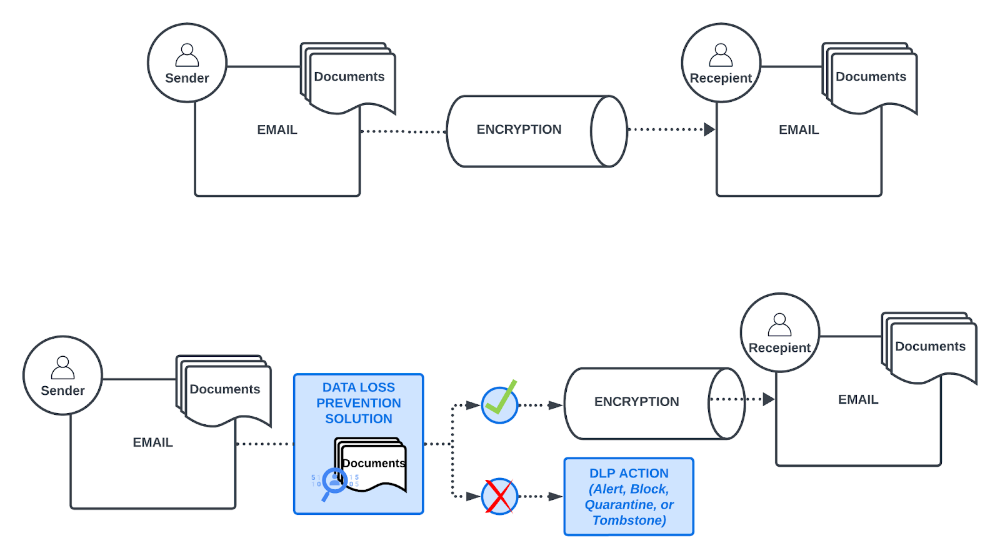

# Data Loss Prevention (DLP) Guidance

Source: https://help.drata.com/en/articles/9702726-data-loss-prevention-dlp-guidance
Collection: Policy Guidance
Updated: 2024-08-05
Fetched: 2026-11-22

## Article text

### Background:

A Data Loss Prevention (DLP) solution is a control to have when developing a holistic cybersecurity program. Having a DLP solution can help organizations protect data from unintended leakage and information disclosure.

### What is a Data Loss Prevention (DLP) Solution?

A Data Loss Prevention (DLP)solution is a technical control that provides the ability to manage how data is being handled, while also preventing data exfiltration and leakage.

DLP solutions typically work in tandem with the implementation of a Data Classification and Labeling technique to give the DLP solution a specific criteria on what to monitor, using Precise method *(e.g., registering the actual string or hash digest to be monitored)* or Imprecise method *(e.g., registering keywords, regex, metadata tags, labels, etc. to be monitored)*. Commonly monitored data are Personally Identifiable Information (PII), Protected Health Information (PHI), and Intellectual Property (IP).

Data Loss Prevention (DLP) solutionscan be implemented as part of your cloud solution provider’s offering, a software application, or a hardware appliance. All of which can be implemented in two (2) ways:

- **Network-based **- positioned at the organization’s network edge to analyze data that is leaving the network
- **Host-based** - installed within a specific device, server, or workstation to analyze data leaving the particular asset

### Why do I need a DLP on my email if encryption is already in place?

Most email providers do offer TLS encryption by default. It is important to note that having encryption is not synonymous to having an actual Data Loss Prevention (DLP) solution.

Encryption protects emails and attachments while it is moving across the internet, but it does not prevent anyone from sending documents to unauthorized persons. That said, the DLP solution will help exactly with that by making sure that email attachments are only being sent if it contains files that are authorized to be shared. To visualize this, here are a few illustrations:

1. Data Loss Prevention (DLP) solution **IS NOT IN PLACE**

Here, we can see that although the encryption protects the files being sent during transmission, the file itself did not get checked if it is even allowed to be sent

1. Data Loss Prevention (DLP) solution **IS IN PLACE**

Here, we can see that the DLP analyzes the files if it is allowed to be sent. If DLP finds that it is allowed, the files will be sent while using the standard encryption to protect it during transmission. Otherwise, the DLP will trigger the appropriate action (alert, block, quarantine, or tombstone)

### What do I need to show the Auditor?

We recommend showing a screenshot of your configured Data Loss Prevention (DLP) solution. In addition, we also recommend adding a screenshot showing the DLP solution in action (e.g., showing an email being blocked if it contains data matching the defined DLP rules)

### Is Data Loss Prevention (DLP) Solution mandatory for any framework?

Although we recommend having a Data Loss Prevention (DLP)solution from a security perspective, the primary requirement for most frameworks only mentions having a way to prevent unauthorized and unintended data leakage. With that said, frameworks do not explicitly require a DLP solution to be implemented.

### What alternative or compensation controls can we consider if we do not plan to implement a Data Loss Prevention (DLP) Solution?

There are other compensating controls you can utilize to be able to demonstrate your ability to prevent data leakage. To do this, you will need well-established logging and monitoring procedures where you collect logs (such as those listed below), have someone review them regularly (i.e. weekly), and document their reviews.

- **System Logs:** Regularly review system logs on servers, network devices, and endpoints to track user activities, access attempts, and any unusual behavior. Look for patterns that might indicate unauthorized access or data leakage.
- **File Access Logs:** Enable and review file access logs to monitor who is accessing sensitive files and when. These logs can help you identify unusual or unauthorized access patterns.
- **User Activity Tracking:** Implement user activity tracking on critical systems. This can include recording user actions such as file transfers, printing, copying, and emailing sensitive data.
- **Network Traffic Monitoring: **Set up network traffic monitoring tools to capture and analyze data flowing in and out of your network. This can help identify any unauthorized data transfers or suspicious activities.
- **Email Logging:** Configure email servers to log email activities, including sender, recipient, subject, and attachments. Regularly review these logs to detect any unauthorized sharing of sensitive data via email.
- **Endpoint Monitoring: **Deploy endpoint monitoring agents to track user activities on individual devices. This can include monitoring application usage, file transfers, and external device connections.
- **Data Loss Detection Rules: **Define specific rules for detecting potential data loss or exfiltration. For example, create rules to trigger alerts when large volumes of data are being copied to external storage devices.
- **Alerts and Notifications:** Set up alerts to notify administrators in real-time when predefined events occur, such as unauthorized access attempts or suspicious data transfers.
- **Authentication Logs: **Monitor authentication logs to track successful and unsuccessful login attempts. Detecting multiple failed login attempts can help identify potential unauthorized access attempts.
- **Database Auditing:** Enable auditing features in databases to track changes to sensitive data. This includes recording modifications, inserts, and deletions of critical records.
- **Cloud Services Monitoring:** If you use cloud services, enable logging and monitoring features provided by the cloud provider. Monitor access, data transfers, and configurations within your cloud environment.

## Images

- [image 01] ../../images/documentation/data-loss-prevention-dlp-guidance--01.png
- [image 02] ../../images/documentation/data-loss-prevention-dlp-guidance--01.png

## Related articles

- [Acceptable Use Policy Guidance](acceptable-use-policy-guidance.md)
- [Asset Management Policy Guidance](asset-management-policy-guidance.md)
- [Data Classification Policy Guidance](data-classification-policy-guidance.md)
- [Data Protection Policy Guidance](data-protection-policy-guidance.md)
- [System and Information Integrity Policy Guidance](system-and-information-integrity-policy-guidance.md)
