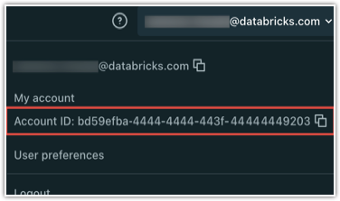

# Databricks Integration Guide (UAR)

Source: https://help.drata.com/en/articles/9971603-databricks-integration-guide-uar
Collection: Connection Support › Other Guidance
Updated: 2025-12-14
Fetched: 2026-11-22

## Article text

Integrating Databricks with Drata automates your user access reviews, saving time and reducing errors by syncing user data directly from Databricks.

## Key Capabilities

- **Access retrieval**: Retrieves users and assigned roles from connected systems.
- **Review enablement**: Makes this access data available for review in Drata’s Access Reviews feature.
- **Account mapping support**: Allows external accounts to be mapped to Drata personnel for accurate review and tracking.

## Prerequisites & Data Access

- **Databricks Account Admin** privileges
- Ability to create an **OAuth App Connection** in Databricks
- Must be assigned one of the following Drata roles: **Admin, Workspace Managers, DevOps Engineer**.
- If you have the **Access Reviewer** Drata role, you can only view the Connections page.

### Permissions & Data Table

| Permission / Scope | Why It’s Needed | Data Accessed (Read Only) |
|---|---|---|
| Databricks Account ID | Identifies the Databricks account | Account-level IAM data |
| OAuth Client ID & Client Secret | Authenticate the connection | Users and groups |

### Step-by-Step Setup

### Step 1: Log in to the Databricks account console

Log in based on your cloud provider:

- AWS: [https://accounts.cloud.databricks.com](https://accounts.cloud.databricks.com)
- Azure: [https://accounts.azuredatabricks.net](https://accounts.azuredatabricks.net)

### Step 2: Copy your Databricks Account ID

1. Select your username in the top-right corner.
2. Copy the **Account ID** displayed in the dropdown.
   

**Expected outcome:**
You have copied your Databricks Account ID.

### Step 3: Create an OAuth App Connection

1. In the Databricks account console, go to **Settings → App Connections**.
2. Select **Add connection**.
3. Enter:
   - **Application Name:** (e.g., Drata)
   - **Redirect URL:**
      `https://api.stackone.com/connect/oauth2/databricks_iam/callback`
   - **Access scopes:** All APIs
   - **Client secret:** Generate
   - **Access token TTL:** 30 minutes (minimum)
   - **Refresh token TTL:** 129,600 minutes (recommended)
4. Select **Add**.
5. Copy and store securely:
   - **Client ID**
   - **Client Secret**

**Expected outcome:**
A new OAuth app connection is created.

### Step 4: Connect Databricks in Drata

1. In Drata, go to **Connections → Available Connections**.
2. Select **Databricks**.
3. Enter:
   - Cloud Provider (AWS or Azure)
   - Account ID
   - Client ID
   - Client Secret
4. Select **Connect**.
5. If prompted, authorize the connection in Databricks.

**Expected outcome:**
Drata successfully connects to Databricks.

## Images

- [image 01] ../../images/integrations/databricks/databricks-integration-guide-uar--01.png

## Related articles

- [Domo Integration Guide](domo-integration-guide.md)
- [Egnyte Integration Guide (UAR)](egnyte-integration-guide-uar.md)
- [RingCentral Integration Guide](ringcentral-integration-guide.md)
- [Smartsheet Integration Guide](smartsheet-integration-guide.md)
- [Box Integration Guide](box-integration-guide.md)
