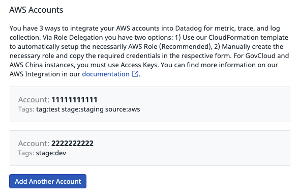
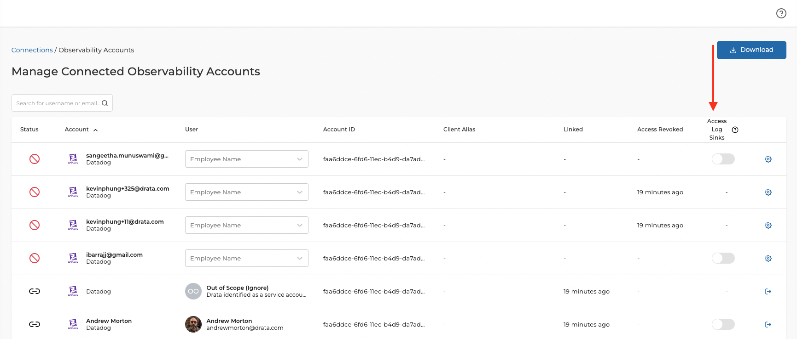
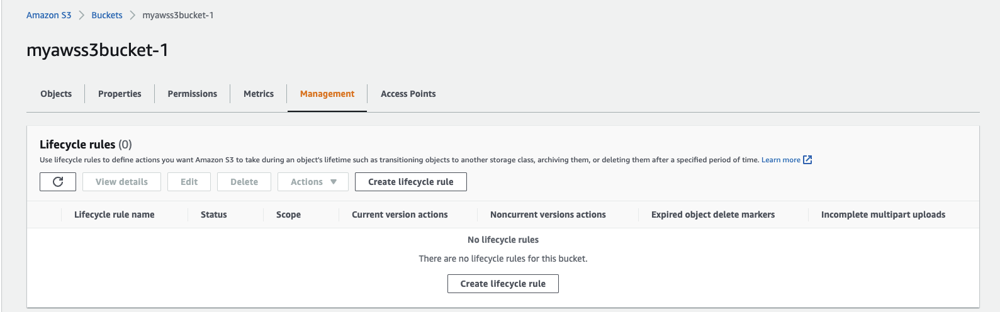
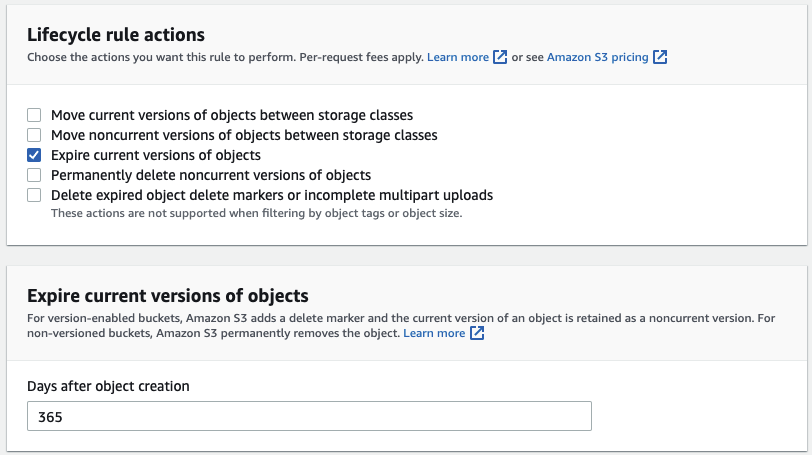
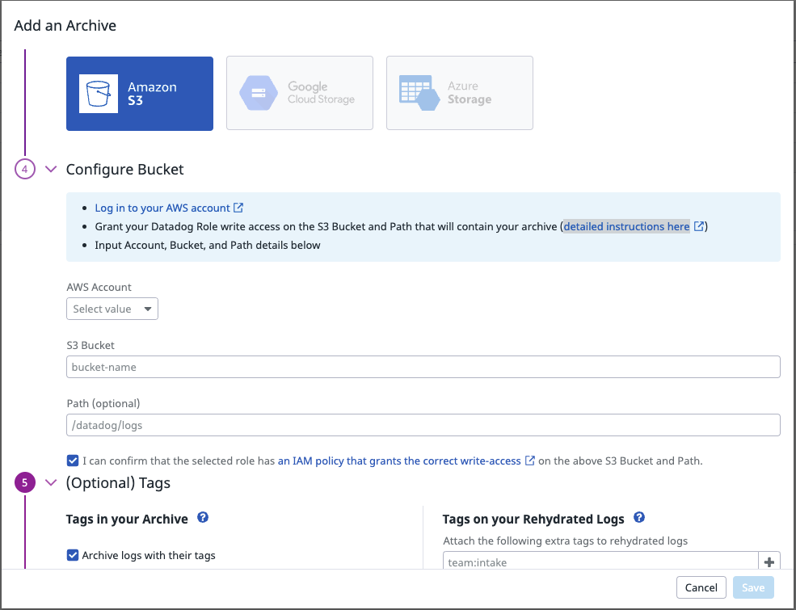
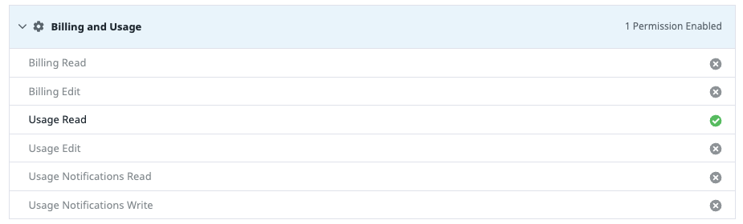

# Datadog Integration Guide

Source: https://help.drata.com/en/articles/6414118-datadog-integration-guide
Collection: Connection Support › Other Guidance
Updated: 2026-11-14
Fetched: 2026-11-22
Description: This article describes how to set up a Datadog Connection for the first time within Drata.

## Article text

The **Datadog integration** enables Engineering, DevOps, and Security teams to automate observability monitoring tests by connecting Drata to Datadog. It allows Drata to validate and collect evidence for infrastructure, logging, and monitoring controls across your environment.

## Key Capabilities

- **Observability test automation:** Enables Drata to automatically validate monitoring coverage across infrastructure, database, and log sources.
- **Log and metric monitoring:** Supports AWS-connected Datadog environments for metric-based monitoring and centralized logging.
- **Compliance evidence collection:** Gathers observability data to demonstrate adherence to security monitoring and log retention policies.

## Prerequisites & Data Access

- Must have **Admin**, **Information Security Lead**, **DevOps Engineer**, or **Workspace Manager** roles in Drata.
- Must have **administrator permissions** in Datadog to create API keys, roles, and service accounts.
- Must have **AWS integrated with Datadog** (per Datadog documentation).
- Must have an **AWS connection established in Drata**.

### Permissions & Data Table

| **Permission/Scope** | **Why It’s Needed** | **Data Accessed (Read Only)** |
|---|---|---|
| `API Key` | Allows Drata to authenticate with Datadog’s API for log and metric access. | Environment and observability data |
| `Application Key` | Provides scoped access via the service account for monitoring and logging APIs. | Monitor configurations, logs, and usage metrics |
| `Security Notification Rules Read` | Verifies that Datadog security notifications are active. | Notification rule configuration |
| `Usage Read` | Confirms active monitoring and infrastructure usage for capacity tests. | Usage metrics across hosts |
| `Logs Read Archives` | Checks log archive configurations for retention requirements. | Log archive destinations and metadata |
| `Logs Configuration Read` | Verifies log pipeline configurations. | Log processing and pipeline details |

## Monitoring Test Requirements

There are three simultaneous requirements to ensure the monitoring tests that depend on the Datadog integration work correctly:

1. You must integrate AWS with Datadog. This process will happen outside of Drata. If you have not set this up in your Datadog account, you can follow [Datadog's AWS guide](https://docs.datadoghq.com/getting_started/integrations/aws/).
2. You must make an AWS connection in Drata. Please follow [this AWS connection help article](aws-integration-guide-infrastructure-user-access-review.md) for details.
3. Follow the below instructions in this help article to connect Datadog to Drata.

Six of the 10 Drata Observability monitoring tests require all three of those integrations to be in place:

1. Test 111 - Logs are Retained for 365 Days
2. Test 112 - Database CPU Monitored
3. Test 113 - Database Free Storage Space Monitored
4. Test 114 - Database Read I/O Monitored
5. Test 115 - Messaging Queue Message Age Monitored
6. Test 118 - Infrastructure Instance CPU Monitored

The following Observability monitoring tests are supported by the Datadog connection, but do not require an AWS connection:

1. Test 109 - Logs are Centrally Stored
2. Test 110 - Only Authorized Users can Access Log Sinks
3. Test 121 - Logs Monitored for Suspicious Activity
4. Test 129 - Capacity and Usage Monitoring

Separately, Test 117 - NoSQL Cluster Storage Utilization Monitored is not supported by the Datadog connection. It is only supported by the AWS and GCP connections.

## Step-by-Step Setup

First, log into your company's Datadog with **administrator permissions **(you will need these permissions to set up a service account).

### Step 1: Create an API Key in Datadog

1. Log into [Datadog](https://app.datadoghq.com/organization-settings/api-keys) with **administrator permissions**.
2. Click **+ New Key**.
3. Enter the name **Drata API Key** and click **Create Key**.
4. Click **Copy Key**. This value will not be shown again. You will enter this value during the connection process.

### Step 2: Create a Datadog Role

1. Navigate to [Datadog Roles](https://app.datadoghq.com/organization-settings/roles).
2. Click **+ New Role**.
3. Enter the name **Drata Monitoring Role**.
4. Assign the following permissions:
   - **Security Notification Rules Read**: Enables verification of enabled security notifications.
   - **Usage Read**: Required for Capacity and Usage Monitoring tests.
   - **Logs Read Archives**: Required for verifying log archive destinations.
   - **Logs Configuration Read**: For checking log pipeline configuration.

There are 8 permissions granted to all roles by default. These permissions cannot be disabled. With the four additional permissions, the role should now have **12 permissions** in total.

### Tagging Limitations (Datadog–AWS Integration)

Note: Some monitors rely on **Datadog–AWS integration tags** for test identification.

Datadog’s AWS integration ([https://app.datadoghq.com/integrations/amazon-web-services](https://app.datadoghq.com/integrations/amazon-web-services)) has the ability to tag metrics with specific tags for each AWS Account as shown here:



For the various **infrastructure monitoring tests**, some monitor setups make use of integration-level tagging that requires additional permissions. If your monitor chooses tags generated as part of your Datadog <> AWS Integration, Drata may not be able to use those tags to match the monitor to its related infrastructure and fail the test.

### Step 4: Create a Service Account

1. Navigate to [Datadog Service Accounts](https://app.datadoghq.com/organization-settings/service-accounts).
2. Click **+ New Service Account**.
3. Enter **Drata Service Account** for the **Name** and **email address**.
4. Assign the previously created **Drata Monitoring Role**.
5. Click **Create Service Account**.

### Step 5: Create an Application Key

1. Open the newly created **Service Account**.
2. Click **+ New Key**.
3. Enter the name **Drata Application Key** and click **Create Key**.
4. Click **Copy Key**. This value will not be displayed again.

## Complete the Connection

In Drata’s **Connections** page, enter the following information:

| **Drata Field** | **Datadog Value** |
|---|---|
| API Key | The Datadog API Key you created |
| Application Key | The Application Key from your Service Account |

For steps on accessing and using the Connections page in Drata, refer to [The Connections Page in Drata](https://help.drata.com/en/articles/12305645-the-connections-page-in-drata).

## Expected Datadog Setup and Troubleshooting

### Observability Monitoring Tests

> **⚠️ Note: **For these tests, only customers with AWS Infrastructure and Datadog are supported.

In the current Datadog implementation, these tests will only work in Datadog if there is an accompanying AWS connection that can inform Drata of the AWS infrastructure that needs monitoring.

The first set of tests require monitors to be created within Datadog that contain the following metrics in their monitoring queries. These monitors should be visible on your [https://app.datadoghq.com/monitors/manage](https://app.datadoghq.com/monitors/manage) screen, or they will need to be created. 

On the AWS side, you need to add Amazon Web Services to your installed [Datadog Integrations](https://app.datadoghq.com/integrations), if you haven't already, to be able to use the default metrics provided for AWS. Once installed, include these metrics in the query when [creating a new monitor](https://app.datadoghq.com/monitors#create/integration). The Drata integration only cares about a monitor existing with the defined metrics listed below for each test.

If you had previously set up CloudWatch alarms to pass the Drata monitoring tests listed below, and you now want your alarms to be read from Datadog, you must delete the AWS CloudWatch alarms in order for Drata to read the Datadog settings. In addition, for the alarm-based monitoring tests to pass, you must set up active notifications against these alarms in Datadog. This is a similar concept to establishing an SNS topic and active subscription against a CloudWatch alarm in AWS.

**Warning**: The `metric name` must be explicit and match. For example - `aws.rds.cpuutilization.max` is not supported, even though the metric name is similar -- let us know if we should look at additional metrics you make use of today!

| Monitoring Test | Datadog Metric Name |
|---|---|
| Database CPU Monitored | ```<br>aws.rds.cpuutilization<br>aws.docdb.cpuutilization<br>``` |
| Database Free Storage Space Monitored | ```<br>aws.rds.free_storage_space<br>aws.rds.free_local_storage<br>aws.docdb.free_local_storage<br>``` |
| Database Read I/O Monitored | ```<br>aws.rds.read_iops<br>``` |
| Messaging Queue Message Age Monitored | ```<br>aws.sqs.approximate_age_of_oldest_message<br>``` |
| Infrastructure Instance CPU Monitored | ```<br>aws.ec2.cpuutilization.maximum<br>aws.ec2.cpuutilization<br>aws.ecs.cpuutilization<br>aws.ecs.cpuutilization.maximum<br>``` |

### Logs are Centrally Stored

This test will generate an API response from Datadog listing [all your active logging pipelines](https://app.datadoghq.com/logs/pipelines). If there is at least one, the test will pass. This test is not expected to fail very often, but is expected to give your auditor a good idea of all the data sources your company has that are piping logs into Datadog. Note that pipelines can be created in various ways, and if you are unfamiliar with them, we recommend reading through the [Datadog documentation](https://docs.datadoghq.com/logs/log_configuration/pipelines/).

Additional details about how Drata executes this test can be found [here](test-109-logs-are-centrally-stored.md).

### Only Authorized Users can Access Log Sinks

This test checks for user permissions to read logs in Datadog. For now, the tests are using the standard Datadog Roles to check, though we have plans to limit this to the specific permissions **Logs Read Index Data** and **Logs Read Data. **As of now, we more simply check the user has access to one or all of the following Roles: **Datadog Admin Role, Datadog Read Only Role, or Datadog Standard Role**.

If that is true of a user, we fail the test unless the user has been specifically marked with the "**Access Log Sinks**" toggle in the Drata console under the [Datadog Manage Accounts](https://app.drata.com/manage-accounts/observability) page. See the image below for an example. Note that out of scope accounts will not be included in this check.



Additional details about how Drata executes this test can be found [here](test-110-only-authorized-users-can-access-log-sinks.md).

### Logs are Retained for 365 Days

In its current state, this test requires an AWS S3 Bucket to exist and be configured in Datadog as an archive. Drata must have read access to this bucket's metadata under the AWS connection. The S3 bucket may have a Lifecycle Rule that expires items in the bucket after 365 days or longer, or have no lifecycle rule that prevents it from holding the data indefinitely. Note that the setting up of Lifecycle Rules below is **optional**.

**(Optional) To find and set this period in AWS:**

1. Select an AWS Bucket in the [AWS S3 Web Console](https://s3.console.aws.amazon.com/s3/buckets)
2. Select the Management Tab
3. Within the LifeCycle rules section, click the "Create lifecycle rule" button.
   
4. Set up the Lifecycle rule with whatever name, prefix, and object tags you want, but for this test Drata looks at the "Lifecycle rule actions" section.
5. Select the checkbox for "Expire current versions of objects"
6. The section "Expire current versions of objects" will appear.
7. Set the "Days after object creation" value to **365** or a greater value.
   
8. Scroll to the bottom and click the "Create Rule" button.

**To set up Datadog to Archive data to an S3 bucket:**

1. Only Datadog users with [logs_write_archive permission](https://docs.datadoghq.com/account_management/rbac/permissions/?tab=ui#logs_write_archives) can complete this and the following steps.
2. Navigate to the [Logs Archiving configuration page](https://app.datadoghq.com/logs/pipelines/archives) in the Datadog console.
3. Click the "+ New Archive" button.
4. Set your Archive Name and define which data you want archived.
5. Select Amazon S3 as the Archive Type
   
6. Select the appropriate AWS account and role combination for your S3 bucket
7. (Optional) Input a prefix directory in the Path input.
8. Click the "Save" button to create the Archive.
9. For additional info please read the [Datadog documentation on this setup](https://docs.datadoghq.com/logs/log_configuration/archives/?tab=awss3)

Additional details about how Drata executes this test can be found [here](test-111-logs-are-retained-for-365-days.md).

### Logs are Monitored for Suspicious Activity

**Warning Note**: This test depends on the Datadog Cloud Security Platform product, which is a paid Datadog feature. You can check if you have this feature enabled by navigating to [https://app.datadoghq.com/security/home](https://app.datadoghq.com/security/home) and verifying that you see the "Cloud SIEM" dashboard. If this product is not enabled, you should disable this test.

For more information, go to [Logs Are Monitored For Suspicious Activity](test-121-logs-monitored-for-suspicious-activity.md)

### Capacity and Usage Monitoring

**Reminder:** The Datadog Service Account making the connection will need to have access to the Usage Read Permission. To add this, you will need to edit either the Read Only Role or make a new Role that also has this permission, and attach it to the Drata Service Account.



Datadog should be ingesting information from at least one infrastructure source (easily done after making an integration connection from the Datadog integration page).

You should ensure at least 1 infrastructure instance is active, running, and connected to Datadog. This can be verified by viewing the [Datadog Infrastructure List](https://app.datadoghq.com/infrastructure).

The Drata test will check that within the last 24 hours, for at least a 1 hour period, Datadog detected usage from that infrastructure. This can be viewed on the Datadog [Plan & Usage page](https://app.datadoghq.com/billing/usage).

Additional details about how Drata executes this test can be found [here](test-129-capacity-and-usage-monitoring.md).

## Images

- [image 01] ../../images/integrations/datadog/datadog-integration-guide--01.png
- [image 02] ../../images/ux/connections/datadog-integration-guide--02.png
- [image 03] ../../images/integrations/datadog/datadog-integration-guide--03.png
- [image 04] ../../images/integrations/datadog/datadog-integration-guide--04.png
- [image 05] ../../images/integrations/datadog/datadog-integration-guide--05.png
- [image 06] ../../images/integrations/datadog/test-129-capacity-and-usage-monitoring--01.png

## Related articles

- [Test 129: Capacity and Usage Monitoring](test-129-capacity-and-usage-monitoring.md)
- [AWS Integration Guide (Infrastructure, User Access Review)](aws-integration-guide-infrastructure-user-access-review.md)
- [AWS CodeCommit Integration Guide](aws-codecommit-integration-guide.md)
- [AWS Inspector (Amazon Inspector) Integration Guide](aws-inspector-amazon-inspector-integration-guide.md)
- [New Relic Integration Guide](new-relic-integration-guide.md)
