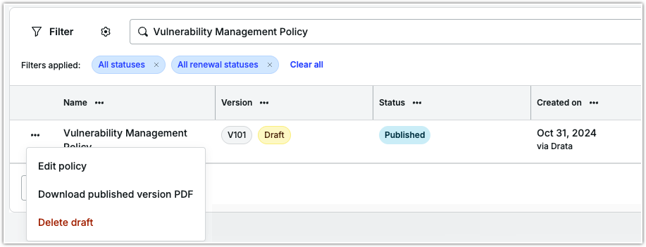

# Delete a Policy Draft

Source: https://help.drata.com/en/articles/13551276-delete-a-policy-draft
Collection: Understand the Drata Platform › Policies
Updated: 2026-11-09
Fetched: 2026-11-22
Description: Learn how to delete a policy version in Draft status, including which policy types and versions can be deleted.

## Article text

You can only delete a policy when it is in **Draft** status. Deleting a draft removes the unapproved version and reverts the policy to its previous version, if one exists.

Policies in **Needs approval**, **Approved**, or **Published** status can't be deleted. To remove an active policy, archive it instead.

## Prerequisites

- Only policies in **Draft** status can be deleted.
- Policies in **Needs approval**, **Approved**, or **Published** status can't be deleted.

## What happens when you delete a draft version

When you delete a draft policy version:

- The current unapproved version is permanently deleted
- The policy reverts to the previous version, if one exists
- If no previous version exists, the policy is removed from the policies list

This action can't be undone.

## Delete a draft policy version

1. Open **Governance → Policies**.
2. Locate the policy in **Draft** status.
3. Select the **ellipsis (⋯)** next to the policy and choose **Delete draft**.
4. Review the confirmation prompt.
5. Select **Delete** to confirm.

## When a policy can be deleted

The ability to delete a policy depends on the policy type, status, and version.

| **Policy type** | **Status** | **Version** | **Result** |
|---|---|---|---|
| Drata template policy | Draft | Version 0 (initial, unpublished) | Can't be deleted |
| Drata template policy | Draft | Version 1 or later | Draft can be deleted; reverts to the previous version |
| Custom policy | Draft | Version 0 (initial, unpublished) | Can be deleted; policy is removed entirely |
| Custom policy | Draft | Version 1 or later | Can be deleted; reverts to the previous version |
| Any policy | Needs approval | Any | Can't be deleted; cancel the approval cycle first |
| Any policy | Not Draft | Any | Can't be deleted; archive the policy instead |
| Synced external policy (Confluence or Notion) | N/A | Any | Can't be deleted in Drata; manage it in the external system and sync changes |

## Images

- [image 01] ../../images/ux/policies/delete-a-policy-draft--01.png

## Related articles

- [View and Manage Workflows](view-and-manage-workflows.md)
- [Policy Center Overview](policy-center-overview.md)
- [View and edit a policy](view-and-edit-a-policy.md)
- [Archive and restore policies](archive-and-restore-policies.md)
- [Create and manage policy translations](create-and-manage-policy-translations.md)
