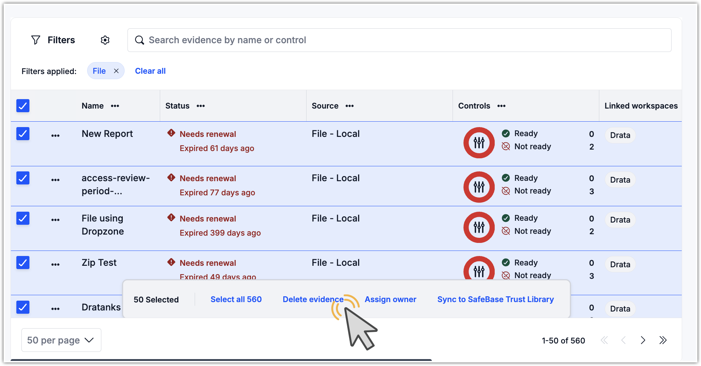
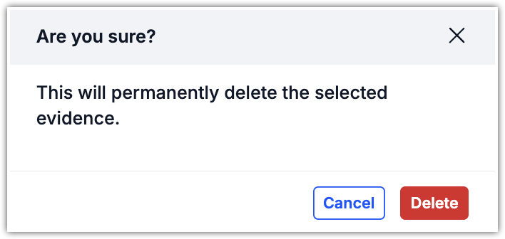

# Delete Evidence (New Experience)

Source: https://help.drata.com/en/articles/13404533-delete-evidence-new-experience
Collection: Understand the Drata Platform › Evidence
Updated: 2026-01-16
Fetched: 2026-11-22

## Article text

⚠️ **Warning:** Deleting manual evidence is permanent. The evidence will be removed from the Evidence Library and unlinked from all associated controls.

**To Delete Evidence Items**

**Note**: Test evidence cannot be deleted and should be managed by disabling or fixing the related test.

1. Go to **Compliance > Evidence**.
2. Select one or more evidence items using the checkboxes.
3. Select **Delete evidence**.
   
4. Confirm the deletion.
   

## Before You Delete Evidence, Check the Following

Deleting evidence is permanent, so review these items first to avoid unintended readiness or audit issues.

### 1. Is the evidence linked to active controls?

- Check which controls the evidence is mapped to.
- If the evidence supports a control that is currently **In Scope**, deleting it may cause the control to become **Not Ready**.

**Tip:** If the evidence is outdated but still relevant, update the artifact instead of deleting it.

### 2. Is this evidence being used across multiple frameworks?

- Evidence can be reused across frameworks (for example, SOC 2 and ISO 27001).
- Deleting it may impact readiness in more than one framework.

**Tip:** Review the **Linked controls** section before deleting.

### 3. Is the evidence still relevant but needs replacement?

- If the content is outdated or incorrect, consider:
   - Uploading a new artifact to replace it, or
   - Unlinking the evidence from specific controls instead of deleting it.

Deleting removes all history and associations.

### 4. Is this manual evidence or test evidence?

- **Manual evidence** can be deleted.
- **Test evidence cannot be deleted** and should be managed by disabling or fixing the related test.

### 5. Are you currently preparing for an audit?

- Deleting evidence during an audit can create gaps or raise auditor questions.
- Auditors may rely on historical context even if evidence is no longer current.

**Tip:** Avoid deleting evidence during an active audit unless advised by your auditor or compliance lead.

## Images

- [image 01] ../../images/ux/evidence/delete-evidence-new-experience--01.png
- [image 02] ../../images/ux/evidence/delete-evidence-new-experience--02.png

## Related articles

- [Evidence Overview](evidence-overview.md)
- [Evidence Renewal Date](evidence-renewal-date.md)
- [Pre-audit evidence packages in Drata (New Experience)](pre-audit-evidence-packages-in-drata-new-experience.md)
- [Section 5: Evidence Owners](section-5-evidence-owners.md)
- [Evidence Library: Multiple Artifacts & Multi-File Upload (New Experience)](evidence-library-multiple-artifacts-multi-file-upload-new-experience.md)
