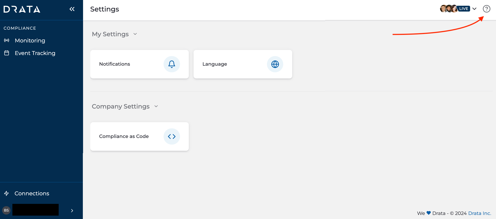

# DevOps engineer overview

Source: https://help.drata.com/en/articles/9548104-devops-engineer-overview
Collection: Settings › Role Administration
Updated: 2024-07-02
Fetched: 2026-11-22

## Article text

The side navigation of the Drata app is divided into several sections, each containing pages you can access based on your role.

Note: If your role has read-only permissions enabled, you can only view, filter, and download the data on the pages available to your role. You cannot modify the data or do certain actions available on that page.

- Compliance
- Settings
- Help Menu

## Compliance

Access the following pages under the Compliance section on the navigation bar:

- Monitoring page: Run tests, manage test notifications, and map controls to tests on the Monitoring page. Learn about [Monitoring](https://help.drata.com/en/articles/4790546-monitoring).
- Event Tracking page: View all events and download raw evidence. Learn about [Event Tracking](https://help.drata.com/en/articles/4790526-event-tracking).

## Settings

The Settings page is accessible through the username menu. DevOps engineers can access **My Settings**, including managing **Compliance as Code** settings.

## Help Menu

Select the help icon or Help & Feedback option to access the Help & Feedback drawer.

This drawer displays sections containing the help center, and upcoming features. You can also grant or revoke remote support access for all personnel through the Help & Feedback drawer.

### Additional resources

- [Role Administration & RBAC](role-administration-rbac.md)

## Images

- [image 01] ../../images/ux/settings/devops-engineer-overview--01.png

## Related articles

- [Azure Boards (DevOps) Integration Guide](azure-boards-devops-integration-guide.md)
- [Information security leads overview](information-security-leads-overview.md)
- [Access reviewer overview](access-reviewer-overview.md)
- [Control managers overview](control-managers-overview.md)
- [Personnel compliance managers overview](personnel-compliance-managers-overview.md)
