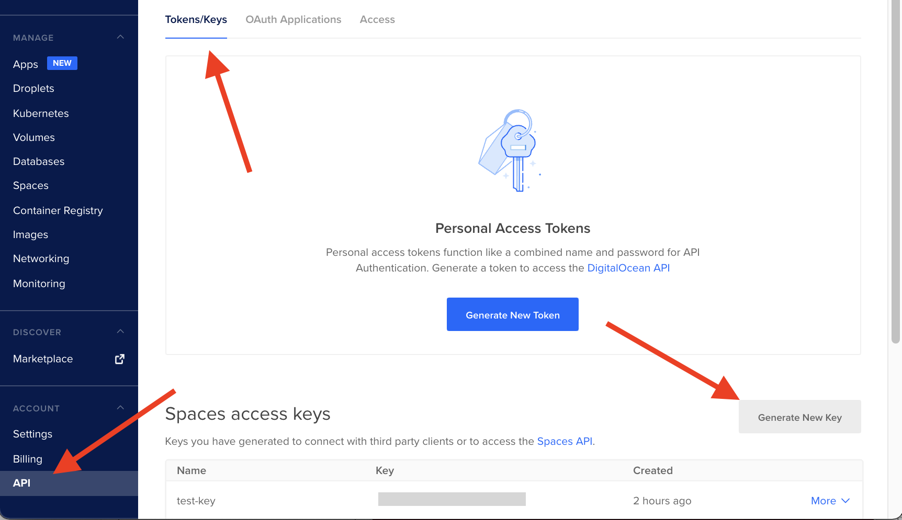
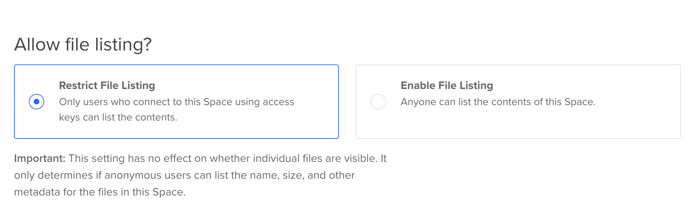

# DigitalOcean Integration Guide

Source: https://help.drata.com/en/articles/5108924-digitalocean-integration-guide
Collection: Connection Support › Infrastructure Guidance
Updated: 2026-08-05
Fetched: 2026-11-22
Description: Making the initial connection to DigitalOcean

## Article text

The **DigitalOcean** integration enables **DevOps, security, and compliance teams** to automate continuous monitoring and evidence collection for infrastructure security controls. This integration allows automated, continuous monitoring and evidence collection of dozens of infrastructure security controls required for compliance.

## Key Capabilities

- **Infrastructure Monitoring:** Continuously collects evidence for infrastructure-related security controls.
- **Team or Individual Accounts:** Connect with the currently signed-in **Individual** account or a **Team** (Owner, Member, or Biller).

## Prerequisites & Data Access

- Access to your company’s **DigitalOcean** account.
- Ability to authenticate to DigitalOcean (you’ll be redirected to login/authorization during setup).
- (Optional, only if monitoring Spaces) Ability to **generate DigitalOcean Spaces access keys** (Access Key and time-sensitive Secret Key).

**API Limitation (from source):** DigitalOcean’s API does **not** support pulling infrastructure users. The **Managed Accounts** page in Drata will show **no DigitalOcean users**, and the following tests will show no DigitalOcean users in results:

- **MFA on Infrastructure Console**
- **Employees have Unique Infrastructure Accounts**
- **Infrastructure Accounts Properly Removed**

## Step-by-Step Setup

### Step 1: Start the Connection

1. In Drata, go to the **Connections** page
2. Search for and select **DigitalOcean** within your available connections.
3. Start the connections process.
   - If you’re not logged in to DigitalOcean, you’ll be redirected to **register/login**; otherwise, you’ll be sent to the **app authorization** page.
   - You can connect the currently signed-in **Individual Account** or any **Team** where that account is **Owner, Member, or Biller**.
      - **IMPORTANT: Drata recommends connecting a Team account.**

**Expected outcome:** You’re redirected and authorized with DigitalOcean; Drata begins the guided setup.

### Step 2 (Optional): Create Access Keys for Spaces

If your company uses **Spaces** and you want Drata to monitor **Cloud Data Storage Exposure**, create Spaces access keys:

1. In DigitalOcean, open the **API** page of your dashboard.
2. Click **Generate New Key**, provide a key **name**, and copy both the **Access Key** and the **time-sensitive Secret Key**.
   - Both are required for Drata to read Spaces.

**Expected outcome:** You have a valid **Access Key** and **Secret Key** for Spaces.

### Step 3 (Optional): Create Spaces & Set Privacy

1. Create a Space: **[https://cloud.digitalocean.com/spaces/new](https://cloud.digitalocean.com/spaces/new)**
2. Privacy options:

- **Restrict File Listing**
- **Enable File Listing**
   - The **Cloud Data Storage Exposure** monitor (104) flags Spaces created with **Enable File Listing** as **failed**.

**Expected outcome:** Spaces are created with your chosen privacy settings; you understand how settings affect the exposure monitor.

### Step 4: Complete the Connection

In Drata’s connection flow, provide any requested values. If your company is using Spaces, select Connect with Spaces.

**Expected outcome:** Connection completes; if Spaces keys were provided, Spaces monitoring is enabled.

## Important Notes

- **Not supported (users):** DigitalOcean API does not expose infrastructure **user** data; user-based infra tests will show no DigitalOcean users.
- **Spaces keys are time-sensitive:** Ensure you store the **Secret Key** securely and update it if rotated.
- **Edge cases:**
   - Connecting as an **Individual** vs **Team** may affect which resources are visible.
   - **Enable File Listing** on Spaces will fail the **Cloud Data Storage Exposure** monitor.
- Due to a DigitalOcean API regression, **Test 104: Cloud Data Storage Exposure** is not currently working as expected in Drata. If you are not using Test 104 for any other connections, you can disable the test and provide manual evidence instead.

## Images

- [image 01] ../../images/integrations/digitalocean/digitalocean-integration-guide--01.png
- [image 02] ../../images/integrations/digitalocean/digitalocean-integration-guide--02.png

## Related articles

- [GitHub Integration Guide](github-integration-guide.md)
- [Heroku  Integration Guide](heroku-integration-guide.md)
- [Paylocity Integration Guide](paylocity-integration-guide.md)
- [MongoDB Atlas Integration Guide](mongodb-atlas-integration-guide.md)
- [TriNet Integration Guide](trinet-integration-guide.md)
