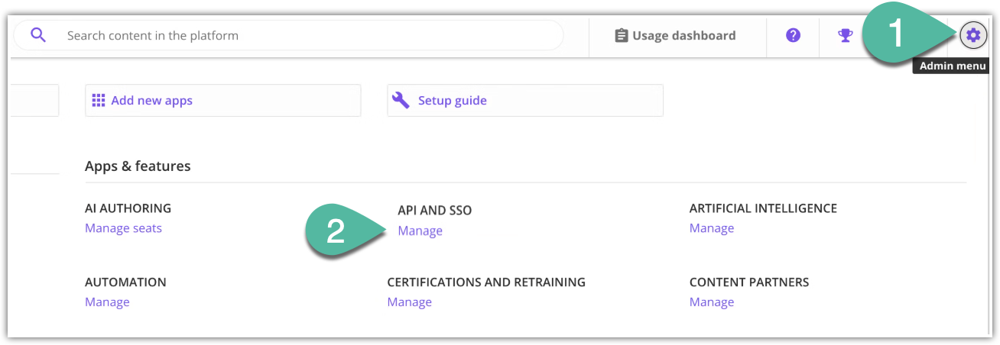
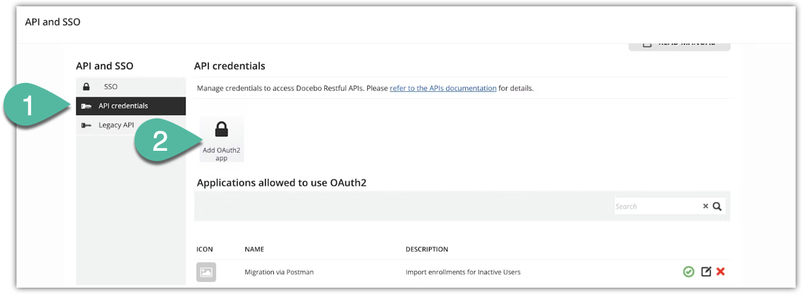
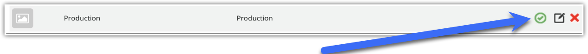

# Docebo Integration Guide

Source: https://help.drata.com/en/articles/12590631-docebo-integration-guide
Collection: Connection Support › Other Guidance
Updated: 2025-10-19
Fetched: 2026-11-22

## Article text

## Prerequisites & Data Access

**Account / Role Needed**

- Docebo: Admin privileges required to configure OAuth and API access
- Drata: Admin or Workspace Manager role to connect StackOne integration

**Prerequisites**

- Docebo plan with **API and SSO** enabled
- Client ID and Client Secret from Docebo OAuth2 app
- Docebo subdomain

---

## Step-by-Step Setup

### Step 1:  Add OAuth2 App

1. Sign in to your Docebo account with Admin credentials.
2. Click **Admin Menu** (top right).
3. Select **Manage** under **API AND SSO**.
   
4. Select **API credentials** and then **Add OAuth2 App**.
   
5. Create a new authentication app.

### Step 2: Create and enable OAuth App

1. Enter a name for your app (e.g. `Drata Integration`).
2. Enter a description (optional).
3. Enter the **Redirect URI**:
   ```
https://api.stackone.com/connect/oauth2/docebo/callback
   ```
4. Choose the required **Grant Types**.
   - Authorization code + implicit grant
   - Resource owner password credentials
5. Click **Confirm**.
6. **Copy the Client ID and Client Secret** generated by Docebo. You will need these for Drata.
7. Click the **green checkmark icon** to enable it.



### Step 3: Get Docebo Domain

1. Copy subdomain from your Docebo URL.
   - Example: From `https://my-domain.docebosaas.com` → Subdomain is `my-domain`.

### Step 4: Find Catalog ID (Optional)

You have the option to also push content to a specific Catalog as well as the system.

1. Go to **Admin Menu → Catalog Management**.
2. Select a catalog.
3. Catalog ID appears in URL:
   - Example: `/catalog/manage/catalogs/23` → ID = **23**

### Step 5: (Optional) Enable xAPI External Content

1. Go to **Settings → Advanced Settings → E-learning tab**.
2. Scroll to **xAPI (Tin Can) external content**.
3. Add your content domain (e.g. `https://example.com/*`).
4. Save.

### Step 6: Link Docebo Account in Drata

1. Open Drata → **Connections** page. Search for **Docebo.**
2. Enter:
   - Client ID
   - Client Secret
   - Subdomain
   - Username & Password
   - Catalog ID (optional)
3. Click **Connect**.

## Images

- [image 01] ../../images/integrations/docebo/docebo-integration-guide--01.png
- [image 02] ../../images/integrations/docebo/docebo-integration-guide--02.png
- [image 03] ../../images/integrations/docebo/docebo-integration-guide--03.png

## Related articles

- [Zelt Integration Guide](zelt-integration-guide.md)
- [Egnyte Integration Guide (UAR)](egnyte-integration-guide-uar.md)
- [RingCentral Integration Guide](ringcentral-integration-guide.md)
- [OpenVPN Integration Guide](openvpn-integration-guide.md)
- [GO1 Integration Guide](go1-integration-guide.md)
