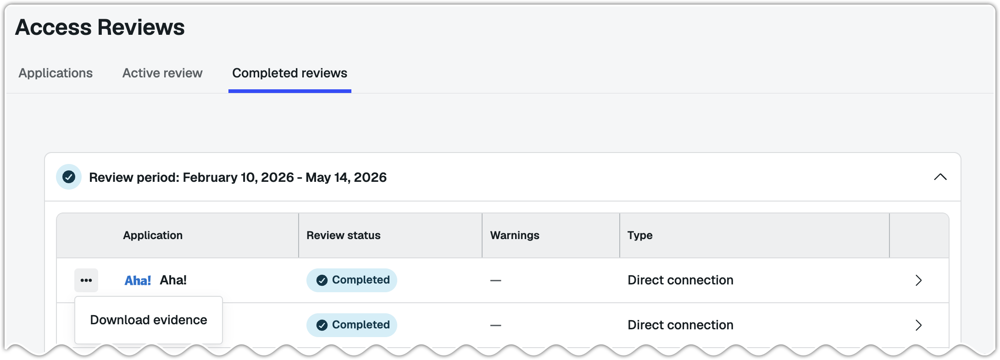
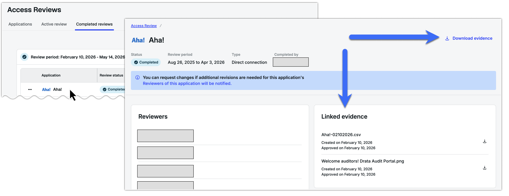
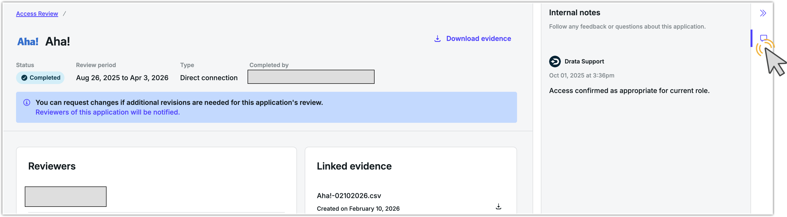

# Download Access Review Evidence and Review Details

Source: https://help.drata.com/en/articles/13704766-download-access-review-evidence-and-review-details
Collection: Understand the Drata Platform › Access Review
Updated: 2026-09-16
Fetched: 2026-11-22

## Article text

After completing an Access Review, Drata generates audit-ready evidence that can be downloaded at any time.

---

### Download Evidence Packages

To view completed reviews:

1. Go to **Governance → Access Reviews**
2. Select the **Completed Reviews** tab
3. Select the desired review period

From here, you can download the full consolidated evidence package (ZIP).

To download evidence for a specific application, select the application to view individual evidence files and additional review details.

---

### View Review Details

Completed reviews include:

- Assigned reviewers
- Completion dates
- Notes added during the review
   
- Uploaded supporting documentation

---

### Evidence Storage

When a review period is completed:

- Evidence is automatically attached to **DCF-11: Annual Access Control Review**
- Evidence is saved in the Evidence PAGE.
- Renewal is set to one year from completion by default

## Images

- [image 01] ../../images/ux/access-review/download-access-review-evidence-and-review-details--01.png
- [image 02] ../../images/ux/access-review/download-access-review-evidence-and-review-details--02.png
- [image 03] ../../images/ux/access-review/download-access-review-evidence-and-review-details--03.png

## Related articles

- [Example Evidence for Not Monitored Controls Linked to Policies](example-evidence-for-not-monitored-controls-linked-to-policies.md)
- [Example Evidence for Not Monitored Controls (HIPAA)](example-evidence-for-not-monitored-controls-hipaa.md)
- [Pre-Audit Checklist: How to Prepare for Your Audit with Drata](pre-audit-checklist-how-to-prepare-for-your-audit-with-drata.md)
- [Run an Access Review](run-an-access-review.md)
- [How to provide evidence for DCF-72: Root access control](how-to-provide-evidence-for-dcf-72-root-access-control.md)
