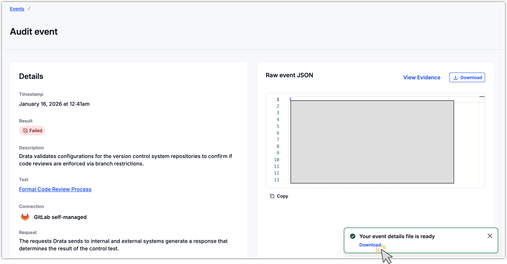

# Download Audit Evidence for a Custom Test (New Experience)

Source: https://help.drata.com/en/articles/13414137-download-audit-evidence-for-a-custom-test-new-experience
Collection: Understand the Drata Platform › Monitoring
Updated: 2026-01-16
Fetched: 2026-11-22

## Article text

## How to download the PDF

1. Go to the **Events** page.
2. Use filters to locate the event for your custom test.
3. Select the event.
4. Select **Download**.
5. When the file is ready, a notification appears in the bottom-right corner. Select **Download** from the notification.
   

### What the PDF includes

The PDF contains system-generated, daily audit evidence, including:

- Test configuration and logic (JSON format)
- Resources evaluated during the test run
- Excluded resources and documented reasons for exclusion
- Raw JSON responses generated by Autopilot

This file is commonly shared with auditors to demonstrate how the custom test operates and how results are produced.

## Download Raw JSON Evidence (TXT)

If auditors or technical reviewers need the raw response data, you can download the JSON output as a text file.

### How to download raw JSON

1. Go to **Monitoring** and select the **custom test**.
2. Open the **History** tab.
3. Select a test event.
4. Scroll to the **Raw JSON** section.
5. Select **Download**.

The download begins immediately and completes automatically.

## Images

- [image 01] ../../images/ux/events/download-audit-evidence-for-a-custom-test-new-experience--01.png

## Related articles

- [View and Manage Test Details (New Experience)](view-and-manage-test-details-new-experience.md)
- [Enable AI Summaries for Tests](enable-ai-summaries-for-tests.md)
- [Events Overview](events-overview.md)
- [Audits page overview (New Experience)](audits-page-overview-new-experience.md)
- [Pre-audit evidence packages in Drata (New Experience)](pre-audit-evidence-packages-in-drata-new-experience.md)
