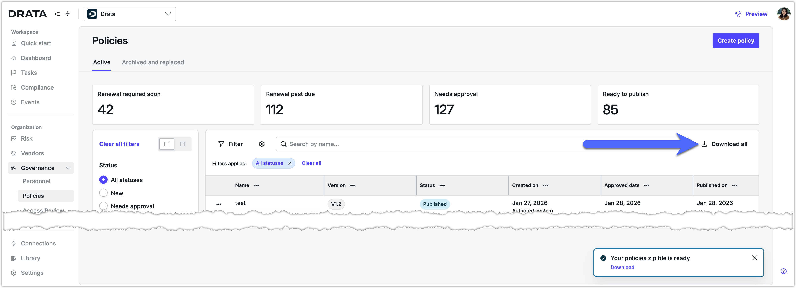
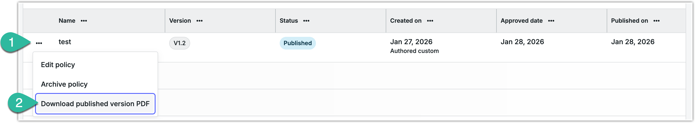
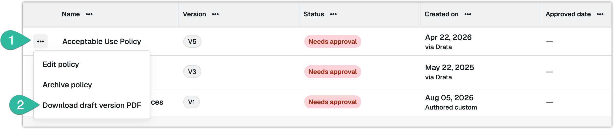
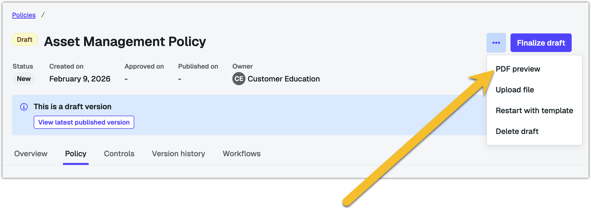

# Download your Policies

Source: https://help.drata.com/en/articles/13756587-download-your-policies
Collection: Understand the Drata Platform › Policies
Updated: 2026-11-09
Fetched: 2026-11-22

## Article text

Downloading policies provides a clear audit trail, helps track version updates for compliance, and allows easy sharing or offline storage.

The PDF includes detailed version history, such as:

- **Policy Information**: Name, description, and renewal date.
- **Version Details**: Full version history, creation date, approval date, published date, policy owner, and approver name.

## Download your policies

1. Go to **Governance > Policies**.
2. Ensure you are on the **Active** tab.
3. Choose how you'd like to download

### Download all published policies

1. Go to **Governance > Policies** and select the **Active** tab.
2. Within the policies table, select **Download All** to download all active, published policies.
3. Policies with **Draft**, **Needs Approval**, or **Approved** status are not included.

The **Download All** button appears only when at least one active, published policy is available.

### Download a single published policy

1. Go to **Governance > Policies** and select the **Active** tab.
2. In the Policies table, select the ellipsis (…) next to the policy.
3. Select **Download published version PDF**.

### Download a single draft policy

To download a draft from the Policies table:

1. Go to **Governance > Policies** and select the **Active** tab.
2. Select the ellipsis (…) next to the draft policy.
3. Select **Download draft version PDF**.

You can also download a draft through PDF preview:

1. Open the draft policy.
2. Select the ellipsis (…) menu, then select **PDF preview**.

Both methods download the current draft as a PDF.

If your downloaded policy PDF shows a blank version history table, see [Troubleshoot Blank Version History in Downloaded Policy PDFs](troubleshoot-blank-version-history-in-downloaded-policy-pdfs.md).

## Images

- [image 01] ../../images/ux/policies/download-your-policies--01.png
- [image 02] ../../images/ux/policies/download-your-policies--02.png
- [image 03] ../../images/ux/policies/download-your-policies--03.png
- [image 04] ../../images/ux/policies/download-your-policies--04.png

## Related articles

- [View and edit a policy](view-and-edit-a-policy.md)
- [Archive and restore policies](archive-and-restore-policies.md)
- [Delete a Policy Draft](delete-a-policy-draft.md)
- [Compare Policy Versions with AI](compare-policy-versions-with-ai.md)
- [Troubleshoot Blank Version History in Downloaded Policy PDFs](troubleshoot-blank-version-history-in-downloaded-policy-pdfs.md)
