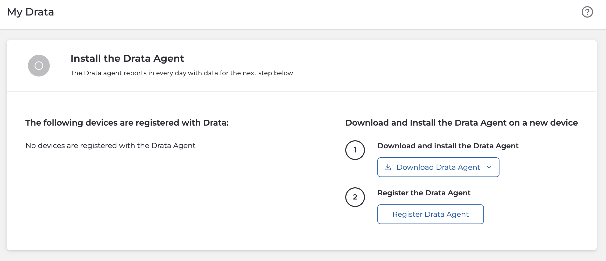

# Drata Agent Installation Link

Source: https://help.drata.com/en/articles/6110773-drata-agent-installation-link
Collection: Personnel Management › Drata Agent
Updated: 2026-08-05
Fetched: 2026-11-22
Description: This article covers how to access Drata Agent directly when the Agent option is disabled.

## Article text

If you have disabled the **Automated via Drata Agent** option on the **Internal Security **page within the** Settings **and need your personnel to download the Drata Agent, send them [this link](https://app.drata.com/employee/install-agent).

- Admins must share the link directly with personnel, as it is not accessible through Drata's standard interface. Personnel must be logged into Drata to access the link.

Once the personnel access the link, they can select **Download Drata Agent **and **Register the Drata Agent.**

When the Drata Agent is installed, the registration time is displayed.

## Images

- [image 01] ../../images/ux/devices/drata-agent-installation-link--01.png

## Related articles

- [Drata Agent not reporting system updates](drata-agent-not-reporting-system-updates.md)
- [SentinelOne (EDR) Integration Guide](sentinelone-edr-integration-guide.md)
- [Understanding Device Linking, Removal, and Visibility in Drata](understanding-device-linking-removal-and-visibility-in-drata.md)
- [How Drata Uses HRIS Data](how-drata-uses-hris-data.md)
- [Install the Drata Agent](install-the-drata-agent.md)
