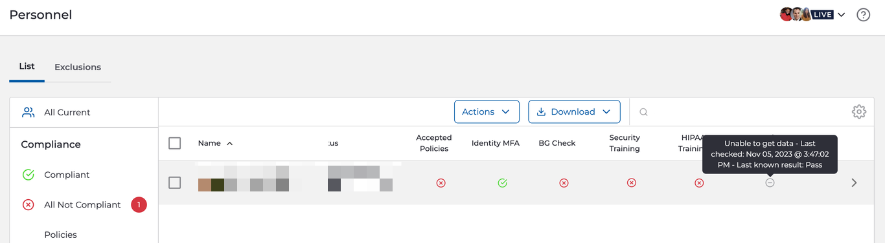
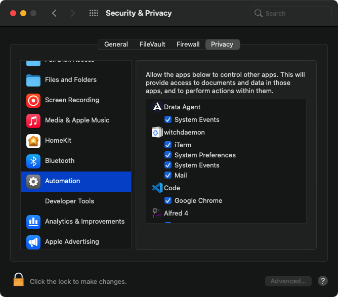

# Drata Agent not reporting system updates

Source: https://help.drata.com/en/articles/4785054-drata-agent-not-reporting-system-updates
Collection: Personnel Management › Drata Agent
Updated: 2026-11-14
Fetched: 2026-11-22
Description: If you or your employee has made changes to their system (to meet requirements) and aren't seeing them report back to Drata

## Article text

Once you have [installed the Drata Agent](https://help.drata.com/en/articles/4740428-installing-the-drata-agent-via-mac-os), it runs daily and reports back to Drata on items such as hard drive encryption, screensaver locking, antivirus software, password manager, and automatic updates.

If the Drata Agent is unable to retrieve data during the daily check, a gray icon appears in the personnel’s row along with the specific compliance check for which the Drata Agent was unable to retrieve data. This is also displayed in the personnel drawer. Select the personnel row to view the drawer. Hovering over the info icon shows details such as when this was last successfully checked by the Drata Agent and the last known compliance check result. As an additional troubleshooting step, you can manually sync the Drata Agent by opening the app on the user’s device, locating the `Sync Now` option, and clicking it.

For Mac: Ensure that the device's 'Security & Privacy' settings are not blocking the Drata Agent's ability to report back the daily check. To do so, go to your device's 'System Preferences’ > 'Security & Privacy' > 'Privacy' and select 'Automation' on the left side.Under ‘Drata Agent', check the ‘System Events’ box.

For Windows: Go to the settings in 'Startup Folder'.

For Ubuntu Linux: Go to 'Startup Applications' in the 'Activities' menu.

Other troubleshooting steps are to ensure that the Drata Agent App (drata-agent) is able to access the internet, specifically [agent.drata.com](https://agent.drata.com) and [github.com](https://github.com), and that it is allowed in your corporate anti-virus application’s settings. Additionally, ensure that there are no issues with device sleep or shutdown interruptions during nightly autopilot syncs. Consistently verify that the device has access to a stable internet connection and has not been disabled by personnel.

If you are still running into issues where the Drata Agent is unable to retrieve data, please reach out to technical support.

## Common Troubleshooting Scenarios for the Drata Agent

Here are common reasons why the Drata Agent might not sync properly:

- **Device Sleep or Shutdown**: If the computer is in sleep mode or shut down during the scheduled nightly autopilot sync, it may prevent the Agent from syncing.
- **Agent Disabled**: Personnel might have disabled the Drata Agent on their devices, causing prolonged periods without syncing.
- **Task Manager Check**: Open the Task Manager to verify if the Drata Agent is running. If running, force quit and reopen the application to ensure it functions correctly.

## Contractor Compliance and Identity Provider Troubleshooting

If contractors are not syncing correctly to Drata or their data appears incorrect, it may be due to problems with domain configuration in your identity provider (IdP). Follow these steps to resolve syncing issues:

1. Confirm contractors' email domains are included in your syncing configuration. Ensure all organizational domains are enabled.
2. Enable multi-domain support in your IdP to sync all domains linked to your account, ensuring contractors from non-primary domains are included.
3. Use the group sync feature for more control over syncing users:
   - Navigate to the **Connections** tab in Drata.
   - Select **IDP** and click on **View**.
   - Choose **Edit**, then select '**Groups**'.
   - Input necessary group details such as Group IDs or email addresses.
   - Click **Update Connection** to save your changes. Once these configurations are set, syncing issues related to contractors should resolve.

## Images

- [image 01] ../../images/ux/personnel/drata-agent-not-reporting-system-updates--01.png
- [image 02] ../../images/documentation/drata-agent-not-reporting-system-updates--02.png

## Related articles

- [Connect your HRIS to Drata](connect-your-hris-to-drata.md)
- [Your Drata Domain](your-drata-domain.md)
- [Why active employees may appear as former employees in Drata? (Concept Guide)](why-active-employees-may-appear-as-former-employees-in-drata-concept-guide.md)
- [How Drata Uses HRIS Data](how-drata-uses-hris-data.md)
- [Troubleshooting Identity Sync Issues in Drata](troubleshooting-identity-sync-issues-in-drata.md)
