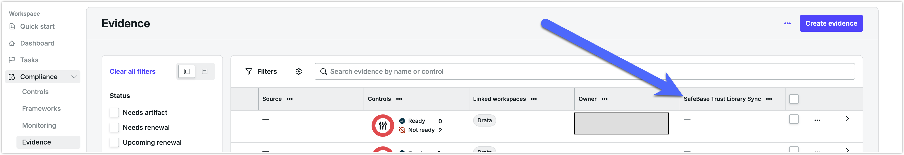
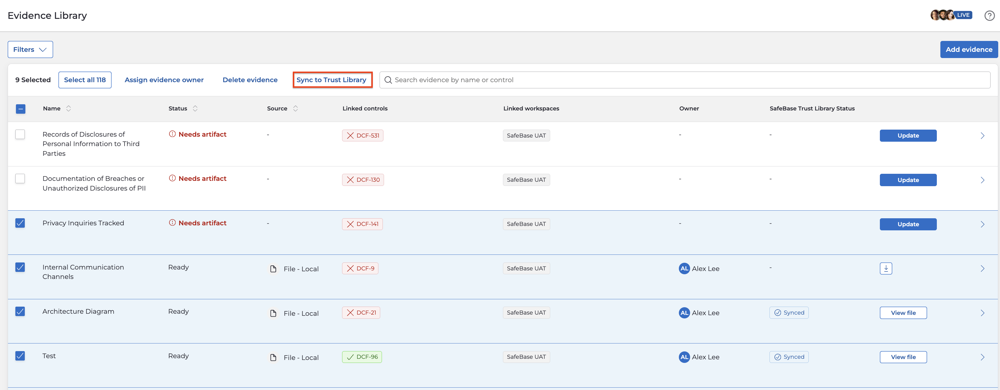
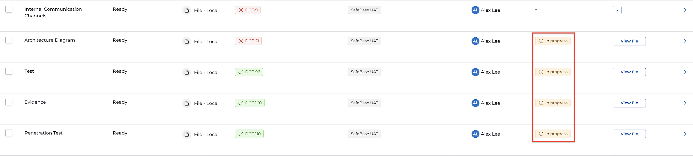
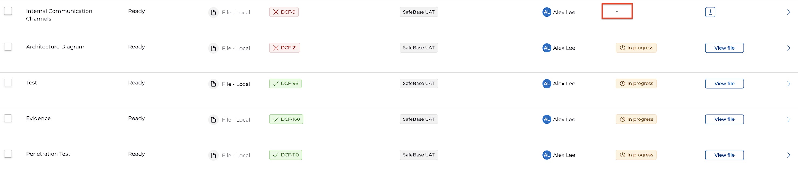
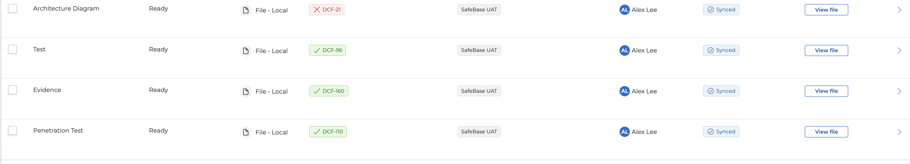
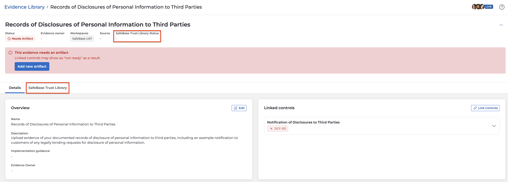
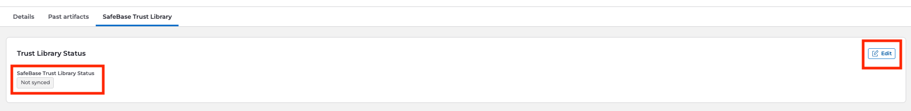
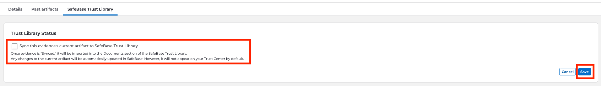
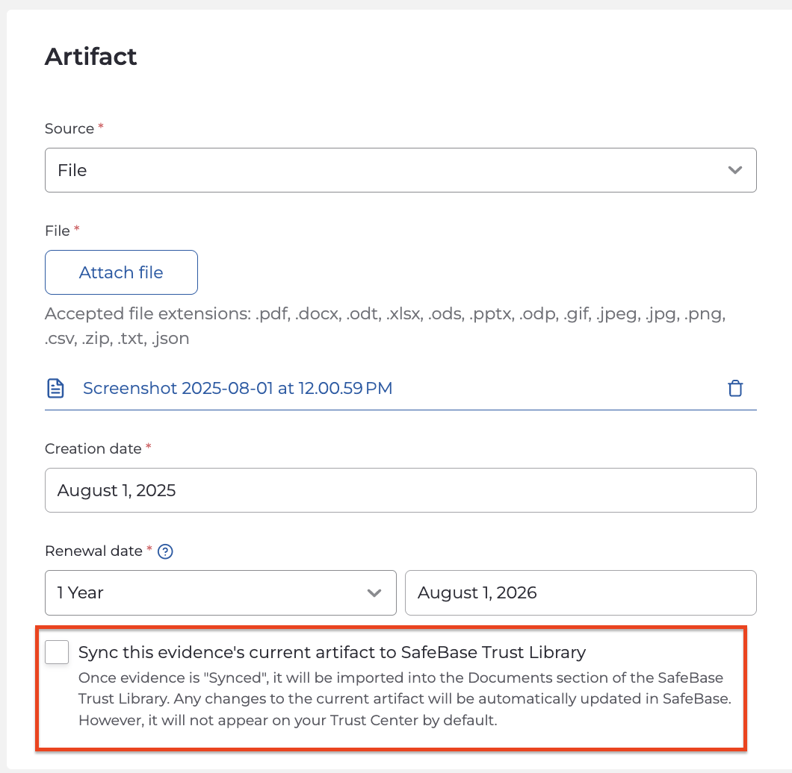

# Drata Evidence Library Sync

Source: https://help.drata.com/en/articles/13356790-drata-evidence-library-sync
Collection: Understand the Drata Platform › Evidence
Updated: 2026-11-09
Fetched: 2026-11-22
Description: Sync frequently-requested compliance and security documents from Drata's Evidence Library to SafeBase.

## Article text

## Overview

You can sync certain artifacts from their Drata Evidence Library into SafeBase's Documents section. There are some key limitations:

- Only evidence in the primary Drata workspace will be synced
- Your Drata tenant must be hosted in the North America (NA) region
- The artifact in your Drata Evidence Library must have a file source. Further, the raw file format must be supported by SafeBase. The supported formats are the same as for manually uploaded documents:
   1. Accepted file types in SafeBase: `avif`, `csv`, `doc`, `docx`, `gif`, `jpeg`, `jpg`, `json`, `pdf`, `png`, `svg`, `tiff`, `txt`, `webp`, `xls`, `xlsb`, `xlsm`, `xlsx`, `zip`
   2. Max size per file: 75 MB

## New Evidence Library Layout

Drata personnel will apply certain settings on your Drata tenant and SafeBase organization to enable the sync. You must also ensure the Drata integration in SafeBase's Settings area is connected (it is OK if the three individual toggles are off).

Once these settings are in place, you will see a new column called **SafeBase Trust Library Status** in Drata's Evidence Library table view.

You will also see a new tab called "SafeBase Trust Library" within the view of a single artifact.

### How the Sync Works

- **One-Way Push:** Drata pushes files to SafeBase over a secure connection. Changes made in Drata automatically update the document in SafeBase.
- **Review Process:** Synced evidence appears in the **Documents** section of your SafeBase Trust Library.
- **Visibility:** Documents will **not** appear on your public SafeBase Trust Center until you manually review and publish them within SafeBase.

## Sync multiple evidences to SafeBase

1. Navigate to the **Evidences page** in Drata.
2. **Filter by Source:** Use the "Filters" button to filter the source to file to ensure eligibility.
3. Select the checkboxes next to the evidence you wish to sync.
4. Click the **Sync to Trust Library** button that appears above the table.
   
5. In the modal, confirm the selection and save.
   - **Note:** We recommend using the filter above to only sync artifacts with files that are supported in SafeBase. If other unsupported artifacts are chosen to be synced, you will still be able to proceed to the modal and will still see the success toast message.
6. The table will update the "SafeBase Trust Library Status" to "In progress" for all pieces of evidence that are being synced.
   
7. Any pieces of evidence that are not eligible to be synced will remain as `-` for the SafeBase Trust Library Status.
   
8. Once the syncing is complete, refresh the page to see that the "SafeBase Trust Library Status" field now shows "Synced."
   

## Individual Sync

1. Within the view of a single artifact, you will see a new field labeled "SafeBase Trust Library Status" as well as a new tab labeled "SafeBase Trust Library."
   
2. Click into the "SafeBase Trust Library" tab. You will see the current sync status of this artifact. Click the Edit button to turn the sync on or off.
   
3. Check the box to sync the current artifact, or uncheck it to turn off the sync. Then click **Save**.
   

## Sync When Adding Evidence

1. Click **Add Evidence** on the Evidences page in Drata.
2. Set the **Source** to "File" and upload your document.
3. Check the box at the bottom of the drawer: **"Sync this evidence’s current artifact to SafeBase Trust Library."**

## Images

- [image 01] ../../images/ux/evidence/drata-evidence-library-sync--01.png
- [image 02] ../../images/ux/evidence/drata-evidence-library-sync--02.png
- [image 03] ../../images/ux/evidence/drata-evidence-library-sync--03.png
- [image 04] ../../images/ux/evidence/drata-evidence-library-sync--04.png
- [image 05] ../../images/ux/evidence/drata-evidence-library-sync--05.png
- [image 06] ../../images/ux/evidence/drata-evidence-library-sync--06.png
- [image 07] ../../images/ux/evidence/drata-evidence-library-sync--07.png
- [image 08] ../../images/ux/evidence/drata-evidence-library-sync--08.png
- [image 09] ../../images/ux/evidence/drata-evidence-library-sync--09.png

## Related articles

- [Evidence Overview](evidence-overview.md)
- [Add Jira Tickets as Evidence](add-jira-tickets-as-evidence.md)
- [Manually Export Evidence Data from Drata](manually-export-evidence-data-from-drata.md)
- [Managing Evidence in Drata Training Video (New Experience)](managing-evidence-in-drata-training-video-new-experience.md)
- [Bulk Import Evidence](bulk-import-evidence.md)
