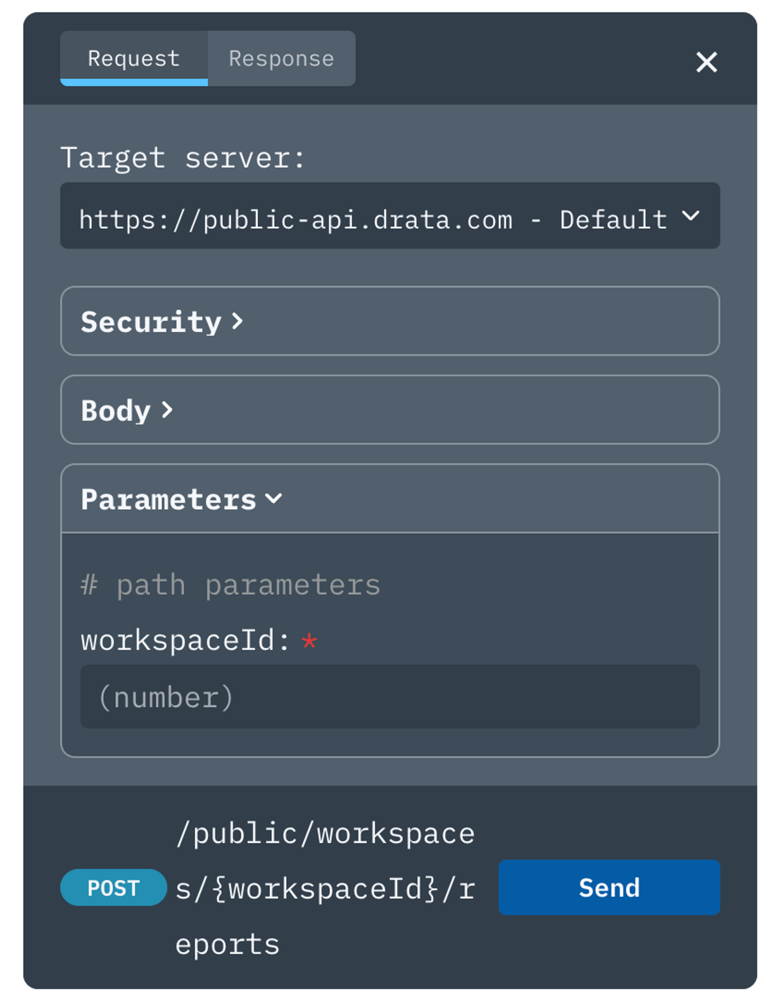

# Drata Public API: Workspace ID for POST or PUT Requests

Source: https://help.drata.com/en/articles/7213398-drata-public-api-workspace-id-for-post-or-put-requests
Collection: Connection Support › Drata API
Updated: 2026-08-05
Fetched: 2026-11-22
Description: This article covers how to identify your workspace ID to make a POST or PUT request using the Drata Open API.

## Article text

## HERE'S WHAT

The [Drata Public API](https://developers.drata.com/docs/) gives users the ultimate flexibility to push data to Drata. You can leverage the available POST and PUT endpoints to automate and streamline the way your team transfers data into Drata.

## BEFORE DIVING IN

- See our full API developer documentation at [https://developers.drata.com/docs/](https://developers.drata.com/docs/).
- The full API key will only be shown once when you create the key. You will not be able to access it again. See this [help article](drata-public-api.md) on how to generate an API key.
- A rate limit of 500 requests / minute will be enforced per unique source IP.

## HERE'S HOW

- For all POST and PUT requests you will need to identify your Workspace ID.
- If you do not have Multiple Product Support enabled on your Drata account, your Workspace ID is 1.
- If Multiple Product Support is enabled, you can make a GET request to the List Workspaces endpoint to identify the Workspace you would like to make the POST or PUT request to.
- Once you have your Workspace parameter identified you can input this value into the “Try It” section of the API documentation, accompanied by your API key and any additional parameters and/or request body.

## Images

- [image 01] ../../images/documentation/drata-public-api-workspace-id-for-post-or-put-requests--01.png

## Related articles

- [Drata Public API](drata-public-api.md)
- [Drata Public API: Upload Evidence for a User](drata-public-api-upload-evidence-for-a-user.md)
- [Drata Public API: Get Event Data from Drata](drata-public-api-get-event-data-from-drata.md)
- [Drata Public API: Get All Controls](drata-public-api-get-all-controls.md)
- [Set up OAuth for the Drata API](set-up-oauth-for-the-drata-api.md)
