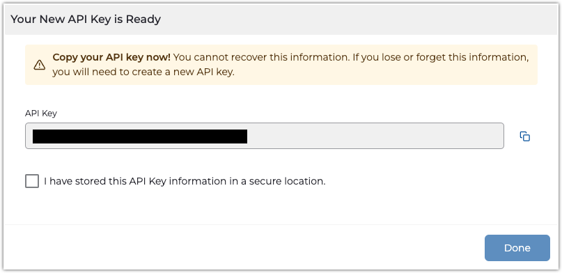
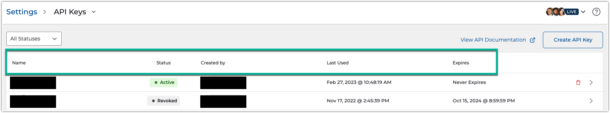
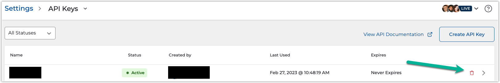
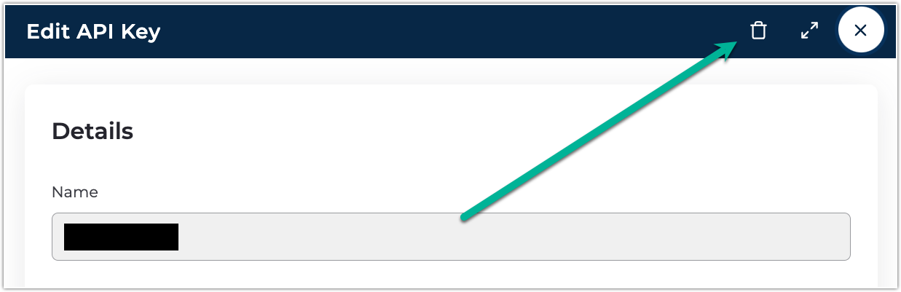

# Drata Public API

Source: https://help.drata.com/en/articles/6695964-drata-public-api
Collection: Connection Support › Drata API
Updated: 2026-08-05
Fetched: 2026-11-22
Description: This article covers how to configure Drata Public API

## Article text

Drata Public API gives users the ultimate flexibility to push and pull data from/to Drata, integrate any custom workflow with Drata platform and bring data from any third party integration solution that supports APIs.

## BEFORE DIVING IN

- Refer to our full API developer documentation at [https://developers.drata.com/docs/](https://developers.drata.com/docs/).
- The full API key will only be shown once when you create the key. You will not be able to access it again. Ensure to save the API key.
- A rate limit of 500 requests / minute will be enforced per unique source IP .

## Create an API key 

Here’s how to create an API key for your organization:

1. Go to the Settings page on Drata. To access settings, select your account on the bottom left side navigation and then the **Settings **option.
2. Select** API Keys** on the Settings page.
3. Select the **Create API Key **button.
4. Enter the API key details.
   - **Name**: The name for your API key cannot be changed once it is active.
   - **Expiration date**: Set an expiration date for your API key. The following options are 12 months, Never, or Custom. The default is **12 months**.
   - **Allowed IP Addresses**: You can restrict key usage to the specified addresses. You can input as many addresses as you’d like to allow traffic from. If left empty, your API key will allow traffic from all sources.
5. Enter the scopes for your API.
   - **Access**: The options are Custom, All read, or All read and write.
      - **Custom**: Select the specific scopes you want enabled for that API key.
      - **All read**: Enable all the current and future read permissions/scopes for the API key.
      - **All read and write**: Enable all the current and future permissions/scopes for the API key.
6. Once you save, you will be prompted to acknowledge that you have saved your API key info in a secure location.
   - **⚠️ Note**: After you select Done, you will not be able to access the full API key again.
      
7. After selecting **Done**, your API key will be active.

## View your API keys

Once you create an API key, you will be presented with a table with all keys created for your organization.

You can view the API key name, the status of the key, who created the API key, when the key was last used to make a request, and when the key expires.

### Status of your API keys

There are 4 statuses for an API key:

- **Active**: The key can be used to make requests for the scopes it’s been provisioned for.
- **Expiressoon**: The key can still be used to make requests for the scopes it’s been provisioned for. The key will expire within 30 days.
- **Expired**: The key cannot be used to make requests. An expired key cannot be converted into an active key. Expirations for a key are permanent.
- **Revoked**: An admin decided to manually revoke access for the key. The key can no longer be used to make requests. A revoked key cannot be converted into an active key.

### Edit or update API Key details

**Note**: You cannot change the name and actually API key value.

1. Select the API key you want to manage additional details for such as the scopes provisioned for that key.
2. Select the edit icon  to change or update the field.
   - To update or change the scopes, you do not need to select an edit icon. Instead, select the desired changes and then save. Scopes can be edited at any time for your API key as long as it has not expired or been revoked.
3. Save your changes.

## Revoke an API key

> **⚠️ Note**: Revoking an API key cannot be undone. Once revoked, that key can no longer make authenticated calls to the Drata API

Here’s how you can revoke an active API key:

1. Select the **trash can** icon that is related to the API you would like to remove.
   
2. You will be prompted with a warning confirming you want to revoke the API key.

You can also open the API key drawer and select the **trash can **icon at the top to revoke the key.

You can still access the details of a revoked API key. The new status of the API key is **Revoked**.

## API Documentation

To learn more about each API, please visit our [API Documentation Page](https://developers.drata.com/docs/).

## Images

- [image 01] ../../images/ux/settings/drata-public-api--01.png
- [image 02] ../../images/ux/settings/drata-public-api--02.png
- [image 03] ../../images/not-product/drata-public-api--03.png
- [image 04] ../../images/ux/settings/drata-public-api--04.png
- [image 05] ../../images/ux/settings/drata-public-api--05.png

## Related articles

- [Drata Public API: Workspace ID for POST or PUT Requests](drata-public-api-workspace-id-for-post-or-put-requests.md)
- [Drata Public API: Get Event Data from Drata](drata-public-api-get-event-data-from-drata.md)
- [Drata Public API: Get All Controls](drata-public-api-get-all-controls.md)
- [15Five Integration Guide](15five-integration-guide.md)
- [Set up OAuth for the Drata API](set-up-oauth-for-the-drata-api.md)
