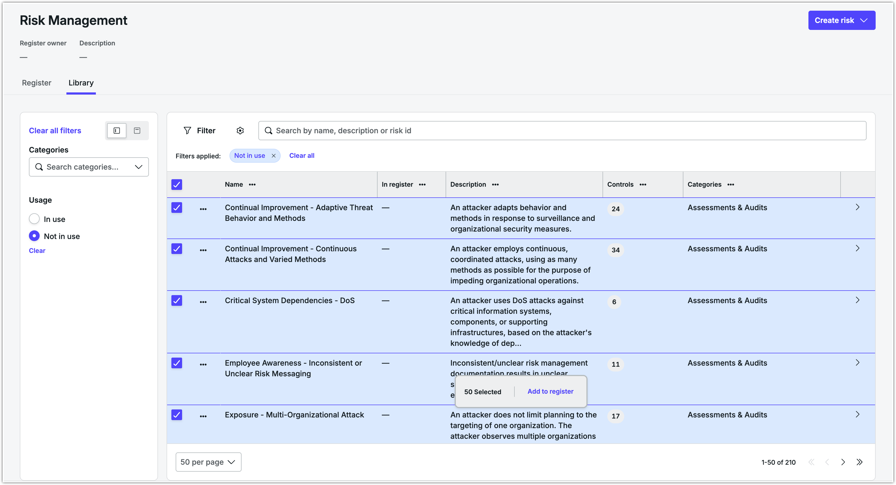
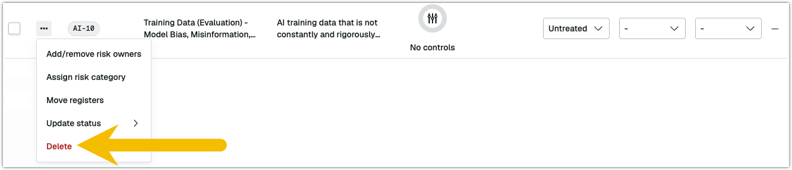

# Drata's Risk Library (New Experience)

Source: https://help.drata.com/en/articles/13371089-drata-s-risk-library-new-experience
Collection: Understand the Drata Platform › Risk
Updated: 2026-09-21
Fetched: 2026-11-22

## Article text

The **Risk Library** contains a predefined set of risks based on industry standards such as **NIST SP 800-30**, **ISO 27005**, **OCR SRA**, and other recognized frameworks. These risks are designed to help you quickly build and populate your Risk Register.

You can add any risk from the Risk Library to your Risk Register. Once a risk is added, it becomes part of your register and can be assessed, assigned, and managed like any other risk.

Standard risks in the Risk Library are **read-only** and cannot be edited directly. After adding a risk to your Risk Register, you can modify its details to reflect your organization’s specific context. If you need to reference Drata’s original, standardized risk descriptions, you can always view them in the Risk Library.

## Add a risk to your register

You can add a risk to your register by:

1. Navigate to **Register page.**
2. Select the desired Risk Register to add a risk into.
3. Open the **Library** tab.
4. Do one of the following:
   - Select the **ellipsis (⋯)** next to a risk and choose **Add to register**, or
   - Select the checkbox next to one or more risks, then click **Add to register**.

## Delete a risk from your register

Deleting a risk is permanent and cannot be undone. The risk's data is removed from your account, including any updates you made to its scoring, treatment plan, notes, and mapped controls.

**If the risk came from the Risk Library**, you can always add it back from the Library tab. This adds back the original, unedited Library template, not the risk you deleted. Any customizations you made, such as an updated description, scoring, owners, categories, or notes, are not recovered.

**If the risk is a custom risk**, it is not stored in the Risk Library. If you delete it, it is removed permanently and cannot be added back or recovered.

**Want to keep a record instead?** Update the risk's status to Archived or Closed rather than deleting it. Status changes can be reversed. Deletion cannot.

**Delete a risk**

1. Select the ellipsis (⋯) next to the risk.
2. Select Delete.

## Images

- [image 01] ../../images/ux/risk/drata-s-risk-library-new-experience--01.png
- [image 02] ../../images/ux/risk/drata-s-risk-library-new-experience--02.png

## Related articles

- [Understanding the Drata Risk Register](understanding-the-drata-risk-register.md)
- [Import Risk in Bulk (New Experience)](import-risk-in-bulk-new-experience.md)
- [Risk management in Drata: An overview](risk-management-in-drata-an-overview.md)
- [Manage multiple risk registers (New Experience)](manage-multiple-risk-registers-new-experience.md)
- [Risk categories in Drata](risk-categories-in-drata.md)
