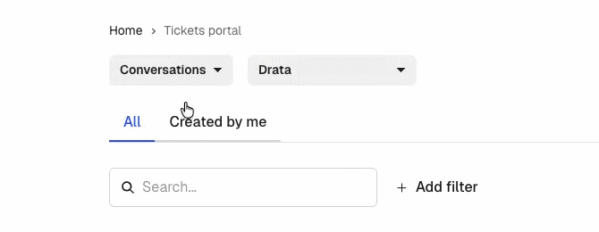

# Drata Support: Conversations vs. Tickets

Source: https://help.drata.com/en/articles/15526207-drata-support-conversations-vs-tickets
Collection: Getting Started › Helpful Resources › How to Get Support at Drata
Updated: 2026-06-16
Fetched: 2026-11-22
Description: What happens when you contact Support in-app, when a request becomes a ticket, and where to track follow-up.

## Article text

## Before Diving In

- Every support inquiry begins as a conversation.
- Starting a conversation does not automatically create a ticket.
- Issues that require ongoing follow-up across multiple days and/or involve multiple stakeholders may be converted into a ticket.
- Drata Support Agents determine if and when a conversation should be converted into a ticket.
- Both conversations and tickets can be viewed at any time through the [Ticket Portal](https://help.drata.com/tickets-portal) by selecting either the **Conversations** or **Tickets** view.

## What to Expect When Contacting Drata Support

When you contact Drata Support, your request begins as a conversation. Conversations are the primary way to engage with our Support team and serve as the starting point for all support requests. While the in-app experience may feel similar to live chat, submitting a conversation does not guarantee an immediate response from a Support Agent.

### Getting Started with Dratanaut

When you open in-app support, **Dratanaut** is your first point of contact. Dratanaut is Drata’s AI-powered support assistant and can help answer common questions, provide guidance, and resolve many issues right away.

If you need assistance from a Support Agent, you can request to speak with a human. Your conversation will be routed to our Support team for review and placed in the support queue.

Once your request has been submitted, a member of our team will review it and respond as soon as possible. While Drata Support does not currently offer guaranteed real-time chat with an agent, you can continue the conversation asynchronously through the support messenger, email, or the Ticket Portal.

### Conversations vs. Tickets

Every support request starts as a conversation, but not every conversation becomes a ticket.

### Conversations

Conversations are the initial support threads you create through in-app support. They are ideal for quick questions and guidance. Once a conversation is created, you can track its progress and continue the discussion directly within the app, by email, or through the [Ticket Portal.](https://help.drata.com/tickets-portal)

### Tickets

Tickets are created for issues that require ongoing investigation, follow-up over multiple days, coordination across teams, or continued communication with Support.

Drata Support Agents determine if and when a conversation should be converted into a ticket. Once a Conversation is created, it can be tracked and responded to from within the app, via email, or from within the [Ticket Portal.](https://help.drata.com/tickets-portal)

### Tracking Your Requests

You can view and manage both conversations and tickets through the Drata [Ticket Portal.](https://help.drata.com/tickets-portal)

The Ticket Portal allows you to:

- View open and closed support conversations
- View open, in-progress, and closed support tickets
- Manage all ongoing support requests in one central location
- Track the status of active issues
- Open any conversation or ticket to review updates and respond directly to the Support team

For more information on how to contact support, click [here](get-support-from-drata.md).

## Images

- [image 01] ../../images/ux/tickets/drata-support-conversations-vs-tickets--01.gif

## Related articles

- [Understanding Connections in Drata](understanding-connections-in-drata.md)
- [Identify and Add Missing Azure Permissions for Drata](identify-and-add-missing-azure-permissions-for-drata.md)
- [Get support from Drata](get-support-from-drata.md)
- [Using the Drata Audit Portal (New Experience)](using-the-drata-audit-portal-new-experience.md)
- [Section 5: Drata for Auditors](section-5-drata-for-auditors.md)
