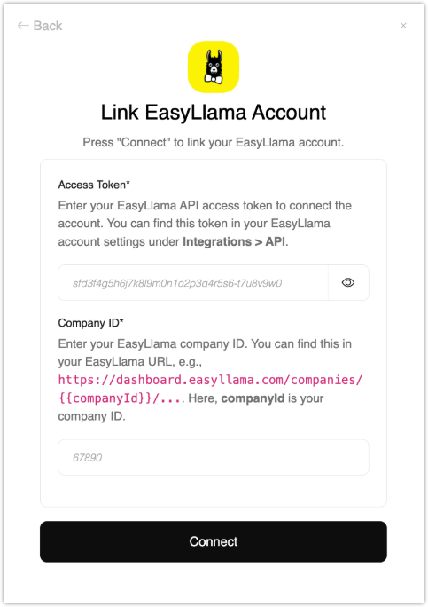
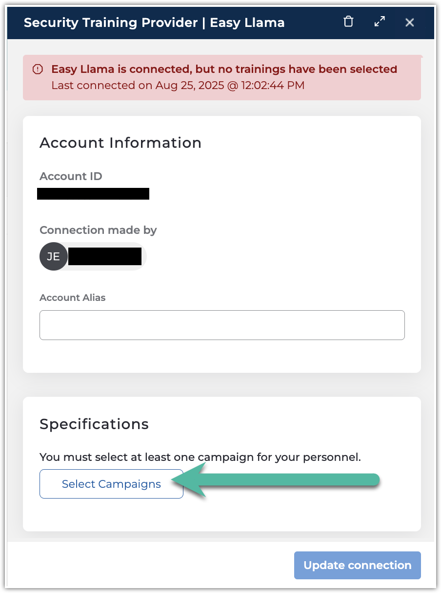
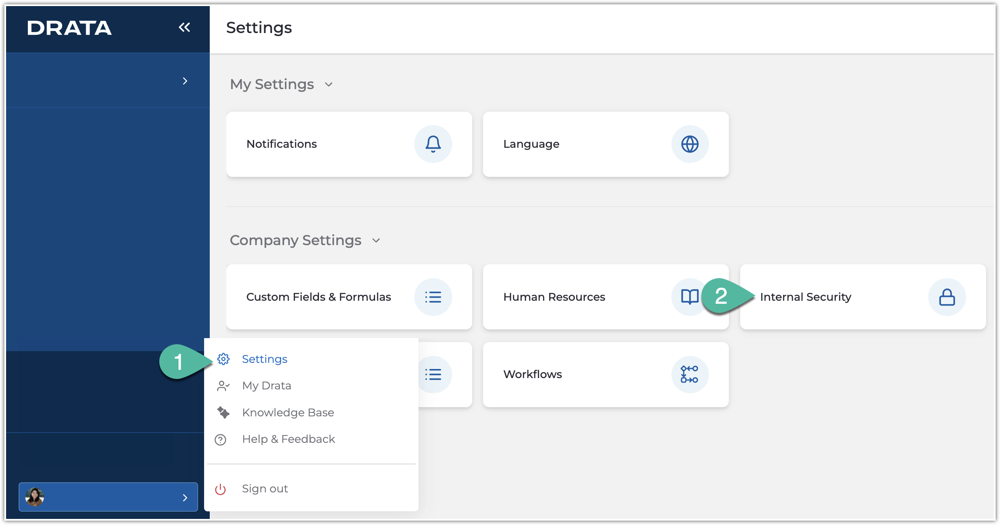
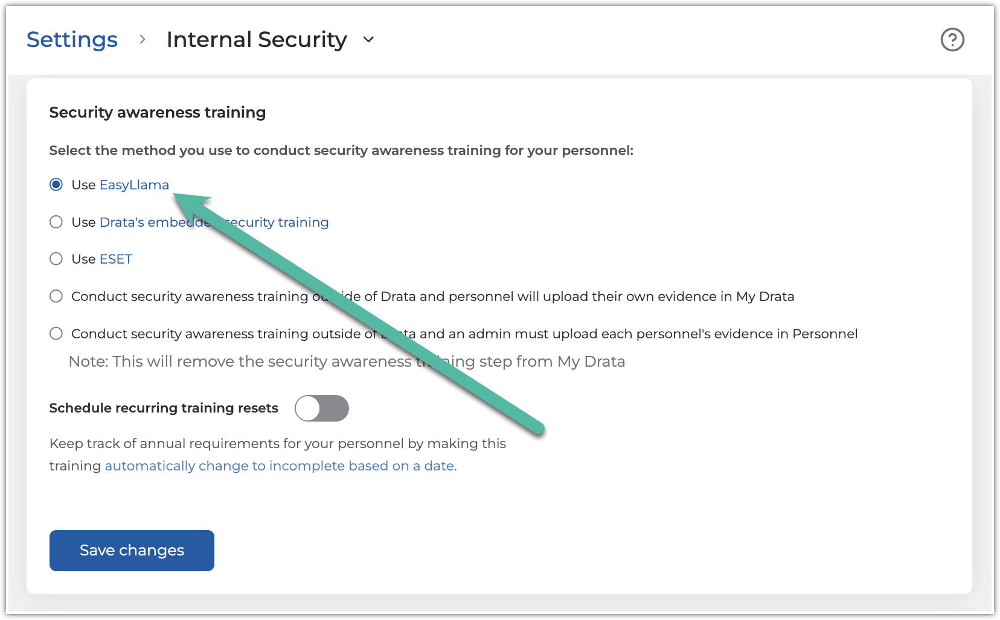

# EasyLlama Integration Guide

Source: https://help.drata.com/en/articles/12048164-easyllama-integration-guide
Collection: Connection Support › Other Guidance
Updated: 2026-03-09
Fetched: 2026-11-22

## Article text

The EasyLlama integration enables security and compliance teams to automatically track security awareness training completion. It connects Drata to EasyLlama so your team can monitor assigned training and completion status to support your compliance program.

## Key Capabilities

- Security awareness training monitoring: Track assigned training and completion status
- Automated evidence collection: Sync training completion records into Drata
- Compliance tracking: Automatically mark personnel as compliant when training is completed

This integration is used to automate tests such as security awareness training verification, helping prove compliance with security awareness and training policy requirements.

## Prerequisites & Data Access

- Administrative access to both **Drata** and **EasyLlama**
- At least one **training course assigned** in EasyLlama
- Personnel assigned to training modules in EasyLlama
- Access to the following values from EasyLlama:
   - **Access Token**
   - **Company ID**
- Required Drata Role with Write access: Admin, Workspace Managers, DevOps Engineer
- Access Reviewers (Access Reviewers can only Read the connection page they can’t make changes)

### Permissions & Data Table

| Permission/Scope | Why It’s Needed |
|---|---|
| EasyLlama API Key / Access Token | Allows Drata to authenticate and retrieve training assignment and completion data |
| Company ID | Identifies the correct EasyLlama organization instance |

## Step-by-Step Setup

### Step 1: Generate an EasyLlama Access Token

1. Log in to **EasyLlama**.
2. Navigate to **Settings → Integrations → API**.
3. Select **Create API Key**.
4. Enter the required fields:
   - **Application Name**
   - **Redirect URL**
5. For the Redirect URL, enter your company website or application URL (for example: `https://yourcompany.com`). EasyLlama requires this field but Drata does not use it.
6. Create the API key.
7. Copy the generated **Access Token**.

Expected outcome: You have an EasyLlama Access Token to authenticate the integration.

### Step 2: Find Your EasyLlama Company ID

1. Log in to your EasyLlama dashboard.
2. Look at the dashboard URL.
   - Example:
      ```
https://dashboard.easyllama.com/companies/{companyId}/...
      ```
3. Copy the **Company ID** value from the URL.

Expected outcome: You have the Company ID required for the connection.

### Step 3: Connect EasyLlama in Drata

1. Log in to **Drata** → go to the **Connections** page.
2. Navigate to your **Available Connections**.
3. Search for and start the **EasyLlama** connection process.
4. Enter the following when prompted:
   - **Access Token**
   - **Company ID**
5. Select the **training campaign** you want Drata to monitor.

Expected outcome:
 EasyLlama is successfully connected and security awareness training data begins syncing to Drata.

## Important Notes

- You **must select a campaign** during setup. If no campaign is selected, the connection will remain incomplete.
- After connecting, Drata automatically enables **EasyLlama as the security awareness training source**.
- Drata syncs EasyLlama training data **nightly**.
- A person is marked as compliant when:
   - They are assigned a valid training course in EasyLlama
   - They complete the assigned course
- After training completion, Drata retrieves the completion record and marks the user as compliant while preserving the training record.

Edge cases:

- If personnel are not assigned to training modules in EasyLlama, Drata cannot track training status.
- Training completion updates may take up to one sync cycle to appear in Drata.

Connect your EasyLlama account to Drata to automate evidence collection for Security Awareness Training. Once connected, Drata monitors each person’s training assignments and completion status to support your compliance program.

## Prerequisites

Before connecting EasyLlama to Drata, make sure:

- You have **administrative access** to both Drata and EasyLlama.
- At least **one training course** is assigned in EasyLlama.
- Personnel are assigned to the **appropriate training modules** in EasyLlama.
- You have the following two values from EasyLlama:** Access Token** and **Company ID**

### Copy EasyLlama Access Token

To generate an Access Token, you must first create an **API Key** in EasyLlama.

1. In EasyLlama, go to **Settings → Integrations → API→ Create API Key**.
2. Enter** Application Name** and** Redirect URL**.
   - Redirect URL: EasyLlama requires this field, but Drata does **not **use it.
      - Enter your company website or application URL (e.g., `https://yourcompany.com`).
3. Once the API Key is created, EasyLlama generates an **Access Token**.
4. Copy and save the Access Token. This is what you’ll enter in Drata.

### Copy your EasyLlama Company ID

- Your Company ID is found in your EasyLlama dashboard URL.
- Example: `https://dashboard.easyllama.com/companies/{companyId}/...`

## Connect EasyLlama

1. Log in to Drata.
2. Navigate to the **Connections** page.
3. Search for **EasyLlama** and select **Connect**.
4. Enter your **Access Token** and **Company ID** exactly as they appear in your EasyLlama account. These credentials must match to establish the connection successfully.
   
5. Select your campaign. If you do not select a campaign, the connection remains in an incomplete state.
   

After you connect EasyLlama, **Drata automatically enables EasyLlama as your security awareness training source**.

### Manage Your Security Awareness Training Source (Optional)

To change the security awareness training source:

1. Go to **Settings** in Drata. Then, select the **Internal Security** page.
   
2. Turn on or off **Use EasyLlama** for the **Security awareness training** section.
   

### EasyLlama in My Drata

When EasyLlama is enabled, assigned personnel have a direct link to complete their training in My Drata.

Drata marks a person as compliant when both of the following are true:

- They are assigned to a valid training course in EasyLlama
- They complete the assigned course in EasyLlama

Drata syncs training data from EasyLlama nightly. After a person completes training, Drata:

- Retrieves the completion record
- Marks the person as compliant
- Stops syncing their training status to preserve the record

## Images

- [image 01] ../../images/integrations/easyllama/easyllama-integration-guide--01.png
- [image 02] ../../images/integrations/easyllama/easyllama-integration-guide--02.png
- [image 03] ../../images/ux/settings/easyllama-integration-guide--03.png
- [image 04] ../../images/ux/settings/easyllama-integration-guide--04.png

## Related articles

- [Huntress (Security Training) Integration Guide](huntress-security-training-integration-guide.md)
- [KnowBe4 Integration Guide](knowbe4-integration-guide.md)
- [Freshsales Integration Guide (UAR)](freshsales-integration-guide-uar.md)
- [Tableau Integration Guide](tableau-integration-guide.md)
- [Infosec IQ Integration Guide](infosec-iq-integration-guide.md)
