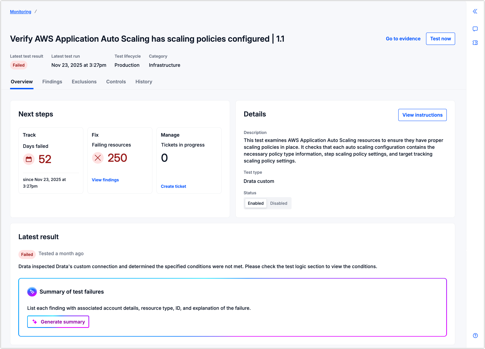

# Enable AI Summaries for Tests

Source: https://help.drata.com/en/articles/13394100-enable-ai-summaries-for-tests
Collection: Understand the Drata Platform › Monitoring
Updated: 2026-11-09
Fetched: 2026-11-22
Description: Enable and use AI-generated summaries to quickly understand why custom tests failed, and export findings to CSV for analysis or auditor sharing.

## Article text

AI summaries help you quickly understand why a **custom test** failed without digging through raw evidence. Instead of manually reviewing findings, Drata AI generates plain-language explanations for each failed resource. You can also export summaries to CSV for deeper analysis or auditor sharing.

## Prerequisites

- **Plan availability:** AI summaries are available for select plans.
- **Permissions:** Only **Administrators** can enable or disable AI features.
- **Test type:** AI summaries are supported **only for custom tests**.
   - Drata-provided tests do not support AI summaries.

If AI is not enabled by an administrator, AI summaries will not be available in your workspace.

## Enable or disable AI summaries

Administrators can manage AI settings at the company level.

1. Go to **Settings**.
2. Under **Configuration**, select **AI settings**.
3. Enable **AI settings** and save your changes.

To disable AI summaries:

- Turn off **Enable AI** and save.
- Existing AI summaries are hidden, and no new summaries are generated.

## Generate an AI summary for a test failure

AI summaries can be generated when a **custom test fails**.

1. Go to **Monitoring**.
2. Select a failing **custom test**.
3. In the test details page, locate the **Latest result** section.
4. Select **Generate summary**.

Drata AI analyzes the test logic and failed resources across all accounts to generate explanations. If many resources failed, summary generation may take additional time.

Once the AI summary is generated, a CSV is downloaded containing failure explanations. The CSV includes:

- Provider name
- Account alias or ID
- Resource name
- Resource ID
- AI-generated summary

Use this export to:

- Share findings with engineering or security teams
- Track remediation work
- Support audit discussions

### Important considerations

- AI summaries are **assistive**, not authoritative.
- AI may not extract all details in every scenario.
- Always validate AI output before using it for security or compliance decisions.
- All standard test data and evidence remain available regardless of AI usage.

## View test failure details

Before generating an AI summary, you can review detailed failure information for a test.

1. Go to **Monitoring**.
2. Select a **failed custom test** to open its details page.
3. In the **History** tab, review failure details such as:
   - Provider name
   - Account alias or ID
   - Test status (Failing or Passing)
4. Select the failed event for more information (such as the raw JSON).

This helps you understand the scope of failures before generating summaries.

## Images

- [image 01] ../../images/ux/monitoring/enable-ai-summaries-for-tests--01.png

## Related articles

- [Test 221: AWS S3 Bucket Access Logging](test-221-aws-s3-bucket-access-logging.md)
- [Test 205: CloudTrail log file integrity validation enabled](test-205-cloudtrail-log-file-integrity-validation-enabled.md)
- [View and Manage Test Details (New Experience)](view-and-manage-test-details-new-experience.md)
- [Using the Drata Audit Portal (New Experience)](using-the-drata-audit-portal-new-experience.md)
- [Split Ticket Routing - Private Beta](split-ticket-routing-private-beta.md)
