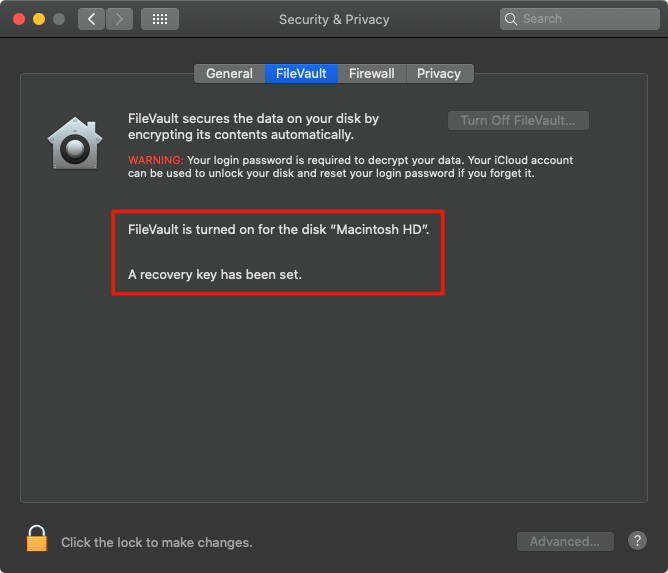

# Encrypting your Computer's Hard Drive

Source: https://help.drata.com/en/articles/4675833-encrypting-your-computer-s-hard-drive
Collection: Personnel Management › Device Compliance
Updated: 2026-08-05
Fetched: 2026-11-22
Description: How to ensure your hard disk is encrypted

## Article text

**Note:** Your company may have specific guidance on how you should encrypt your hard drive. Please check with your IT or compliance teams before proceeding.

Encrypting your hard drive is a critical step in securing sensitive data and passing compliance checks. Follow the instructions below based on your operating system.

## macOS

1. Open **System Preferences** and click **Security & Privacy**
2. Click on the **FileVault** tab
3. If FileVault is off, click "**Turn On FileVault…"** button
4. You may need to click the lock in the lower left corner to make changes.
5. Once enabled, FileVault will display a confirmation message.
   

## Windows 10/11 Professional

Note: BitLocker is not available for Windows Home Edition.

You may want to follow the steps to turn on standard Bitlocker encryption provided by [Microsoft](https://support.microsoft.com/en-us/windows/turn-on-device-encryption-0c453637-bc88-5f74-5105-741561aae838#ID0EBD=Windows_10). Follow Microsoft's official steps to turn on BitLocker encryption:

1. Locate the hard drive you want to encrypt under “**This PC**” in Windows Explorer.
2. Right-click the target drive and choose “**Turn on BitLocker**.”
3. Choose “**Enter a Password**.”
4. Enter a secure password.
5. Choose “**How to Enable Your Recovery Key**” which you’ll use to access your drive if you lose your password.
6. Choose “**Encrypt Entire Drive.**” This option is more secure and encrypts files you marked for deletion.
7. Click “**Start Encrypting**” to begin the encryption process.

## Ubuntu Linux

To encrypt your hard drive on Ubuntu, refer to the following guides:

- [Ubuntu Full Disk Encryption How-To (2019)](https://help.ubuntu.com/community/Full_Disk_Encryption_Howto_2019)
- [Encrypting Disks on Ubuntu 19.04 (Medium)](https://medium.com/@chrishantha/encrypting-disks-on-ubuntu-19-04-b50bfc65182a)

**Note: **If you're using the Drata Agent on Linux, you'll need to manually upload evidence of disk encryption.View [this article](computer-configuration-via-ubuntu-linux.md) for more details.

## Images

- [image 01] ../../images/documentation/encrypting-your-computer-s-hard-drive--01.png

## Related articles

- [Test 66: Hard-Disk Encryption Enabled on Employee Computers](test-66-hard-disk-encryption-enabled-on-employee-computers.md)
- [Computer Configuration via Ubuntu Linux](computer-configuration-via-ubuntu-linux.md)
- [Hexnode UEM (Windows) Integration Guide](hexnode-uem-windows-integration-guide.md)
- [1Password Device Trust (Kolide) Integration Guide](1password-device-trust-kolide-integration-guide.md)
- [Install the Drata Agent](install-the-drata-agent.md)
