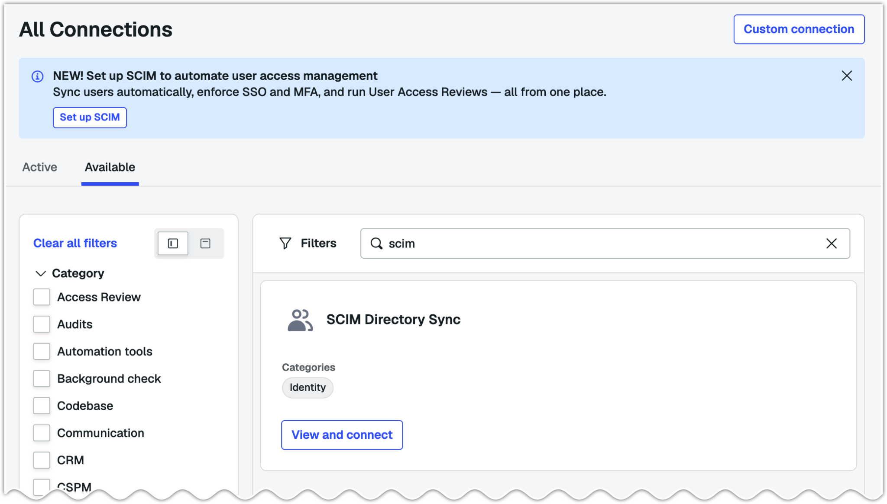
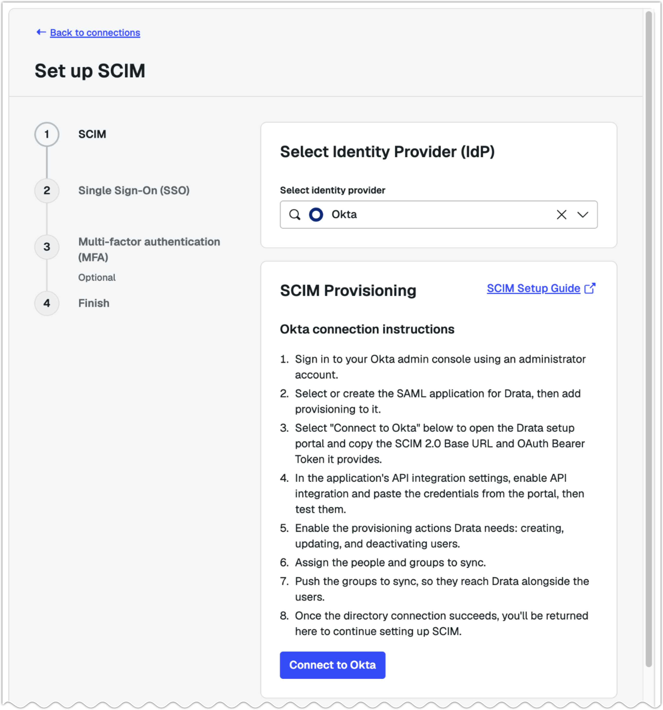
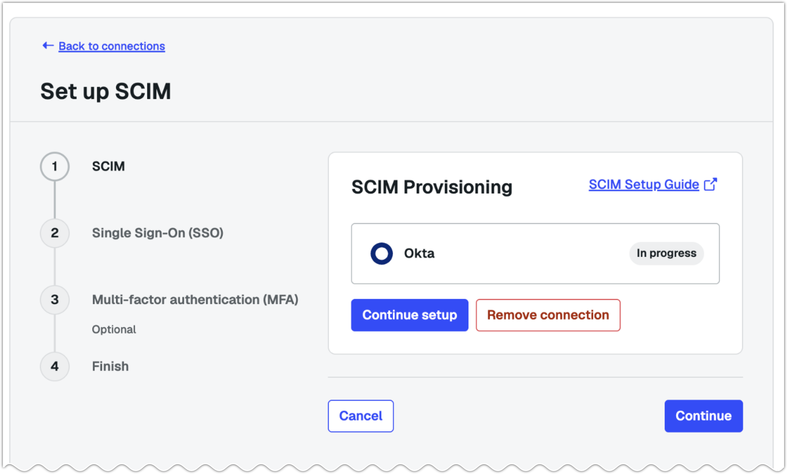

# Enterprise SCIM Integration Guide

Source: https://help.drata.com/en/articles/17953505-enterprise-scim-integration-guide
Collection: Connection Support › Other Guidance
Updated: 2026-11-04
Fetched: 2026-11-22

## Article text

## Overview

SCIM automatically keeps your personnel list, account statuses, and group mappings in sync with your identity provider within minutes of a change, instead of waiting for the next daily sync — without touching the sign-in or MFA monitoring your existing identity provider connection already handles.

### Prerequisite

- You have the Admin role in Drata.
- While setting up SCIM, you'll also set up these connections in the same wizard:
   - Your identity provider connection
   - Enterprise SSO
   - (Optional) MFA and User Access Review connections
- If you already have any of these set up, the wizard will show you and let you approve it or make changes before continuing.

## Set up SCIM Directory Sync

Go to **Connections > Identity** and select **View and connect** on the **SCIM Directory Sync** card — or select **Set up SCIM** in the banner at the top of the Connections page.

### Step 1 — Select your identity provider.

If this is your first time setting up SCIM Directory Sync, choose your identity provider (such as Okta) from the dropdown.

If you already picked a provider and started connecting earlier, you'll instead see that connection's status here (**In progress** or **Connected**) — select **Continue setup** to pick up where you left off, or **Remove connection** to start over.

Selecting **Continue setup** sends you to a setup portal outside Drata. Enter the set up configuration details there, turn on provisioning, and assign the users and groups you want synced to Drata.

**Note:** After you authorize the connection, a confirmation page opens in a new window or tab. It only confirms the connection succeeded. Return to the original Drata connection page to continue setup. Don't continue from the confirmation page

Once you're back in Drata, select Continue to move to Step 2.

### Step 2 —  Set up Single Sign-On (SSO)

Select **Connect IdP** to start the SSO setup for the provider. If you already have Enterprise SSO connected, Drata detects it and marks this step completely automatically — you won't be asked to reconnect. Select **Continue** to move on.

Learn how to connect [SSO connection here](single-sign-on-connection.md).

### Step 3 — Choose how to monitor MFA (and optionally User Access Reviews).

This step only appears if your Step 1 provider supports MFA monitoring (Okta, Microsoft 365, Google Workspace, JumpCloud, OneLogin, PingOne, or CyberArk).

| **Provider** | **Can supply MFA status** |
|---|---|
| Okta | Yes |
| Microsoft 365 | Yes |
| Google Workspace | Yes |
| JumpCloud, OneLogin, PingOne, CyberArk | Yes |

If you already have a matching identity provider connection (for example, an existing Okta connection), Drata offers to adopt it for MFA monitoring instead of asking you to reconnect.

1. Enter your provider's credentials (for Okta: Organization, API Key, Application Client ID, and optionally Application Client Secret). Drata checks these against your provider before saving — if they're wrong, you'll see an error instead of a false "success."
2. Choose who to bring in: **Everyone**, or **Only people from specific groups** (selected by default). If you pick specific groups, list them in the **Group Label** box, one per line.
3. For Okta, you'll also see an **Enable User Access Review** toggle (off by default). Turn it on to run access reviews from this same connection.
4. Select **Skip for now** to move past this step without setting up MFA or UAR — you can come back later by editing the SCIM connection.
5. Select **Continue** to move to the last step.
6. *If your provider doesn't support MFA (for example, Rippling or SailPoint), this step is skipped entirely and you'll go straight from SSO to Finish.*

You'll see a confirmation screen: "Directory Sync Set Up Complete." Select **Finish** to close the wizard and return to the Connections page.

After you finish, go to your identity provider and make sure the right users and groups are assigned to the SCIM app — that's what determines who actually gets synced into Drata.

### What to expect after setup

- MFA status updates on your IdP's daily sync, not in real time. To refresh sooner, select Resync Personnel.
- Personnel appear in the Personnel table once the first sync completes.
- If someone is removed from the SCIM app in your IdP, Drata marks them as former personnel.
- Adding groups can change roles and ownership in Drata. Review group mappings before you add them.

## Common setups

### SCIM for provisioning, IdP for MFA

New hires are provisioned and removed through SCIM. Drata keeps monitoring MFA through your existing Okta, Google Workspace, or Microsoft 365 connection.

### SCIM for provisioning, IdP for MFA and access reviews

The same setup, with User Access Reviews turned on for your IdP connection. UAR is off by default.

### Moving from an IdP-only setup

Add SCIM and keep your existing IdP connection. During the wizard, choose which of MFA and UAR it should keep handling. Your connection is not deleted.

## Limitations

- Only one SCIM connection per organization. You can connect just one identity provider through SCIM at a time — Drata blocks a second SCIM/Directory Sync connection if one is already active. (This limit is just for SCIM; you can still have a separate, regular IdP connection alongside it for MFA or access reviews.)
- Custom roles cannot be used in SCIM group mappings.
- Auth0 and CSV-based IdP connections are not supported alongside SCIM.

## FAQ

**Do I have to choose between SCIM and my IdP connection?** No. SCIM handles provisioning and your IdP connection can keep supplying MFA status and, optionally, UAR data.

**Will my IdP connection still create personnel?** No. Once SCIM is connected, personnel and groups come from SCIM. The IdP connection only supplies the MFA and UAR data you enabled.

**Do I need Enterprise SSO?** Yes, for non-admin users provisioned by SCIM to sign in. Set it up in step 2 of the wizard.

**Why do some personnel show as excluded from the MFA test?** Personnel provisioned by SCIM carry no MFA status. If you have not connected an MFA source, the test excludes them. Connect Okta, Google Workspace, or Microsoft 365 for MFA to include them.

**I skipped the MFA step. Can I add it later?** Yes. Navigate back to the SCIM Directory Sync connection and edit the connection.

**What happens if I turn SCIM off or delete the connection?** Personnel already synced stay in Drata but stop updating automatically. If the SCIM connection is deleted, the MFA connection is promoted and starts managing users again.

## Images

- [image 01] ../../images/ux/connections/enterprise-scim-integration-guide--01.png
- [image 02] ../../images/integrations/enterprise-scim/enterprise-scim-integration-guide--02.png
- [image 03] ../../images/integrations/enterprise-scim/enterprise-scim-integration-guide--03.png

## Related articles

- [Okta Integration Guide (Identity Management Provider)](okta-integration-guide-identity-management-provider.md)
- [JumpCloud IdP Integration Guide](jumpcloud-idp-integration-guide.md)
- [Manual Import (CSV) Identity Provider Integration Guide](manual-import-csv-identity-provider-integration-guide.md)
- [Canva Integration Guide](canva-integration-guide.md)
- [CyberArk Integration Guide](cyberark-integration-guide.md)
