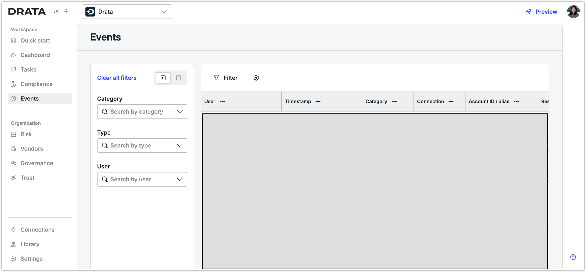

# Events Overview

Source: https://help.drata.com/en/articles/13557370-events-overview
Collection: Understand the Drata Platform › Events
Updated: 2026-11-09
Fetched: 2026-11-22

## Article text

The **Events** page provides a centralized audit trail of activity across the Drata platform. It records system actions, user activity, and automated events to support audit evidence, troubleshooting, and security oversight.

---

## Why the Events page matters

The Events page helps you:

- Maintain an immutable audit trail of platform activity
- Demonstrate control operation and monitoring over time
- Investigate changes made by users or automated processes
- Provide auditors with verifiable system evidence

Events captured here often serve as **direct audit evidence** for control effectiveness.

---

## Prerequisite

| **Drata Role** | **What can they access on the Events page:** |
|---|---|
| **Admin** | View and manage |
| **Information Security Lead** | View and manage |
| **Workspace Manager** | View and manage |
| **Control Manager** | View and manage |
| **Restricted Control Manager** | View and manage |
| **Dev Ops Engineer** | View and manage |

---

## View events

To open the Events page:

1. Select **Events**.
2. Review the event table, which displays:
   - **User** (or system process, such as Autopilot)
   - **Timestamp**
   - **Category**
   - **Connection**
   - **Account ID / alias**
   - **Result**
   - **Type**
   - **Description**

---

### Filter events

Use **Filter** to narrow results by event category or event type. Filtering helps you quickly locate activity such as:

- Autopilot updates
- Connection-related changes
- User updates
- Automated test executions

---

## Review raw event evidence

Some events include raw system responses that can be reviewed as evidence. Select the event to view the raw evidence and its JSON response.

If the JSON response is too large to display, you can download it instead.

---

### Download event evidence

You can download event evidence at any time for audit purposes:

- **PDF**: Includes the raw JSON response plus contextual event details
- **TXT**: Includes only the raw JSON response

These files can be shared directly with auditors as proof of control operation.

---

### Key behaviors to understand

- Events are **read-only** and cannot be edited or deleted
- System-generated activity (such as **Autopilot**) appears as the event user
- Events represent **point-in-time historical evidence**
- The Events page supports both **monitoring tests** and **audit requests**

## Images

- [image 01] ../../images/ux/events/events-overview--01.png

## Related articles

- [SOC 2: All controls](soc-2-all-controls.md)
- [Track Workspace-Aware Events](track-workspace-aware-events.md)
- [Audits page overview (New Experience)](audits-page-overview-new-experience.md)
- [What auditors can see in Audit Portal](what-auditors-can-see-in-audit-portal.md)
- [Hosted Technology Vendors: What to Collect and How Drata Can Help](hosted-technology-vendors-what-to-collect-and-how-drata-can-help.md)
